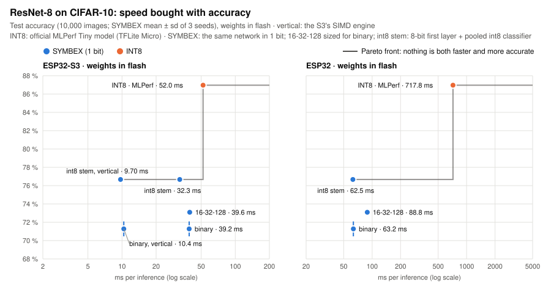
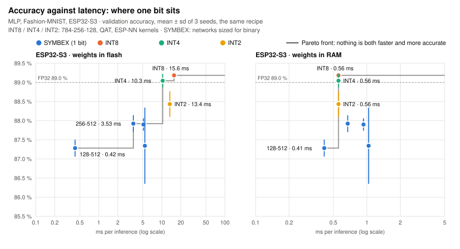

<p align="center">
  
</p>

<p align="center"><b>Binary neural networks, end to end, measured on real chips.</b></p>

<p align="center">
  <a href="https://github.com/Eden-sudo/Symbex-1/releases"></a>
  <a href="LICENSE"></a>
  <a href="https://symbex-1.pages.dev/"></a>
  <a href="benchmarks/"></a>
  <a href="https://github.com/Eden-sudo/Symbex-1/pulls"></a>
  <a href="README.es.md"></a>
</p>

**SYMBEX-1 is an end-to-end framework for binary neural networks, one bit per weight and per activation: trained,
folded into integers, compiled to C and measured on real hardware.** Its first target is the smallest hardware there
is, microcontrollers with a few hundred KB of RAM and no floating point, where every bit counts; the same chain applies
wherever bit operations are cheaper than multiplications.

Binary networks are not new: they have run on FPGAs (FINN), on phones (daBNN, Larq) and on microcontrollers (eBNN,
McDanel et al. 2017; ultracompactBNN, Daghero et al. 2021; CBin-NN, Sakr et al. 2024). What SYMBEX-1 adds is the proof
that the chain goes all the way: every compiled model gives the same answer as its integer simulation on 100 % of the
inputs, and every result is the same network measured on the same commercial chip, on three architectures (Xtensa,
Cortex-M33, RISC-V), against the official INT8 toolchain, TensorFlow Lite Micro, with three seeds and the test set
used once.

## Why binary?

A microcontroller has a few hundred KB of RAM, a few MB of flash, and often no SIMD or floating-point unit. An INT8
network multiplies and adds one byte for every weight. A binary network keeps **one bit** per weight and turns each
multiplication into a bit operation and a count:

- **8× less memory for the weights than INT8** (32× less than FP32): ResNet-8 needs 24 KB of flash instead of 96 KB.
- **Counting instead of multiplying.** 32 to 128 weights at a time: XOR or AND, then a bit count. On a chip without
  SIMD, like the classic ESP32, that arithmetic is 11-17× cheaper than int8 multiply-accumulate (measured with
  `tools/dev/count_bench.py`).
- **No floating point at all.** Scale, BatchNorm and the activation fold into one integer threshold per output:
  `bit = (count >= T)`.

> [!IMPORTANT]
> **Binary networks do not replace INT8: the two optimize different things.** INT8 is the comparison that matters
> because it is what almost everyone deploys, and it keeps the accuracy of the floating-point model. One bit per weight
> gives some of it away, from nothing to more than ten points depending on the task (see the table below), in exchange
> for **8× smaller weights and bit operations instead of multiplications**. SYMBEX is for when latency, memory or a
> very small chip matter more than the last points of accuracy. The charts below show exactly how much each side
> gives up.

Between the two sit INT4, INT2 and ternary networks. [`tools/lowbit`](tools/lowbit/) trains and measures them on the
same chips with ESP-NN multiply-accumulate kernels and our own packing. Those numbers come from our own code, not from
an official toolchain, so they are exploratory baselines, not an objective comparison; they are useful to see where
each bit width sits.

| Binary is a good fit | INT8 is the better choice |
|---|---|
| The chip has no SIMD (classic ESP32, small RISC-V, AVR) | The chip has a strong int8 SIMD unit and plenty of RAM |
| The INT8 model does not fit in the chip | Every point of accuracy matters |
| Yes/no questions: detection, presence, wake-up | Many classes that differ only in fine detail (like CIFAR-10) |
| A tight latency budget, or many inferences per second | |

## What we measured

### ResNet-8: speed bought with accuracy

Each point is one network: higher is more accurate, further left is faster. The latency is measured on the chip; the
accuracy is the model's on the 10,000 test images, on the PC (on the chip, SYMBEX gives its simulation's class on 100 %
of the images, TFLite Micro the PC interpreter's on 98.1 %). The line joins the points no other point beats on both
axes; "vertical" is SYMBEX's engine for the ESP32-S3's SIMD unit.

<picture>
  <source media="(prefers-color-scheme: dark)" srcset="docs/assets/pareto_resnet8_dark.svg">
  
</picture>

- **INT8 is the most accurate:** the official MLPerf Tiny model reaches 87.0 % on CIFAR-10. The fully binary ResNet-8
  reaches 71.3 %, and 76.7 % with an 8-bit first layer and classifier: 10 to 16 points less.
- **Binary is much faster:** on the ESP32-S3, 9.70 ms against 52.0 ms (5.4×) with the [vertical engine](docs/en/vertical.md);
  on the classic ESP32, 62.5 ms against 717.8 ms (11.5×); on the Raspberry Pi Pico 2 (Cortex-M33), 67.8 ms against
  453 ms with CMSIS-NN (6.7×).
- **And much smaller:** 24-29 KB of flash against 96 KB.

TFLite Micro is the INT8 path almost everyone uses, not the fastest INT8 possible: Espressif's ESP-DL runs ResNet-8 in
14.8 ms on the ESP32-S3 (a quick check, not on the chart). The vertical engine is still faster there with the weights in
flash; [Results](docs/en/results.md#how-fast-could-int8-be) has the comparison and what is not measured yet.

### The MLP: one bit against INT8, INT4 and INT2

The same recipe for every method (validation split, 3 seeds), Fashion-MNIST on the ESP32-S3:

<picture>
  <source media="(prefers-color-scheme: dark)" srcset="docs/assets/pareto_mlp_dark.svg">
  
</picture>

Low-bit integers are 1-2 points more accurate; one bit holds the fastest corner. With the weights in flash, where
reading them is the cost, binary is 24-37× faster (0.42 ms against 10.3-15.6 ms); with the weights in RAM the gap
closes to 1.4× (0.41 against 0.56 ms).

### Every benchmark, side by side

The same network on the same chip, binary against TFLite Micro INT8:

<picture>
  <source media="(prefers-color-scheme: dark)" srcset="docs/assets/speedup_dark.svg">
  
</picture>

<picture>
  <source media="(prefers-color-scheme: dark)" srcset="docs/assets/flash_dark.svg">
  
</picture>

| Benchmark | Accuracy, SYMBEX / INT8 | Speed | Memory |
|---|---|---|---|
| [ResNet-8](benchmarks/conv2d/cnn_cifar_resnet8/), CIFAR-10 images | 76.7 / 87.0 % | 5.4× (ESP32-S3) to 11.5× (ESP32) faster | 29 / 96 KB flash |
| [FOMO](benchmarks/conv2d/fomo_voc_person/), person detection | **F1 31.2 / 30.1 %** | 2.0× faster (ESP32-S3); only SYMBEX fits the ESP32 | 41 / 236 KB flash |
| [MLP](benchmarks/mlp/mlp_fashion/), Fashion-MNIST | 87.5 / 89.8 % | 28× (flash) and 2.1× (RAM) on the ESP32-S3, 8.8× on the ESP32 | 27 / 187 KB flash |
| [1D convolutions](benchmarks/conv1d/har_ultracompact/), activity recognition | INT8 about 9 points better | 5.3-10.4× (ESP32), 1.47-1.90× (ESP32-S3) | 6.5-10× less flash |
| [ECG](benchmarks/conv1d/ecg_mitbih/), arrhythmia beats (inter-patient) | balanced 67-75 / 71-72 %, tied within the spread | 6.0-13.4× (ESP32), 2.0-3.0× (Pico 2 M33), 1.04-1.59× (ESP32-S3) | 6.6-8.4× less flash |
| [Digits](benchmarks/mlp/mlp_digits/), on an Arduino Uno | 94.5 % (FP32 on the same input 94.4 %) | 5.3 ms on a 16 MHz AVR | 3.4 KB flash, 0.21 KB RAM |

Against another binary library, ultracompactBNN (Daghero et al. 2021), in its own simulated RISC-V processor, SYMBEX
needs 1.07-1.37× fewer instructions on its four networks. Every table, chip and seed:
[docs/en/results.md](docs/en/results.md).

## What we learned

1. **Binary pays most where the chip has no SIMD.** On the classic ESP32, counting bits is an order of magnitude
   cheaper than multiplying bytes (5.3-11.5× on whole networks). On the ESP32-S3, whose SIMD unit speeds up INT8, the
   standard engine wins by 1.3-2×, and beating Espressif's own INT8 library took a dedicated engine (vertical).
2. **Binary does not replace INT8 on fine-grained classification.** On CIFAR-10 even the best binary recipe stays 10
   points behind. A [study](benchmarks/experiments/training_gap/) found the cause is mostly capacity, not training: the
   binary ResNet-8 fits 72 % of its training images, its full-precision twin 92 %.
3. **Detection and yes/no tasks binarize well.** The binary person detector is as accurate as the INT8 one, 2× faster
   on the ESP32-S3, 6× smaller, and the only one that fits the classic ESP32. On ECG beats (four AAMI classes, test
   patients never seen in training) binary and INT8 are tied within one standard deviation, with different errors.
4. **Size the network for binary.** Its best shape is not the INT8 one: a narrow first layer and wide binary layers
   (MLP 784-128-512-10), thinner early stages and a wider last one (ResNet-8 16-32-128: +1.8 points at the same speed).
5. **An 8-bit input deserves an 8-bit first layer.** For the camera (ResNet-8) and the accelerometer (1D), an int8
   first layer is more accurate, and faster wherever the chip has SIMD.
6. **Per byte, low-bit integers are more accurate.** INT2 and INT4 beat one bit at the same model size; one bit wins
   speed and the smallest chips.
7. **Exact, or it does not count.** Every model is checked bit by bit: the C on the PC and on the chip must equal the
   integer simulation, image by image.

## How it works

SYMBEX-1 has three parts:

- **`lib_symbex`**: a portable C inference engine for binary networks: bit counting instead of multiplication,
  integer thresholds, no floating point. One hardware layer per chip family (generic, ESP32, ESP32-S3, AVR, RP2350).
- **The CDT** (`tools/cdt.py`): takes a model, your data and your hardware limits, trains the binary network, folds
  it into integers, writes its C header and checks it bit by bit, on the PC and on the chip.
- **`benchmarks/`**: reproducible comparisons against INT8 TensorFlow Lite Micro on the same chips.

The engine, step by step:

1. **Every layer is binary.** Weights and activations are one bit. A convolution is a bit count (AND or XOR followed
   by popcount); a residual shortcut is an OR of bits; pooling is an OR.
2. **The input becomes bits too.** Each pixel enters as a thermometer (8 levels per color), so the first layer is binary
   like the rest. Optionally, the first layer and the classifier stay int8 (more accurate, see above).
3. **Everything else folds into integers.** Scale, BatchNorm and the activation collapse into one integer threshold per
   output: `bit = (count >= T)`. No floating point at inference.
4. **The counting method is chosen per chip.** A native popcount instruction where there is one, a 64 KB table or SWAR
   on the ESP32, the SIMD multiplier on the ESP32-S3. `count_bench.py` measures them; the library picks the fastest.
5. **Bit-exact, always.** The compiled C, on the PC and on the chip, must reproduce the integer simulation of the model
   100 %: every exported model is checked, every time.

[docs/en/how-it-works.md](docs/en/how-it-works.md) explains it with diagrams.

## Methodology

The full standard, the references and how to repeat a benchmark: [docs/en/methodology.md](docs/en/methodology.md). In short:

- **Same architecture** whenever SYMBEX is compared with INT8 (the official MLPerf model, or the same network trained
  with the same recipe); a resized binary network is compared with INT8 resized the same way.
- **Independent baseline:** INT8 through the official TensorFlow Lite converter and TensorFlow Lite Micro, in a
  separate environment that imports nothing from SYMBEX.
- **Measured on the chip:** medians over 1000 inferences, one core, at the stock clock (240 MHz on the ESP32 chips,
  150 MHz on the Pico 2); RAM measured on the chip.
- **Several seeds** for SYMBEX: accuracy as mean ± standard deviation over 3 seeds.
- **Validation split:** every choice (checkpoint, threshold, variant, shape) is made on a validation split carved out
  of the training data; the test set is evaluated once. A review found places where the test set had been used for
  selection; they were fixed and the affected figures re-measured (October 2026).

## Current state and next steps

Done: fully binary 2D and 1D convolutions, dense networks, five chips (ESP32, ESP32-S3, both cores of the Raspberry
Pi Pico 2, AVR), the vertical engine for the ESP32-S3, and the int8 first layer and classifier as options (November
2026). Next:

- **Energy** per inference, with a current meter: latency and memory are measured, energy is not yet.
- **ESP-DL** as a full INT8 baseline (3 seeds, the whole test set, every benchmark).
- **FOMO re-trained** on the new fixed validation split.

## Repository layout

```
Symbex1_PIO/               PlatformIO project
  lib/lib_symbex/          the C engine (include/, src/, hal/), and tests/run_tests.py (bit-exact tests, every HAL)
  src/main.cpp             minimal example: a demo network checked against its PC simulation on your board
tools/
  cdt.py                   the CDT: configuration (TOML) -> train -> export -> validate -> chip
  chip_test.py             runs an exported model on a board: exactness, accuracy, latency per layer, RAM
  compiler_core/           the library behind the CDT
  configs/                 example.toml: every option, commented
  lowbit/                  INT8 / INT4 / INT2 baselines (Brevitas, ESP-NN kernels) for any benchmark
  dev/                     developer tools: fine_profile.py (time per library function), count_bench.py (raw
                           arithmetic of each chip), train_bench.py
benchmarks/                reproducible comparisons against TensorFlow Lite Micro: mlp/, conv1d/, conv2d/, experiments/
tests/                     Python tests (pytest -q from the root)
docs/                      documentation: en/ (English), es/ (Spanish), assets/ (charts), preprint/
```

## Quick start

```
# the library on your board (PlatformIO): the example must print "8/8 equal to the PC simulation"
cd Symbex1_PIO && pio run -t upload && pio device monitor -b 115200

# the library tests (gcc)
python Symbex1_PIO/lib/lib_symbex/tests/run_tests.py

# a model through the CDT (from tools/), then on a board
python cdt.py my_model.toml
python chip_test.py <output folder> --board esp32 --port /dev/ttyUSB0
```

Requirements: Python with PyTorch; gcc; PlatformIO and pyserial for the chip; TensorFlow for the INT8 baselines.

## Previous versions

Version 2 reported results on the scikit-learn Digits dataset with the `gated` and `bitslice` methods. During the
version 3 review, errors were found in those methods; those results are not reported until the methods are rebuilt and
re-measured. The first convolutional engine of version 3 (with a learned int8 first layer) has been replaced by the fully
binary engine above.

## Citation

A preprint describing SYMBEX-1 is in preparation; the reference will be added here.

## Contributors

Carlos Duarte (Edén) -- Panama -- GitHub: [Eden-sudo](https://github.com/Eden-sudo)
Obed -- GitHub: [Obed0101](https://github.com/Obed0101) -- test suite, low-bit baselines, validation split review
Abrahan -- GitHub: [abrahandejesusaparicio-code](https://github.com/abrahandejesusaparicio-code) -- FOMO person
detection on the classic ESP32

Spanish version: [README.es.md](README.es.md) -- License: see [LICENSE](LICENSE).
