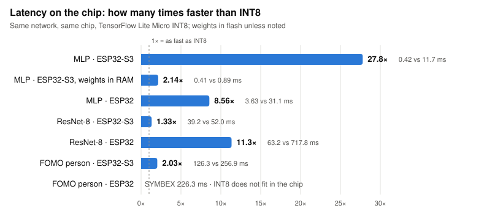
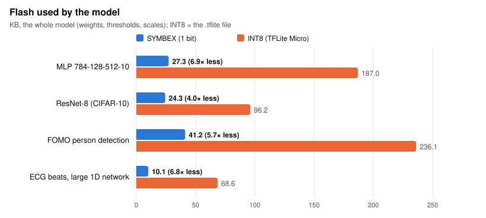

# SYMBEX-1 documentation

*[Leer en español](README.es.md)*

How SYMBEX-1 works, how to use it and what it measured. The [main README](../README.md) has the summary; these pages
go into the details.

| Page | What it explains |
|---|---|
| [How it works](how-it-works.md) | Binary networks, counting bits instead of multiplying, folding everything into integer thresholds, bit-exactness |
| [CDT](cdt.md) | The compiler: from a PyTorch model to a checked C header, on the PC and on the chip |
| [Library](library.md) | lib_symbex: the layers, the hardware layer of each chip, how to add it to a project |
| [Results](results.md) | Every benchmark in one place: speed, flash and accuracy against INT8, with the charts |
| [The vertical engine](vertical.md) | Counting 128 windows at once: ResNet-8 in 10.4 ms on the ESP32-S3 (7.7 / 6.4 ms with the optional compact / prepared modes), the formula and the inference logic |

The diagrams are written in [Mermaid](https://mermaid.js.org/) inside the pages (GitHub draws them). Charts live in
[`assets/`](assets/) and are generated from the result files of the benchmarks, so they can always be re-created.

## At a glance

Fully binary networks against the official INT8 ones (TensorFlow Lite Micro with Espressif's ESP-NN kernels, the
deployment path almost everyone uses, not the fastest INT8 possible: see [Results](results.md#how-fast-could-int8-be)),
the same network on the same chip:

<picture>
  <source media="(prefers-color-scheme: dark)" srcset="assets/speedup_dark.svg">
  
</picture>

<picture>
  <source media="(prefers-color-scheme: dark)" srcset="assets/flash_dark.svg">
  
</picture>

The gap depends on the chip and on where the weights are. The ESP32-S3 has a SIMD unit that speeds up INT8, so there
the gap is smallest when INT8 can use it fully (ResNet-8: 1.33×, the MLP with its weights in RAM: 2.14×), and
Espressif's ESP-DL library is faster than SYMBEX's standard engine there (ResNet-8 in 14.8 ms vs 39.2 ms), and SYMBEX's
[vertical engine](vertical.md) is faster than ESP-DL with the weights in flash (10.4 ms), and with the weights in RAM too with its optional compact
mode (7.70 ms, about the same RAM); on the classic ESP32, without
SIMD, SYMBEX is 8.6-11.3× faster, against ESP-DL too, and the INT8 detector does not fit at all. Accuracy is in each
benchmark's README. To re-create the charts after a new
measurement: `python tools/dev/docs_charts.py`.
