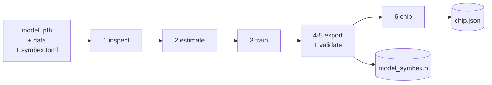
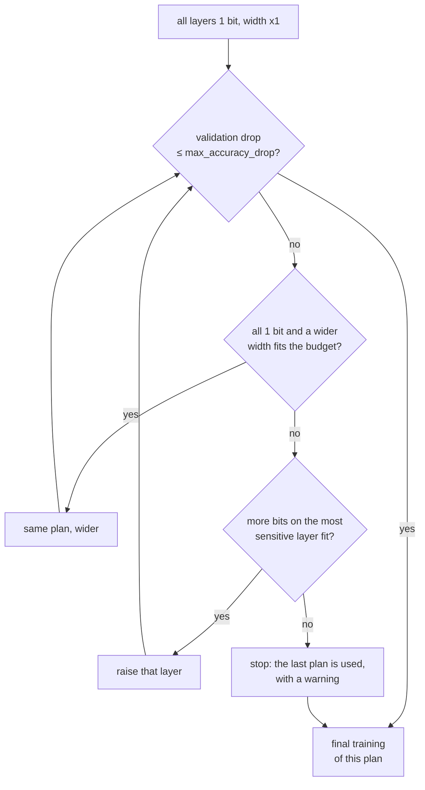
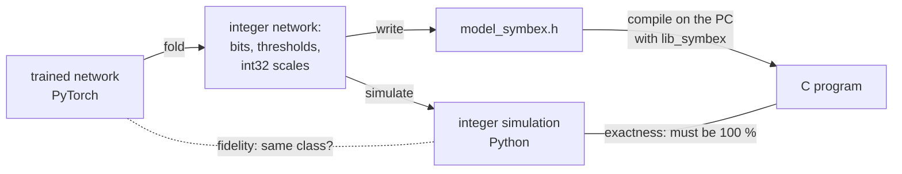

# The CDT: from a PyTorch model to a checked C header

The CDT (`tools/cdt.py`) is the compiler of SYMBEX-1. It takes a model, the data and the limits of a microcontroller, and
returns a binary network as a C header for lib_symbex. That header has been checked bit by bit on the PC and, when a
board is connected, on the chip. One configuration file (`symbex.toml`) describes the whole run, so every result can
be re-created from the file it came from.

This page explains what happens inside. For the options and the files it writes, see the
[tools README](../tools/README.md); for how a binary layer computes, see [How it works](how-it-works.md).

## The run in one picture



Every stage writes its result to the output folder, so a run can start or stop anywhere: `--from export` exports a
model trained before, and `--from chip` measures an existing export again.

## Two paths: dense and boolean

The method in `[model]` decides the path.

| | `plain` / `ternary` (dense networks) | `boolean` (fully binary convolutional networks) |
|---|---|---|
| The model | an FP32 network (an MLP) that the CDT binarizes | a network that is already binary by definition (its layers live in the benchmark's `model.py`) |
| estimate | how much each layer suffers at 1, 2, 4 and 8 bits | skipped: there is nothing to choose |
| train | searches the width and the bits per layer within the budget, then trains the chosen network | trains the network as defined, labels only |
| export | `export/dense.py`, `export/ternary.py` | `export/boolean.py` |

## 1 inspect

The CDT reads the model: how many convolution and linear layers it has, its parameters and its precision. A model that
is already quantized still works, but the CDT warns that part of the information is lost and the estimate is less
reliable. The `ternary` method refuses a model with convolutions, and `plain` exports MLPs only.

## 2 estimate (dense only)

`sensitivity.py` runs the original model on a few real training samples (`calibration_samples`, 32 by default). For every layer it measures how much
the output changes when the weights, the activations and the normalization go down to k bits (cosine similarity), and
how much memory each choice takes. The result is only an order: which layer gets more bits first, if more are needed.
The decision is made later, by accuracy.

## 3 train

**Dense networks: a search, then the final training.** Each trial trains for a few epochs (`search_epochs`) and is
judged on the validation split:



Wider comes first because it keeps every layer at 1 bit, and today the export only accepts plans where every layer
is 1 bit (`--options bin` limits the search to them).

**Boolean networks** are trained as they are defined, with the labels only. With `data_on_gpu = true` and
`compile = "reduce-overhead"`, the training set goes to the GPU once and the training step is replayed as a CUDA graph:
the binary ResNet-8 trains in 3.0 minutes instead of 8.6, with the same accuracy and the same exactness.

**Validation and test.** Every choice (the search, the checkpoint) is made on a validation split carved out of the
training data. `split_seed` fixes it, so every training seed is judged on the same images. The test set is evaluated
once, at the end, and saved in `train.json` as the reported number.

Next to the accuracy, the CDT prints two numbers that say how close the binary network stays to the original:
**identity** (the same class as the original, sample by sample) and **retained** (of the samples the original gets
right, how many the binary network still gets right).

## 4-5 export and validate

Every exporter does the same three things with the same integers:



1. **Fold.** Every BatchNorm becomes an integer threshold, and the signs become packed words
   ([How it works](how-it-works.md) shows the derivation).
2. **Simulate.** A Python model of the integer network: the ground truth the C has to reproduce.
3. **Write and check.** The header is written, compiled with lib_symbex on the PC, and run on the validation images.

Two numbers come out:

| | Compares | Expected |
|---|---|---|
| **Fidelity** | PyTorch against the integer simulation | close to 100 % (the rounding of the thresholds can flip a borderline sample) |
| **Exactness** | the compiled C against the integer simulation | **100 %, always**; anything else is reported as `[X]` |

For dense networks the export also chooses the arithmetic (`[output] arithmetic = "auto"`): AND or XNOR, whichever the
chip profile in `tools/chip_profiles/` predicts to be faster for the shape of this model. Both give the same classes.
With `int8_reference = true` it also exports the INT8 version of the original model, with TFLite's integer
arithmetic, to compare against.

## 6 chip

With a board in `[chip]` (`esp32`, `s3`, `pico2_arm`, `pico2_riscv`; `uno` for the AVR examples), the CDT builds a
firmware around the header, flashes it, and sends the validation images over the serial port. It reports:

- the **equality with the integer simulation**, image by image (it must be 100 % again, now on the chip);
- the accuracy, the latency (median over the images) and the latency of each layer;
- the RAM used and the flash of the model.

`weights = "flash"` (the default, how a model is usually deployed) or `"ram"` decides where the weights live. With
`--compare-arithmetic` (dense networks), the same model is also measured with the other arithmetic, to confirm on the
chip what the profile predicted.

`tools/chip_test.py` runs this stage alone on any export folder.

## Running it

```
cd benchmarks/conv2d/cnn_cifar_resnet8
python ../../../tools/cdt.py symbex.toml                                   # train, export, check on the PC
python ../../../tools/cdt.py symbex.toml --from chip --board s3 --port /dev/ttyACM0
```

`--show-config` prints the configuration that would run and where every value came from (default, file or flag).
Working examples: `benchmarks/conv2d/cnn_cifar_resnet8/symbex.toml` (boolean), `benchmarks/mlp/mlp_fashion/symbex.toml`
(plain), `tools/configs/ternary_fashion.toml` (ternary); `tools/configs/example.toml` has every option, commented.

## Inside the code

| Part | Where |
|---|---|
| The stages, the search, the configuration | `tools/cdt.py` |
| Estimate | `tools/compiler_core/sensitivity.py` |
| Binary and k-bit layers, widening | `tools/compiler_core/methods/` |
| Training loops (labels, distillation) | `tools/compiler_core/train/` |
| Fold, simulate, write, check | `tools/compiler_core/export/` |
| Board, firmware, measurement | `tools/compiler_core/chip/` |

The [compiler_core README](../tools/compiler_core/README.md) lists every file, and marks which ones are current and
which are earlier versions.
