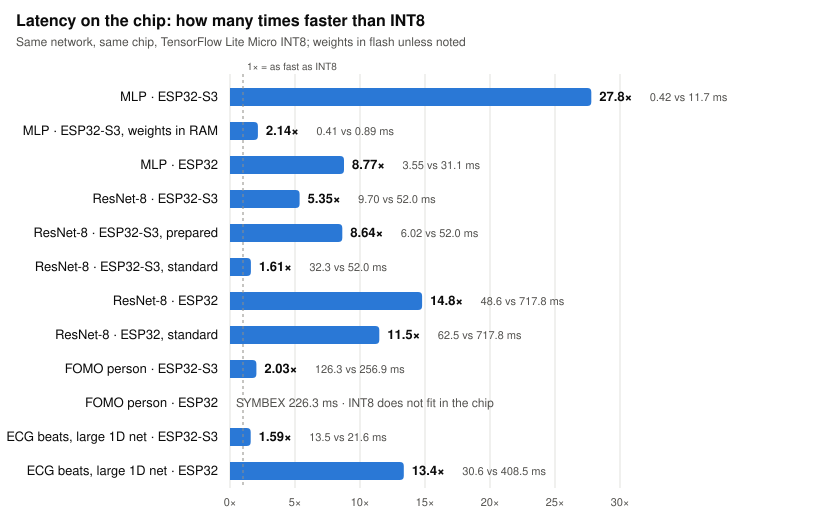
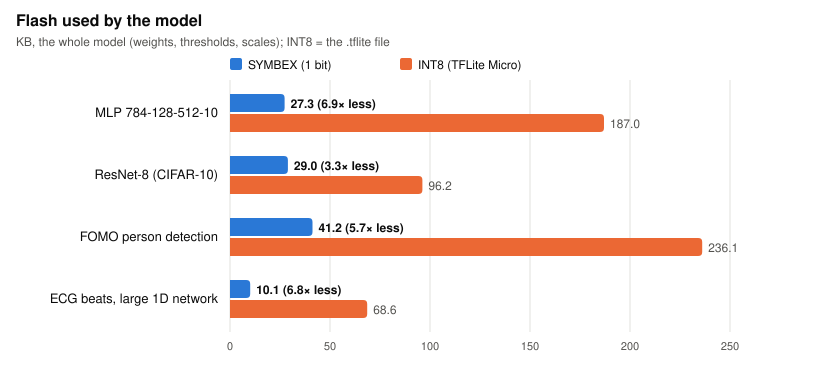

# SYMBEX-1 documentation

*[Leer en español](../es/README.md)*

How SYMBEX-1 works, how to use it and what it measured. The [main README](../../README.md) has the summary; these pages
go into the details.

| Page | What it explains |
|---|---|
| [How it works](how-it-works.md) | Binary networks, counting bits instead of multiplying, folding everything into integer thresholds, bit-exactness |
| [CDT](cdt.md) | The compiler: from a PyTorch model to a checked C header, on the PC and on the chip |
| [Library](library.md) | lib_symbex: the layers, the hardware layer of each chip, how to add it to a project |
| [Results](results.md) | Every benchmark in one place: speed, flash, accuracy and energy against INT8, with the charts |
| [Methodology](methodology.md) | The measurement standard: what is compared against what (INT8, INT4 / INT2, another binary engine), the checklist every benchmark follows, how to repeat it |
| [The vertical engine](vertical.md) | Counting 128 windows at once: ResNet-8 in 10.4 ms on the ESP32-S3 (7.7 / 6.4 ms with the optional compact / prepared modes; 6.0 ms with the int8 stem), the formula and the inference logic |

The diagrams are written in [Mermaid](https://mermaid.js.org/) inside the pages (GitHub draws them). Charts live in
[`assets/`](../assets/) and are generated from the result files of the benchmarks, so they can always be re-created.

## At a glance

SYMBEX networks against TensorFlow Lite Micro INT8 with the vendor's kernels (ESP-NN, CMSIS-NN), the deployment path
almost everyone uses, not the fastest INT8 possible (see [Results](results.md#how-fast-could-int8-be)): the same
network on the same chip.

<picture>
  <source media="(prefers-color-scheme: dark)" srcset="../assets/speedup_dark.svg">
  
</picture>

<picture>
  <source media="(prefers-color-scheme: dark)" srcset="../assets/flash_dark.svg">
  
</picture>

The gap depends on the chip and on where the weights are. On the classic ESP32, without SIMD, SYMBEX is 5-15× faster
than TFLite Micro (ResNet-8 also against Espressif's ESP-DL: 48.6 against 712 ms, a quick check), and the INT8 person
detector does not fit at all. On the ESP32-S3, whose SIMD unit speeds up INT8, the standard engine wins by 1.0-2.0× on
convolutional networks (ResNet-8: 1.61×) and Espressif's ESP-DL is faster than it (14.8 against 32.3 ms). The
[vertical engine](vertical.md) beats ESP-DL: 9.70 ms with the weights in flash, and 7.07 ms in its compact mode against
ESP-DL with its weights in RAM (with less RAM, 138 against 147 KB). With the weights in RAM, the MLP's gap closes to
2.14×. Energy per inference follows the speed: 8-13× less on the classic ESP32 and 1.4-25× less on the ESP32-S3
([Results](results.md#energy-per-inference)). Accuracy is in [Results](results.md) and in each benchmark's README. To re-create the charts after a new
measurement: `python tools/dev/docs_charts.py`.
