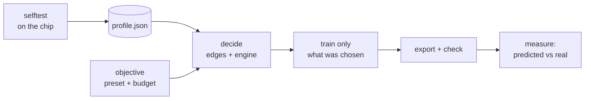

# Design: a CDT that adapts to the hardware (proposal, Nov 18 2026)

*Status: design only. Nothing here is implemented yet; every number is a measurement already in the repository unless
it says ESTIMATE.*

## Goal

The user gives a model, the data and a chip (one we know, or one we never tested). The CDT returns the fastest network
that is still **fully binary in the middle**. It only adds int8 (first layer, classifier) or picks an engine when that
chip has been **measured** to pay for it. The user chooses one objective, not the bits of every layer.

## What we already know (measured)

The best choice changes from chip to chip, so a fixed recipe cannot be right everywhere:

| Chip | How it counts bits (best, `count_<chip>.json`) | int8 first layer vs binary one | Vertical engine vs standard (ResNet-8) |
|---|---|---|---|
| ESP32-S3 | no popcount; lut16, 110 cycles / output | 1.79x (Nov 3 kernel), 5.7x with the PIE kernel (Nov 5) | 3.3x faster (32.33 -> 9.73 ms) |
| Classic ESP32 | no popcount; lut16, 129 cycles | 0.86x (slower) | 1.29x (compact) |
| Pico 2 Cortex-M33 | no popcount, DSP; lut16, 78 cycles | 1.13x | 1.15x (prepared) |
| Pico 2 Hazard3 | `cpop` (Zbb); builtin, 56 cycles | 0.62x (slower) | slower: standard wins |
| x86 PC | `popcnt`; builtin64, 3.6 ns | not measured | 1.7-2.0x (one core, seed 42) |

Accuracy side (also measured): on ResNet-8 the int8 stem adds about 4.5 points. In the same-bytes control
(damage_probe part 8), protecting the stem helped more than the same bytes in a middle block, and middle layers tied
one another. So the choice worth automating is at the **edges** (first layer, classifier), not a per-layer bit search
in the middle.

## What the CDT does today

- `[output] arithmetic = "auto"`: AND or XNOR chosen from a kernel profile measured on the board. This only works for
  the esp32 and the s3; the Pico 2 and the Uno use fixed rules, and with no board it falls back to AND.
- `[chip] engine = "auto"`: the vertical engine only on the s3. This comes from a fixed set (`AUTO_VERTICAL_BOARDS`),
  not from a measurement.
- The int8 first layer and the int8 classifier are recipe options the user picks by hand.
- Without a board the PC build checks exactness only. It does not time anything.
- A chip we never tested has no path at all: the boards are a closed list in `chip/core.py`.

## Proposal

1. **`selftest.c`: one portable C file, no PlatformIO.** It holds the kernels of lib_symbex at the user's layer shapes:
   bit count (each method), binary row, int8 row, vertical vs standard block, and weights read from flash vs RAM. It
   prints one JSON line. A known board builds and runs it through PlatformIO, as today. Any other chip builds it with
   its own toolchain, and the user pastes the line back (`cdt.py profile --import line.json`). The checksums stay, so a
   wrong build is refused.
2. **`board = "host"`.** The PC (or a Raspberry Pi) builds `selftest.c` and the exported model with the local `cc`
   and runs both. The result is real timing on that CPU, plus the exactness check that exists today. This needs no
   port and no PlatformIO.
3. **Decide from the profile, at the user's shapes.** For each edge layer the CDT predicts the time of the binary and
   the int8 version from the profile, and does the same for each engine. The objective is one preset:
   - `fastest`: fully binary, fastest engine;
   - `balanced` (default): int8 at an edge only if it costs at most X % of the predicted time;
   - `accurate`: int8 at both edges if it fits the flash / RAM budget.

   The middle stays binary (or ternary) always.
4. **Train only what was chosen.** No training of options the chip does not pay for.
5. **Predicted vs measured.** After the chip stage, `chip.json` records both times. If they differ by more than a
   tolerance, the CDT warns, and the profile is measured again next time.

## Order of work (each one a PR)

1. `board = "host"`: real timing on the PC / Pi with the existing C build.
2. `selftest.c` + `profile --import`, starting with the bit-count and row kernels, which `count_bench.py` already has.
3. `engine = "auto"` and `arithmetic = "auto"` read from the profile instead of the fixed sets.
4. Predicted vs measured in `chip.json`. Check it on the 4 boards and the PC before trusting the predictor.
5. Presets for the edge layers (int8 first layer, int8 / pooled classifier).

## Open questions (Edén decides)

- The tolerance X of `balanced`, and whether `balanced` or `fastest` is the default.
- Should `selftest.c` also time the int8 kernels the user's chip vendor ships (ESP-NN, CMSIS-NN)? It is fairer, but
  it means more code to keep.
- Where ternary fits: as a fourth preset, or as a flag on top of any preset.
