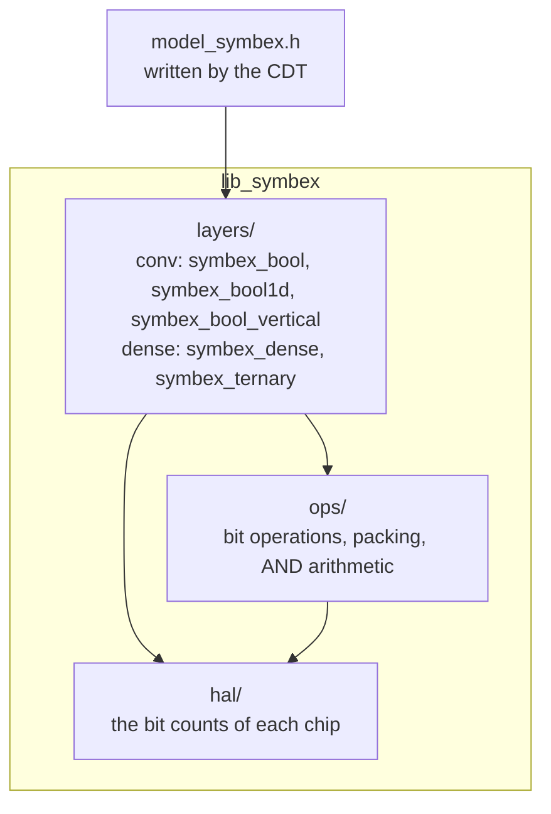

# lib_symbex: the C engine

*[Leer en español](../es/library.md)*

lib_symbex runs the networks the [CDT](cdt.md) exports. It is plain C with no dependencies, the model's memory is
static, and every model it runs has been checked bit by bit against the CDT's integer simulation. It lives in
`Symbex1_PIO/lib/lib_symbex/`, and the same sources build for the PC, the ESP32, the ESP32-S3 and the Raspberry Pi Pico 2
(both cores), as well as for PULP in the 1D benchmark.

## Using it in a project

The CDT writes one header per model, `model_symbex.h`. It holds the weights, the thresholds and the buffers, and every
model offers the same call:

```c
#include "model_symbex.h"

int cls = symbex_mlp_infer(input);   // uint8 input -> class index
```

For the convolutional models, `input` is an RGB image (uint8, HWC order); for the dense ones, it is the input vector.
`SYMBEX_MLP_N_INPUTS` and `SYMBEX_MLP_N_CLASSES` give the sizes. The weights and the buffers are static arrays, and
there is no setup call. The only allocation is the HAL's 64 KB counting table (16-bit table, on the ESP32 and the M33),
made once on the first count; without the RAM for it, the HAL falls back to SWAR.

`Symbex1_PIO/` is the minimal PlatformIO project. `src/main.cpp` runs a small demo network and checks every image
against the class the PC simulation gave ("8/8 equal"). To run a real model, copy its `model_symbex.h` over
`src/model_symbex.h` and delete `src/demo_input.h`; `main.cpp` explains the three steps.

Outside PlatformIO, compile `src/` with `include/` on the include path. Only one HAL is needed: `src/hal/esp32s3/` on
the ESP32-S3, `src/hal/generic/` everywhere else (plus `src/hal/rp2350/` on the Pico 2).

## Headers that keep working when the library grows

An exported `model_symbex.h` is data for the library: it fills its structs (`SymbexBoolNet`, `SymbexBool1D`,
`SymbexLayerData`, ...). A header exported today keeps building with later versions of lib_symbex, without exporting it
again, because the library and the CDT follow three rules (`include/core/symbex_format.h`):

1. **A new field goes last, and 0 / NULL means the behavior before it.** Example: `SymbexBoolNet.stem_i8 = NULL` is the
   thermometer stem, as before the int8 stem existed.
2. **The CDT writes every struct by field name** (`.stride = 1`), so a field the header does not name starts at 0.
3. **The header silences `-Wmissing-field-initializers` inside itself only** (`#pragma GCC diagnostic push / pop`). C++
   warns about a missing field even when the others are named, and the firmware builds treat warnings as errors.

A change that cannot follow them (a field removed, renamed or given another meaning) raises `SYMBEX_FORMAT`. Each header
checks the format it was written in, and a header the library can no longer read stops the build with an `#error` that
says to export it again. `pytest tests/test_header_format.py` builds the header of every current exporter in C and C++
with `-Wall -Wextra -Werror` and checks it against the simulation, together with headers frozen at earlier formats
(`tests/headers/`), so a break shows up before it is pushed.

Headers exported before format 1 (November 2026: fields by position, no format check) must be exported once again.

## How it is organized



| Folder | What it holds |
|---|---|
| `include/layers/conv/` | `symbex_bool.h`: fully binary 2D networks (thermometer input or, optionally, an int8 first layer `symbex_bool_stem_i8`; binary convolutions with integer thresholds, OR pool, OR shortcut, binary classifier, pooled int8 classifier `symbex_bool_pool_head` (int8 weights on the ones per k × k window) or per-cell detection head, and the whole-network runner `symbex_bool_net_run`). `symbex_bool1d.h`: binary 1D convolutions for time series, any channel count, with a fused OR pool. `symbex_bool_vertical.h`: the [vertical engine](vertical.md), the same networks and bits counted 128 windows at once (optional prepared and compact modes; the int8 stem and the pooled classifier run as in the standard engine) |
| `include/layers/dense/` | `symbex_dense.h`: 1-bit dense layers (uint8 first layer, then bits with one integer threshold per neuron). `symbex_ternary.h`: weights in {-1, 0, +1} |
| `include/ops/` | bit operations, bit packing, the AND form of the counts |
| `include/hal/symbex_hal.h` | the interface every chip implements: the bit counts and the first-layer kernels |
| `include/core/` | types and the dense / conv network runners of the earlier engine |

The other files in `layers/` (`symbex_conv2d`, `symbex_bpr`, `symbex_binary_pool`, `symbex_gated`) belong to earlier
versions of the engine: they still build, and the tests still cover all of them except `symbex_gated`, but no
current export uses them.

## A binary layer in C

Every layer of the fully binary networks has the same shape:

```c
struct SymbexBoolConv {
    uint16_t in_ch, out_ch, kernel, stride;
    uint16_t in_h, in_w, out_h, out_w;
    uint16_t row_words;               // words per weight row
    const uint32_t* weights;          // one packed row of bits per output channel
    const int32_t*  thresholds;       // out bit = raw >= thresholds[o]
    const int16_t*  weight_counts;    // popcount of the weights per kernel pixel (image borders)
};
```

The maps are bits in HWC order: channel c of a pixel is bit c % 32 of word c / 32. For each output position, the layer
builds the window once, packed (16 channels × 9 pixels = 144 bits fill 5 words, not 9), and counts the whole layer in
one call to the HAL. Then it compares each count with the threshold of its channel. The CDT has already folded
BatchNorm and the sign into that threshold, so there is no other arithmetic.

`weights`, `thresholds` and `weight_counts` are `const`, so they stay in flash on the ESP32 (memory-mapped) unless the
export puts them in RAM.

## The HAL: how each chip counts bits

All the arithmetic of a binary network is counting bits. The HAL is where each chip does it its own way, chosen at
compile time:

| Chip | How it counts | Where |
|---|---|---|
| x86, AArch64 | the CPU's popcount instruction | `hal/generic` |
| RP2350 Hazard3 (RISC-V) | `cpop` (Zbb) | `hal/generic` + `hal/rp2350` |
| RP2350 Cortex-M33 | 16-bit table (64 KB in RAM); `usada8` (DSP) for the first layer | `hal/generic` + `hal/rp2350` |
| ESP32 (Xtensa LX6) | 16-bit table (64 KB in RAM), or SWAR when there is no RAM for it | `hal/generic` |
| ESP32-S3 (Xtensa LX7) | the PIE SIMD unit (`pie_swar`), 128 bits at a time | `hal/esp32s3` |
| AVR (Arduino Uno) | 8-bit table in flash | `hal/generic` |
| anything else | SWAR (portable C) | `hal/generic` |

These choices come from measurements, not from guesses: `tools/dev/count_bench.py` times every method on each chip
and saves the fastest per layer size in `tools/chip_profiles/`. For example, on the Pico 2's M33 the 16-bit table is
1.8× faster than SWAR, and on Hazard3 `cpop` is 1.25× faster than SWAR.

Every count has a `*_rows` form that computes a whole layer in one call, so the fixed cost of a call (checks, table
setup, SIMD registers) is paid once per layer instead of once per neuron.

The HAL also answers which form of the count is faster on the chip (`symbex_hal_prefers_xor`): the XOR form counts the
differences directly, and the AND form uses `popcount(x) + popcount(w) − 2·popcount(x AND w)` with the stored weight
counts. Both give the same bits.

**Compile flags** (for measuring, or for a chip the automatic detection does not know):

| Flag | Effect |
|---|---|
| `-DSYMBEX_POPCOUNT_FORCE_SWAR`, `_LUT16`, `_LUT8` | force one method |
| `-DSYMBEX_POPCOUNT_FORCE_NATIVE` | the compiler's `__builtin_popcount`, for a core where it becomes an instruction (PULP's `p.cnt`) |
| `-DSYMBEX_POPCOUNT_NO_LUT16` | no 64 KB table: gives that RAM back on the ESP32 or the M33 |
| `-DSYMBEX_U8_EXTERNAL` | the application provides its own first-layer kernels (example: `benchmarks/conv1d/har_ultracompact/pulp/`) |
| `-DSYMBEX_CODE_IN_RAM` | the inner loops marked `SYMBEX_FAST_CODE` (today the vertical engine's) run from RAM: `.time_critical` on the RP2350, IRAM on the ESP32 chips |

`symbex_hal_name()` returns the method in use as text, which is useful in logs.

**A new chip** needs only `hal/generic` to work (SWAR is portable). To make it fast, measure it with `count_bench.py`,
and add its method to `hal/generic` if it is an instruction the compiler already emits, or a folder `hal/<chip>/` if it
needs its own code (as the S3's PIE does).

## Tests

```
python Symbex1_PIO/lib/lib_symbex/tests/run_tests.py            # every layer against a Python reference
python Symbex1_PIO/lib/lib_symbex/tests/run_tests.py --stress   # + sanitizers and boundary sizes
```

The tests build the library with gcc in several HAL configurations: generic, the S3's C mode, the native count forced,
the 8-bit AVR paths, and the two first-layer kernels of the RP2350. Every layer must give the same results as a numpy
reference in each of them. The chips themselves are checked by the CDT's chip stage: the whole network, image by image,
against the simulation.
