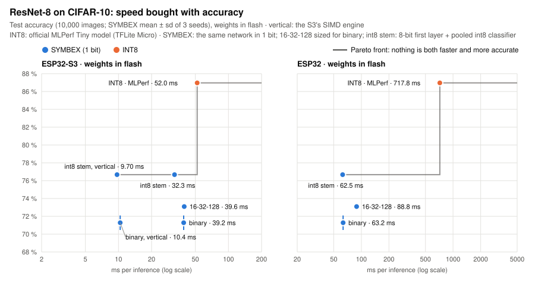

# Results: every benchmark in one place

*[Leer en español](../es/results.md)*

Each benchmark compares a fully binary SYMBEX network against INT8 on the same chip and with the same architecture.
The INT8 side is the official TensorFlow Lite Micro model or, where no official model exists, the same network trained
with the same recipe. All the rules come from the [methodology](methodology.md):

- the results are means over 3 seeds (42, 43, 44);
- every choice is made on a validation split, and the test set is used once;
- the weights are in flash unless the table says otherwise;
- on every board, the chip gives **the same output as the integer simulation on 100 % of the inputs**.

**What INT8 means here.** The INT8 side is the deployment path almost everyone uses: TensorFlow Lite Micro with
Espressif's optimized ESP-NN kernels. It is not the fastest INT8 possible: on the ESP32-S3, Espressif's ESP-DL library
runs ResNet-8 2.6× faster than SYMBEX's standard engine. SYMBEX's vertical engine ([The vertical engine](vertical.md))
runs it in 10.4 ms, 1.43× faster than ESP-DL with the weights in flash; with the weights in RAM, ESP-DL stays 1.06×
faster, unless one of the engine's optional modes is used: compact (7.70 ms, 1.27× faster than ESP-DL in RAM, with
151 KB of RAM against ESP-DL's 147 KB) or prepared (6.44 ms, 1.52× faster, 238 KB of RAM). The most accurate ResNet-8 recipe (an int8 first layer and a pooled int8
classifier, everything else binary) runs faster still: 9.70 ms in the default mode, 7.07 ms compact with less RAM than
ESP-DL (138 against 147 KB), 6.02 ms prepared. [How fast could INT8 be?](#how-fast-could-int8-be) shows what is measured and
what is not.

This page gives the headline of each benchmark. The details, the commands and the raw files are in each benchmark's
README.

## Speed, flash and RAM

<picture>
  <source media="(prefers-color-scheme: dark)" srcset="../assets/speedup_dark.svg">
  
</picture>

<picture>
  <source media="(prefers-color-scheme: dark)" srcset="../assets/flash_dark.svg">
  
</picture>

Every run on one core, at 240 MHz on both ESP32s. SYMBEX and INT8 always have their weights in the same place: flash
on every row but one.

| Benchmark | Chip | Weights in | Latency, SYMBEX / INT8 | Speed-up | Flash, SYMBEX / INT8 | RAM, SYMBEX / INT8 |
|---|---|---|---|---|---|---|
| MLP (Fashion-MNIST, 784-128-512-10) | ESP32-S3 | flash | 0.42 / 11.67 ms | **27.8×** | 27.3 / 187.0 KB | 4.6 / 6.7 KB |
| MLP (Fashion-MNIST, 784-128-512-10) | ESP32-S3 | **RAM** | 0.414 / 0.888 ms | **2.14×** | 27.3 / 187.0 KB | 4.6 / 6.7 KB + the weights (21 / 187 KB) |
| MLP (Fashion-MNIST, 784-128-512-10) | ESP32 | flash | 3.55 / 31.11 ms | **8.77×** | 27.3 / 187.0 KB | 4.4 / 6.7 KB |
| ResNet-8 (CIFAR-10), vertical engine ⁴ | ESP32-S3 | flash | 10.4 / 52.0 ms | **5.02×** | 24.3 / 96.2 KB | 62.6 / 80.5 KB |
| ResNet-8 (CIFAR-10), standard engine | ESP32-S3 | flash | 39.2 / 52.0 ms | **1.33×** | 24.3 / 96.2 KB | 14.8 / 80.5 KB |
| ResNet-8 (CIFAR-10) | ESP32 | flash | 63.3 / 717.8 ms | **11.3×** | 24.3 / 96.2 KB | 78.6 / 53.1 KB ¹ |
| ResNet-8, most accurate recipe ², vertical engine ⁴ | ESP32-S3 | flash | 9.70 / 52.0 ms | **5.36×** | 29.0 / 96.2 KB | 54.2 / 80.5 KB |
| ResNet-8, most accurate recipe ², standard engine | ESP32-S3 | flash | 32.3 / 52.0 ms | **1.61×** | 29.0 / 96.2 KB | 15.2 / 80.5 KB |
| ResNet-8, most accurate recipe ², vertical engine, compact ⁵ | ESP32 | flash | 48.6 / 717.8 ms | **14.8×** | 29.0 / 96.2 KB | 199.7 / 53.1 KB ¹ |
| ResNet-8, most accurate recipe ², standard engine | ESP32 | flash | 62.5 / 717.8 ms | **11.5×** | 29.0 / 96.2 KB | 79.0 / 53.1 KB ¹ |
| FOMO person detection (32-32-128) | ESP32-S3 | flash | 126.3 / 256.9 ms | **2.03×** | 41.2 / 236.1 KB | 79.0 / 222.6 KB |
| FOMO person detection (32-32-128) | ESP32 | flash | 226.3 ms / does not fit | **only SYMBEX runs** | 41.2 / 236.1 KB | 142.8 KB ¹ / does not fit |
| Activity recognition (1D), 4 networks | ESP32-S3 | flash | 0.49-3.83 / 0.72-7.11 ms | **1.47-1.90×** | 0.7-6.5 / 7.3-42.5 KB | 1.3-2.7 / 2.7-25.5 KB |
| Activity recognition (1D), 4 networks | ESP32 | flash | 0.78-12.78 / 4.17-115.62 ms | **5.3-10.4×** | 0.7-6.5 / 7.3-42.5 KB | 1.3-2.7 / 2.7-10.3 KB |
| ECG beats (1D), 3 networks | ESP32-S3 | flash | 3.03-13.55 / 3.14-21.59 ms | **1.04-1.59×** | 1.3-10.1 / 11.4-68.6 KB | 3.6-5.4 / 8.7-45.9 KB |
| ECG beats (1D), 3 networks | ESP32 | flash | 5.47-30.55 / 32.95-408.46 ms | **6.0-13.4×** | 1.3-10.1 / 11.4-68.6 KB | 3.3-5.1 / 7.3-25.3 KB |
| ECG beats (1D), 3 networks | Pico 2, Cortex-M33 (CMSIS-NN) | flash ³ | 5.70-29.60 / 11.66-89.52 ms | **2.0-3.0×** | 1.3-10.1 / 11.4-68.6 KB | see the benchmark |

- **Flash** is the whole model: weights, thresholds and scales for SYMBEX, the `.tflite` file for INT8.
- **RAM** is what the model uses while it runs. For SYMBEX, that is the buffers, the input and the stack, measured on
  the chip. For INT8, it is TFLite Micro's arena, which also holds the input.
- ¹ On the classic ESP32, SYMBEX counts bits with a 64 KB table in RAM, the fastest method there. Without it, ResNet-8
  needs 15 KB of RAM and runs in 71.0 ms (10.1×), and FOMO needs 79 KB and runs in 274.5 ms.
- The 1D rows are ranges from the smallest network to the largest: Daghero's four for activity recognition, the
  three (s / m / l) of the ECG benchmark.
- ³ On the Pico 2 the large ECG pair is measured with both models in RAM: the 68.6 KB TFLite model does not fit the
  chip's 16 KB flash cache (in flash it runs in 383 ms, 12.6×). On the M33 SYMBEX adds its 64 KB bit-count table.
- ² The same ResNet-8 with an int8 first layer on the pixels instead of the thermometer, Bop for the binary weights and
  a pooled int8 classifier; every other layer binary (the CDT's `--variant int8stem_pool2`). 76.7 ± 0.3 % on the test
  set against 71.3 % (3 seeds), and faster than the fully binary network on every board but Hazard3 (57.9 against
  56.1 ms) ([the benchmark](../../benchmarks/conv2d/cnn_cifar_resnet8/README.md#the-most-accurate-recipe-int8-stem--bop--pooled-int8-classifier)).
- ⁴ On the ESP32-S3 the conv networks run on the vertical engine, the S3's own: it counts with the 128-bit logic of
  its SIMD unit, which has no bit-count instruction ([The vertical engine](vertical.md)). Same
  exported network and the same output bits as the standard engine, more RAM (its work block). FOMO and the 1D
  networks are still measured with the standard engine.
- ⁵ On the classic ESP32 the vertical engine wins too (it has no 128-bit registers): 54.68 ± 0.09 ms by
  default (116 KB of RAM) and 48.57 ± 0.10 ms in compact mode (200 KB), against 62.52 ms for the standard engine
  (79 KB); 3 seeds, weights in flash, exact 100 %. The prepared mode does not fit its DRAM
  ([the benchmark](../../benchmarks/conv2d/cnn_cifar_resnet8/README.md)).

The charts are drawn from the result files by `python tools/dev/docs_charts.py`, so a new measurement updates them.

The gap is set by the chip. The classic ESP32 has no SIMD, and there counting bits is an order of magnitude cheaper
than 8-bit multiply-accumulate. The ESP32-S3 has a SIMD unit (PIE) that speeds up INT8, so the gap is smaller. Where
INT8 can use that unit fully, the gap is narrowest: ResNet-8 at 1.33× with the standard engine (5.0× with the vertical one) and the MLP with its weights in RAM at 2.14×.
There, Espressif's ESP-DL library is faster than SYMBEX's standard engine; on ResNet-8, [the vertical engine](vertical.md)
beats it with the weights in flash, and in RAM with its optional compact and prepared modes (see [How fast could INT8 be?](#how-fast-could-int8-be)).
[How it works](how-it-works.md) explains why counting bits is cheaper.

## How it is measured

- **Clock.** The firmware fixes the clock in its build settings: 240 MHz on the ESP32 and the ESP32-S3
  (`CONFIG_ESP_DEFAULT_CPU_FREQ_MHZ_240`), 150 MHz on the Pico 2, 16 MHz on the Arduino Uno. Nobody measures the MHz;
  they are the setting both sides are built with.
- **Time.** The firmware reads the chip's microsecond timer (`esp_timer_get_time()`, `micros()` on the Uno) right
  before and right after one inference. Each input is timed separately, and the median over every input is reported
  (1,000 inputs in most runs). One core, nothing else running.
- **Same build for both sides.** The SYMBEX and TFLite firmwares use the same ESP-IDF settings: optimized for speed
  (`CONFIG_COMPILER_OPTIMIZATION_PERF`), the same clock and the same serial protocol.
- **Correctness.** Each SYMBEX output is checked against the integer simulation on the PC. Each TFLite output is
  checked against the TFLite interpreter on the PC.

## How fast could INT8 be?

The INT8 side is the official deployment path, already optimized: TensorFlow Lite Micro from Espressif
(`esp-tflite-micro`) with Espressif's ESP-NN kernels turned on (`CONFIG_NN_OPTIMIZED`). On the ESP32-S3, those kernels
use the PIE SIMD unit. The arena is sized to what each model needs.

Where INT8 could still go faster:

| Option | What we know |
|---|---|
| Calling ESP-NN directly, without the TFLite interpreter | **Measured** on the x1 MLP (784-256-128-10) on the ESP32-S3, weights in RAM: 0.556 ms instead of 0.876 ms (1.58× faster). SYMBEX x1 runs in 0.525 ms, so in RAM the two are close (`tools/lowbit`, [mlp_fashion](../../benchmarks/mlp/mlp_fashion/README.md)). |
| Weights in RAM | **Measured** where the model fits: the MLP, and the 1D networks. In flash, INT8 is slow because it reads 8× more bytes through the flash cache. RAM removes that, if the chip has room. |
| ESP-DL (Espressif's other library, tuned for the S3) | **Measured** in a quick check, table below. On the ESP32-S3 it is the fastest INT8: faster than SYMBEX's standard engine on ResNet-8 (the vertical engine beats it with the weights in flash, and in RAM with its compact mode at about the same RAM), and on the MLP when the weights are in RAM. |
| CMSIS-NN on the Pico 2's Cortex-M33 | **Measured** (TFLite Micro with Arm's CMSIS-NN kernels, DSP on). It does not catch SYMBEX: ResNet-8 453.0 ms in flash and 211.4 ms with the model in RAM, against SYMBEX's 74.5 ms (6.1× / 2.8×); MLP 784-128-512-10 31.35 / 2.89 ms against 4.57 / 1.53 ms (6.9× / 1.9×). |

**ESP-DL, quick check.** ESP-DL v3 (`espressif/esp-dl`, ESP-IDF 6.1), models quantized to INT8 with `esp-ppq`
(post-training, 512 calibration images; `target="esp32s3"` on the S3, `"c"` on the ESP32). ResNet-8 uses the MLPerf
Tiny float weights; the MLP is the same FP32 784-128-512-10 that the INT8 rows start from. Same clock and build
settings as every other run, median of 100 (ResNet-8) or 200 (MLP) test inputs, one build per row. "Flash" keeps the
weights in flash (`param_copy = false`); "RAM" copies them to RAM when the model loads.

| Model | Chip | Weights in | ESP-DL | SYMBEX | TFLite Micro | SYMBEX vs. ESP-DL |
|---|---|---|---|---|---|---|
| ResNet-8 | ESP32-S3 | flash | **14.8 ms** | 39.2 ms | 52.0 ms | ESP-DL **2.6× faster** |
| ResNet-8, SYMBEX vertical engine | ESP32-S3 | flash | 14.8 ms | **10.4 ms** (63 KB of RAM) | 52.0 ms | SYMBEX **1.43× faster** |
| ResNet-8, SYMBEX vertical engine | ESP32-S3 | RAM | **9.8 ms** (147 KB of RAM) | 10.4 ms (87 KB of RAM) | — | ESP-DL **1.06× faster** |
| ResNet-8, SYMBEX vertical engine, compact (optional) | ESP32-S3 | flash | 14.8 ms | **7.70 ms** (151 KB of RAM) | 52.0 ms | SYMBEX **1.92× faster** |
| ResNet-8, SYMBEX vertical engine, compact (optional) | ESP32-S3 | RAM | 9.8 ms (147 KB of RAM) | **7.70 ms** (175 KB of RAM) | — | SYMBEX **1.27× faster** |
| ResNet-8, SYMBEX vertical engine, prepared (optional) | ESP32-S3 | flash | 14.8 ms | **6.44 ms** (238 KB of RAM) | 52.0 ms | SYMBEX **2.3× faster** |
| ResNet-8, SYMBEX vertical engine, prepared (optional) | ESP32-S3 | RAM | 9.8 ms (147 KB of RAM) | **6.44 ms** (262 KB of RAM) | — | SYMBEX **1.52× faster**, with more RAM |
| ResNet-8, most accurate recipe ², vertical engine | ESP32-S3 | flash | 14.8 ms | **9.70 ms** (54 KB of RAM) | 52.0 ms | SYMBEX **1.53× faster** |
| ResNet-8, most accurate recipe ², compact | ESP32-S3 | RAM (SYMBEX: flash) | 9.8 ms (147 KB of RAM) | **7.07 ms** (138 KB of RAM) | — | SYMBEX **1.39× faster**, with less RAM |
| ResNet-8, most accurate recipe ², prepared | ESP32-S3 | RAM (SYMBEX: flash) | 9.8 ms (147 KB of RAM) | **6.02 ms** (217 KB of RAM) | — | SYMBEX **1.63× faster**, with more RAM |
| ResNet-8 | ESP32 | flash | 712.4 ms | **63.3 ms** | 717.8 ms | SYMBEX **11.3× faster** |
| ResNet-8 | ESP32 | RAM | 603.4 ms | **59.7 ms** | — | SYMBEX **10.1× faster** |
| ResNet-8, most accurate recipe ², vertical engine, compact | ESP32 | flash | 712.4 ms | **48.6 ms** (200 KB of RAM) | 717.8 ms | SYMBEX **14.7× faster** |
| ResNet-8, most accurate recipe ² | ESP32 | flash | 712.4 ms | **62.5 ms** | 717.8 ms | SYMBEX **11.4× faster** |
| ResNet-8, most accurate recipe ² | ESP32 | RAM | 603.4 ms | **58.2 ms** | — | SYMBEX **10.4× faster** |
| MLP 784-128-512-10 | ESP32-S3 | flash | 11.38 ms | **0.42 ms** | 11.67 ms | SYMBEX **27× faster** |
| MLP 784-128-512-10 | ESP32-S3 | RAM | **0.317 ms** (177 KB of RAM) | 0.414 ms | 0.888 ms | ESP-DL **1.31× faster** |
| MLP 784-128-512-10 | ESP32 | flash | 28.49 ms | **3.55 ms** | 31.11 ms | SYMBEX **8.0× faster** |
| MLP 784-128-512-10 | ESP32 | RAM | 4.84 ms (177 KB of RAM) | **3.55 ms** (in flash) | — | SYMBEX 1.36× faster, from flash |

Accuracy on those inputs: ResNet-8 86 / 100, the MLP 179 / 200, the same on both chips. This check is one run on a
subset of the test set, not yet a full benchmark with 3 seeds; it is enough to show where ESP-DL stands.

So the headline numbers compare SYMBEX with the INT8 path almost everyone deploys, not with the fastest INT8 possible.
On the ESP32-S3, ESP-DL is faster than SYMBEX's standard engine on ResNet-8 (2.6×) and on the MLP with its weights in
RAM (1.31×). [the vertical engine](vertical.md) turns ResNet-8 around with the weights in flash (10.4 ms, 1.43× faster than ESP-DL);
with the weights in RAM, ESP-DL is still 1.06× faster, unless an optional mode is used: compact (7.70 ms, 1.27× faster
than ESP-DL with 151 KB of RAM against 147 KB) or prepared (6.44 ms, 1.52× faster, 238 KB). SYMBEX's clear wins are chips without SIMD (the classic ESP32: 7.8-11.3× faster than ESP-DL
too), weights that stay in flash on dense layers, flash size (4-10× smaller) and RAM.

## Accuracy: where binary costs

Binary weights and activations cost accuracy. How much depends on the task:

| Benchmark | SYMBEX | INT8 (same network) | Difference |
|---|---|---|---|
| FOMO person detection, F1 | **31.2 ± 0.7 %** | 30.1 ± 0.2 % | binary as good as INT8 |
| Digits on an Arduino Uno (1-bit input) | 94.5 ± 1.3 % | FP32 on the same input: 94.4 % | binarizing the network costs nothing |
| MLP, Fashion-MNIST (784-128-512-10) | 87.5 % | 89.8 % (QAT) | −2.3 points |
| ResNet-8, CIFAR-10 | 71.3 ± 0.8 % (73.1 % sized for binary; 76.7 ± 0.3 % with the int8 first layer and classifier ²) | 87.0 % (MLPerf Tiny) | −10 to −16 points |
| Activity recognition, large networks | 56.8-58.8 % | 66.2-67.9 % (TFLite) | about −9 points |
| ECG beats, balanced accuracy on unseen patients, 3 networks | 67.0-75.0 % | 70.9-72.4 % | tied within one standard deviation (3-9 points) |

Detection, the ECG beats and small tasks with a binary input binarize well. Classes that differ only in fine detail,
like CIFAR-10's ten, lose the most. With a byte-wide input such as an accelerometer, an int8 first layer is both faster and more
accurate than a binary one (see the 1D benchmark).

The same trade-off on ResNet-8 (higher is more accurate, further left is faster; latency on the chip, accuracy on the
PC over the 10,000 test images; on the chip SYMBEX matches its simulation on 100 % of the images, TFLite Micro its PC
interpreter on 98.1 %):

<picture>
  <source media="(prefers-color-scheme: dark)" srcset="../assets/pareto_resnet8_dark.svg">
  
</picture>

## The benchmarks

Each benchmark has a `reference/` folder with one ready model (seed 42), its INT8 model and the commands to measure
both on a board without training ([Methodology](methodology.md)).

### ResNet-8 on CIFAR-10: against the official MLPerf Tiny model

[`benchmarks/conv2d/cnn_cifar_resnet8`](../../benchmarks/conv2d/cnn_cifar_resnet8/README.md)

- The architecture is the same as the official INT8 ResNet-8 of MLPerf Tiny, measured with TFLite Micro on the same
  boards.
- **ESP32-S3, vertical engine (the S3's own):** 10.36 ± 0.05 ms (3 seeds), 5.0× faster than TFLite Micro
  and 1.43× faster than ESP-DL with the weights in flash, 63 KB of RAM ([The vertical engine](vertical.md)). Its
  optional modes build lists and thresholds once into RAM: compact 7.70 ± 0.05 ms with 151 KB of RAM (1.27× faster than
  ESP-DL in RAM), prepared 6.44 ± 0.02 ms with 238 KB (8.1× faster than TFLite Micro, 1.52× faster than ESP-DL in RAM).
- **ESP32-S3, standard engine:** 39.2 ms vs 52.0 ms (1.33×), 15 KB of RAM. Espressif's ESP-DL runs the same network in
  14.8 ms, 2.6× faster than this engine (see [How fast could INT8 be?](#how-fast-could-int8-be)).
- **ESP32:** 63.3 ms with the weights in flash vs 717.8 ms (11.3×); 59.7 ms with the weights in RAM.
- **Pico 2:** 56.1 ms on Hazard3 and 74.5 ms on the M33; on the M33 the vertical engine's prepared mode runs it in
  57.4 ms (seed 42, a ranking; [The vertical engine](vertical.md#other-chips-pico-2)). TFLite Micro INT8 with CMSIS-NN
  on the M33: 453.0 ms (6.1×), 211.4 ms with the model in RAM; on Hazard3, with the reference kernels: 5702 ms.
- **The most accurate recipe** (int8 first layer + Bop + pooled int8 classifier, the rest binary; in the CDT):
  76.7 ± 0.3 % on the test set with 29.0 KB of flash. ESP32-S3 32.3 ms (1.61×), vertical engine 9.70 / 7.07 /
  6.02 ms (default / compact / prepared); ESP32 62.5 ms (11.5×), vertical engine 54.7 / 48.6 ms (default /
  compact, 116 / 200 KB of RAM; prepared does not fit); M33 67.8 ms (6.7×); Hazard3 57.9 ms. Ready to use in
  [`reference/`](../../benchmarks/conv2d/cnn_cifar_resnet8/reference/README.md).
- **Memory:** 24.3 KB of flash vs 96.2 KB, and 15 KB of RAM vs a 53-80 KB arena.
- **Accuracy:** 71.3 ± 0.8 % vs 87.0 %. With the network shaped for binary (16-32-128 / 1-1-2) it reaches 73.1 % at the
  same speed.

### FOMO person detection on Pascal VOC

[`benchmarks/conv2d/fomo_voc_person`](../../benchmarks/conv2d/fomo_voc_person/README.md)

- The comparison is the same detector, trained the same way, against its INT8 version.
- **Detection:** F1 31.2 % vs 30.1 %, so the two detect alike.
- **ESP32-S3:** binary is 2.03× faster.
- **Flash:** 41 KB vs 236 KB.
- **Classic ESP32:** the binary detector runs in 226.3 ms; the INT8 one does not fit, because its arena overflows the
  RAM by 88 KB.
- **Pico 2:** 338.5 ms on Hazard3 and 416.4 ms on the M33.

### MLP on Fashion-MNIST: binary against INT8, INT4 and INT2

[`benchmarks/mlp/mlp_fashion`](../../benchmarks/mlp/mlp_fashion/README.md)

- **Sized for binary** (784-128-512-10): 0.42 ms on the ESP32-S3 with the weights in flash vs 11.7 ms for TFLite INT8
  of the same network (28×), 27 KB of flash and 4.6 KB of RAM.
- **Accuracy per byte:** low-bit integers win. INT2 QAT is 1.0-1.6 points more accurate than a binary model of about
  the same size.
- **Speed and memory:** SYMBEX wins. The width works best when the first layer is narrow and the binary layers are wide.

### Digits on an Arduino Uno: binary from end to end

[`benchmarks/mlp/mlp_digits`](../../benchmarks/mlp/mlp_digits/README.md)

- Input, weights and activations are all 1 bit.
- **Arduino Uno:** 94.5 % on handwritten digits in 5.3 ms, with 0.21 KB of RAM and 3.4 KB of flash.
- **The same network** runs in 0.11 ms on the ESP32-S3, 0.23 ms on the ESP32 and 0.38-0.40 ms on the Pico 2.

### Activity recognition with 1D convolutions: against ultracompactBNN and INT8

[`benchmarks/conv1d/har_ultracompact`](../../benchmarks/conv1d/har_ultracompact/README.md)

- **Against ultracompactBNN** (Daghero et al. 2021), in its own environment: their processor (RI5CY on GVSoC), their
  four networks and their code unchanged. SYMBEX needs **1.07-1.37× fewer instructions**, and both are exact.
- **Against TFLite INT8** on the boards: 5.3-10.4× faster on the ESP32 and 1.47-1.90× on the ESP32-S3, with 6.5-10×
  less flash.
- **Where fully binary stops paying (a working theory):** with an 8-bit input, an int8 first layer is faster than the
  binary one and more accurate.

### ECG arrhythmia beats with 1D convolutions: inter-patient MIT-BIH

[`benchmarks/conv1d/ecg_mitbih`](../../benchmarks/conv1d/ecg_mitbih/README.md)

- **Tied with INT8 on patients never seen in training** (AAMI classes N / S / V / F, de Chazal's DS1 / DS2 split, 3
  seeds): balanced accuracy 67.0 / 71.2 / 75.0 % binary against 70.9 / 71.9 / 72.4 % INT8 on the three networks,
  every gap inside one standard deviation. The binary networks find more S beats, the INT8 ones more N and V.
- **The recipe was chosen by patient-wise cross-validation** inside the training patients: three rhythm (RR) channels
  help both methods, augmentation helps INT8 and hurts binary, so neither uses it. A second operating point with
  fewer false alarms is also reported.
- **Faster and smaller on four cores, exact on all of them:** 6.0-13.4× on the ESP32, 2.0-3.0× on the Pico 2's
  Cortex-M33 against CMSIS-NN, 1.04-1.59× on the ESP32-S3; 1.3-10.1 KB of model against 11.4-68.6 KB; 39 chip runs,
  1,000 beats each, 100 % equal to the integer simulation.
- **Not a clinical result:** the rare classes rest on very few patients (75 % of the test S beats come from one
  record), so the positive predictive value of S and F is low for both methods.

## The tables of each benchmark

The full tables of each benchmark, measured on the chips on one core (they were on the main README until November 2026).

### Image classification: a fully binary ResNet-8 ([`benchmarks/conv2d/cnn_cifar_resnet8`](../../benchmarks/conv2d/cnn_cifar_resnet8/))

CIFAR-10, against the official INT8 ResNet-8 of MLPerf Tiny. Every layer of the SYMBEX network is binary, the first
one included (the image enters as a thermometer of bits); 3 training seeds, labels only.

| | **SYMBEX, binary** | MLPerf Tiny INT8 |
|---|---|---|
| Accuracy | 71.28 ± 0.81 % | 87.0 % |
| ESP32-S3, vertical engine | **10.4 ms (5.02× faster)**; 39.2 ms with the standard engine | 52.0 ms |
| ESP32 | **59.7 ms (12.0× faster)**, weights in RAM; 63.3 ms in flash | 717.8 ms |
| Raspberry Pi Pico 2, Cortex-M33 | **74.5 ms (6.1× faster)** | 453.0 ms (CMSIS-NN) |
| Raspberry Pi Pico 2, Hazard3 RISC-V | **56.1 ms** | 5702 ms (reference kernels, the only ones TFLite Micro has for it) |
| Flash | **24.3 KB** | 96.2 KB |
| RAM | **15 KB** (62.6 KB with the vertical engine) | 53-80 KB |
| Same result as its PC reference | **100 %** | 98.1 % |

**The most accurate recipe.** With an int8 first layer on the pixels and a pooled int8 classifier (every other layer
binary, Bop for the binary weights; `--variant int8stem_pool2` in the CDT), the same ResNet-8 reaches **76.7 ± 0.3 %**
and runs faster: ESP32-S3 32.3 ms (1.61×), 6.0-9.7 ms with the vertical engine; ESP32 62.5 ms (11.5×), 48.6 ms with the vertical
engine's compact mode (14.8×); Pico 2 M33
67.8 ms (6.7×), Hazard3 57.9 ms; 29 KB of flash, exact on every board. Seed 42 is ready to use in
[`reference/`](../../benchmarks/conv2d/cnn_cifar_resnet8/reference/README.md).

**Sized for binary.** The best shape of a binary network is not the INT8 one: a sizing study (blocks and channels per
stage, latency predicted from measured chip profiles) found that the first stages can be thinner and the last one
wider. Measured on the chip, 3 seeds (on the ESP32 the gain is accuracy at the same speed; the best shape depends on
the chip):

| Network | Accuracy | ESP32-S3 | ESP32 | RAM |
|---|---|---|---|---|
| ResNet-8 shape (16-32-64, 2-2-2 blocks) | 71.28 ± 0.81 % | 39.2 ms | 59.7 ms (weights in RAM) | 15 KB |
| **16-32-128, 1-1-2 blocks** | **73.10 ± 0.23 %** | **39.6 ms** | 60.9 ms (weights in RAM) | 15 KB |
| **16-64-128, 1-1-2 blocks** | **74.45 ± 0.23 %** | 46.6 ms | | 16 KB |

### Person detection: FOMO, binary against the same detector in INT8 ([`benchmarks/conv2d/fomo_voc_person`](../../benchmarks/conv2d/fomo_voc_person/))

Pascal VOC persons, 96 × 96 images, a 12 × 12 grid of person centers. The INT8 reference is **the same architecture**
trained with the same recipe.

| | **SYMBEX, binary** | TFLite INT8 |
|---|---|---|
| F1 (3 seeds) | **31.2 ± 0.7 %** | 30.1 ± 0.2 % |
| ESP32-S3 | **126.3 ms (2.0× faster)** | 256.9 ms |
| ESP32 | **runs** | does not fit (its arena overflows the RAM) |
| Flash | **41 KB** | 236 KB |
| RAM | **51 KB** | 223 KB |
| Same result as its PC reference | **100 %** | 88 % |

Detection binarizes well: every cell answers a yes/no question, and the binary detector is as accurate as the INT8 one.

### Dense networks ([`benchmarks/mlp/mlp_fashion`](../../benchmarks/mlp/mlp_fashion/), [`benchmarks/mlp/mlp_digits`](../../benchmarks/mlp/mlp_digits/))

Fashion-MNIST, sized for binary (784-128-512-10: a narrow first layer, wide binary layers), against INT8 of the same
network; 3 seeds, labels only, weights in flash unless stated:

| | **SYMBEX, binary** | INT8 (same network) |
|---|---|---|
| Accuracy | 87.47 ± 0.09 % | 89.81 ± 0.11 % (QAT) |
| ESP32-S3 | **0.42 ms (28× faster)** | 11.7 ms (TFLite Micro) |
| ESP32-S3, weights in RAM | **0.41 ms (2.1× faster)** | 0.89 ms |
| ESP32 | **3.5 ms (8.8× faster)** | 31.1 ms |
| Raspberry Pi Pico 2, Cortex-M33 | **4.6 ms (6.9× faster)**; 1.5 ms with the weights in RAM (1.9×) | 31.4 ms (CMSIS-NN); 2.9 ms in RAM |
| Raspberry Pi Pico 2, Hazard3 | **4.4 ms (8.5× faster)**; 1.4 ms with the weights in RAM (6.8×) | 37.5 ms; 9.6 ms in RAM (reference kernels) |
| Flash | **27 KB** | 187 KB |
| RAM | **4.6 KB** | 6.7 KB |

INT8 is 2.3 points more accurate; SYMBEX wins speed and memory. On the smaller Digits MLP the two tie on the ESP32-S3
(0.109 against 0.110 ms), SYMBEX is 2-3.3× faster on the ESP32, and it is the only one that runs on an Arduino Uno.

### Activity recognition: binary 1D convolutions ([`benchmarks/conv1d/har_ultracompact`](../../benchmarks/conv1d/har_ultracompact/))

UniMiB-SHAR (accelerometer, 17 activities), the four networks of the closest prior work (Daghero et al. 2021,
ultracompactBNN), 3 seeds:

- **Against their binary library, in their own simulated RISC-V environment (GVSoC):** SYMBEX needs **1.07-1.37×
  fewer instructions** on all four networks, also with their own trained weights.
- **Against INT8 TFLite Micro, same architectures, weights in flash:** **5.3-10.4× faster** on the ESP32 and
  **1.47-1.90× faster** on the ESP32-S3, with 2-10× less RAM and 6.5-10× less flash. INT8 is more accurate on these
  small networks (about 9 points on the large ones).
- **Where fully binary stops paying (a working theory):** with an 8-bit input like the accelerometer, a first layer
  with int8 weights is faster and more accurate than a binary one on every board measured.

### ECG arrhythmia: binary 1D convolutions on unseen patients ([`benchmarks/conv1d/ecg_mitbih`](../../benchmarks/conv1d/ecg_mitbih/))

MIT-BIH Arrhythmia Database, AAMI classes N / S / V / F, inter-patient split (DS1 trains, DS2 tests), one 256-sample
window per beat plus three RR channels, three networks (s / m / l: 8-16-16, 16-32-32, 32-64-64 channels), the same
layers in both methods, 3 seeds.

Balanced accuracy on the test patients (mean ± standard deviation):

| Network | SYMBEX binary | TFLite INT8 |
|---|---|---|
| s | 67.0 ± 4.6 % | 70.9 ± 6.1 % |
| m | 71.2 ± 3.3 % | 71.9 ± 4.6 % |
| l | **75.0 ± 5.5 %** | 72.4 ± 8.8 % |

Latency per beat with the weights in flash (ms, mean over 3 seeds, standard deviations ≤ 0.02 ms), SYMBEX / INT8:

| Network | ESP32-S3 (ESP-NN) | ESP32 (ESP-NN) | Pico 2 Cortex-M33 (CMSIS-NN) | Pico 2 Hazard3 (reference kernels) |
|---|---|---|---|---|
| s | 3.03 / 3.14 (1.04×) | 5.47 / 32.95 (6.0×) | 5.70 / 11.66 (2.0×) | 5.75 / 225.48 (39×) |
| m | 6.06 / 6.86 (1.13×) | 11.69 / 94.48 (8.1×) | 11.74 / 35.10 (3.0×) | 10.55 / 799.95 (76×) |
| l | 13.55 / 21.59 (1.59×) | 30.55 / 408.46 (13.4×) | 29.60 / 89.52 (3.0×, both in RAM) | 23.25 / 3554.52 (153×) |

Model size 1,360 / 3,696 / 10,352 bytes against 11.4 / 23.7 / 68.6 KB; SYMBEX RAM 3.4-5.7 KB in total (TFLite arena
7.3-45.9 KB). Hazard3 only has TFLite's reference kernels, so that column measures what runs today, not the best INT8
can do. Every one of the 39 chip runs gives 100 % the classes of the integer simulation. The test set was scored three
times, once per recipe; the benchmark README keeps all three and explains the second operating point (fewer false
alarms, macro F1 52-57 % binary against 51-60 % INT8).

### Why it is faster: counting bits against multiplying

`tools/dev/count_bench.py` measures the raw arithmetic of each chip on the same convolution pattern: binary (bit counting)
against int8 (multiply-accumulate).

| Chip | Binary against int8, raw arithmetic |
|---|---|
| ESP32 (no SIMD) | **11-17× faster** |
| ESP32-S3 (8-bit SIMD, no popcount instruction) | 1.05-2.1× faster (the SIMD multiplier counts the bits: `pie_swar`) |
| x86 (AVX2 / VNNI) | 1.5-3.8× |

## Future work

- Energy per inference, measured with a current meter.
- ESP-DL as a full INT8 baseline (3 seeds, the whole test set, every benchmark), with its scripts in the repository.
- Beating ESP-DL on the ESP32-S3 with the weights in RAM with clearly less RAM (default vertical engine: 10.4 ms vs
  9.8 ms with 63 KB; the compact mode wins at 7.70 ms with about the same RAM, 151 KB against 147 KB), and the
  vertical engine for the MLP and the 1D networks.
- FOMO's decision threshold calibrated again on the new validation split.
- An int8 first-layer kernel for Hazard3: there the int8 first layer is still a little slower than the thermometer
  (whole ResNet-8, seed 42: 57.4 against 56.1 ms); on every other board it is already faster.
