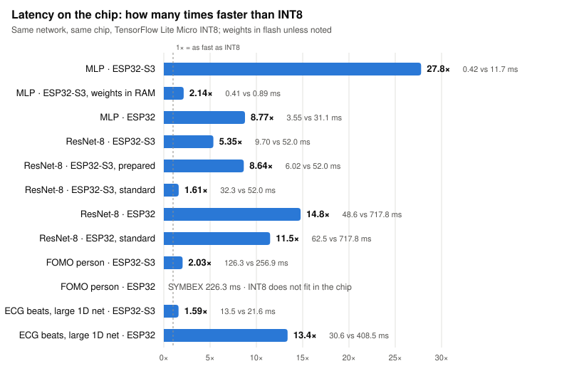
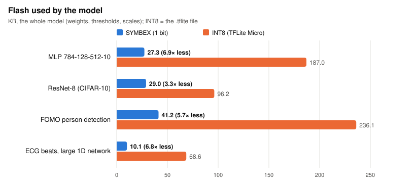

# Documentación de SYMBEX-1

*[Read in English](../en/README.md)*

Cómo funciona SYMBEX-1, cómo se usa y qué midió. El [README principal](../../README.es.md) tiene el resumen; estas páginas
entran en los detalles.

| Página | Qué explica |
|---|---|
| [Cómo funciona](how-it-works.md) | Redes binarias, contar bits en vez de multiplicar, plegar todo en umbrales enteros, exactitud bit a bit |
| [CDT](cdt.md) | El compilador: de un modelo de PyTorch a un header de C comprobado, en la PC y en el chip |
| [Librería](library.md) | lib_symbex: las capas, la capa de hardware de cada chip, cómo añadirla a un proyecto |
| [Resultados](results.md) | Todos los benchmarks en un solo lugar: velocidad, flash, precisión y energía frente a INT8, con las gráficas |
| [Metodología](methodology.md) | El estándar de medición: qué se compara contra qué (INT8, INT4 / INT2, otro motor binario), la lista que sigue cada benchmark, cómo repetirlo |
| [El motor vertical](vertical.md) | Contar 128 ventanas a la vez: ResNet-8 en 10.4 ms en el ESP32-S3 (7.7 / 6.4 ms con los modos opcionales compacto / preparado; 6.0 ms con el stem int8), la fórmula y la lógica de inferencia |

Los diagramas están escritos en [Mermaid](https://mermaid.js.org/) dentro de las páginas (GitHub los dibuja). Las
gráficas viven en [`assets/`](../assets/) y se generan a partir de los archivos de resultados de los benchmarks, así que
siempre se pueden volver a crear.

## De un vistazo

Redes SYMBEX frente a TensorFlow Lite Micro INT8 con los kernels del fabricante (ESP-NN, CMSIS-NN), la ruta de
despliegue que usa casi todo el mundo, no el INT8 más rápido posible (ver
[Resultados](results.md#qué-tan-rápido-podría-ser-int8)): la misma red en el mismo chip.

<picture>
  <source media="(prefers-color-scheme: dark)" srcset="../assets/speedup_dark.svg">
  
</picture>

<picture>
  <source media="(prefers-color-scheme: dark)" srcset="../assets/flash_dark.svg">
  
</picture>

La diferencia depende del chip y de dónde están los pesos. En el ESP32 clásico, sin SIMD, SYMBEX es 5-15× más rápido
que TFLite Micro (ResNet-8 también frente a ESP-DL de Espressif: 48.6 frente a 712 ms, una prueba rápida), y el
detector de personas INT8 ni siquiera cabe. En el ESP32-S3, cuya unidad SIMD acelera INT8, el motor estándar gana por
1.0-2.0× en las redes convolucionales (ResNet-8: 1.61×) y ESP-DL de Espressif es más rápido que él (14.8 frente a
32.3 ms). El [motor vertical](vertical.md) le gana a ESP-DL: 9.70 ms con los pesos en flash, y 7.07 ms en su modo
compacto frente a ESP-DL con sus pesos en RAM (con menos RAM, 138 frente a 147 KB). Con los pesos en RAM, la
diferencia del MLP se reduce a 2.14×. La energía por inferencia sigue a la velocidad: 8-13× menos en el ESP32 clásico y 1.4-25× menos en el
ESP32-S3 ([Resultados](results.md#energía-por-inferencia)). La precisión está en [Resultados](results.md) y en el README de cada benchmark. Para volver a crear las gráficas después de una nueva medición:
`python tools/dev/docs_charts.py`.
