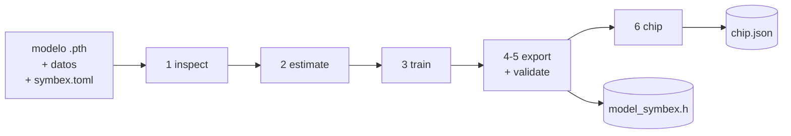
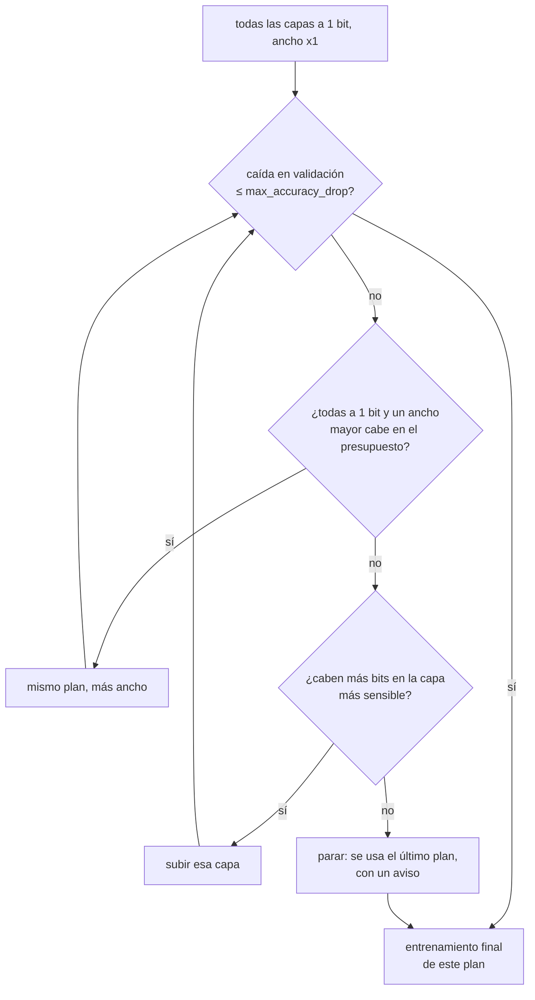
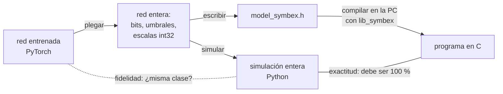

# El CDT: de un modelo de PyTorch a un header de C comprobado

*[Read in English](../en/cdt.md)*

El CDT (`tools/cdt.py`) es el compilador de SYMBEX-1. Recibe un modelo, los datos y los límites de un microcontrolador,
y devuelve una red binaria como un header de C para lib_symbex. Ese header se comprobó bit a bit en la PC y, cuando hay
una placa conectada, en el chip. Un archivo de configuración (`symbex.toml`) describe toda la corrida, así que cada
resultado se puede volver a crear a partir del archivo del que salió.

Esta página explica qué pasa por dentro. Para las opciones y los archivos que escribe, ver el
[README de tools](../../tools/README.md); para cómo calcula una capa binaria, ver [Cómo funciona](how-it-works.md).

## La corrida en una imagen



Cada etapa escribe su resultado en la carpeta de salida, así que una corrida puede empezar o parar en cualquier punto:
`--from export` exporta un modelo entrenado antes, y `--from chip` vuelve a medir una exportación existente.

## Dos caminos: denso y booleano

El método en `[model]` decide el camino.

| | `plain` / `ternary` (redes densas) | `boolean` (redes convolucionales completamente binarias) |
|---|---|---|
| El modelo | una red FP32 (un MLP) que el CDT binariza | una red que ya es binaria por definición (sus capas viven en el `model.py` del benchmark) |
| estimate | cuánto sufre cada capa a 1, 2, 4 y 8 bits | se salta: no hay nada que elegir |
| train | busca el ancho y los bits por capa dentro del presupuesto, y luego entrena la red elegida | entrena la red tal como está definida, solo con etiquetas |
| export | `export/dense.py`, `export/ternary.py` | `export/boolean.py` |

## 1 inspect

El CDT lee el modelo: cuántas capas convolucionales y lineales tiene, sus parámetros y su precisión numérica. Un modelo
que ya está cuantizado sigue funcionando, pero el CDT avisa que parte de la información se pierde y que la estimación es
menos fiable. El método `ternary` rechaza un modelo con convoluciones, y `plain` solo exporta MLP.

## 2 estimate (solo densas)

`sensitivity.py` ejecuta el modelo original sobre unas pocas muestras reales de entrenamiento (`calibration_samples`,
32 por defecto). Para cada capa mide cuánto cambia la salida cuando los pesos, las activaciones y la normalización bajan
a k bits (similitud coseno), y cuánta memoria ocupa cada opción. El resultado es solo un orden: qué capa recibe más bits
primero, si hacen falta. La decisión se toma después, por precisión.

## 3 train

**Redes densas: una búsqueda y luego el entrenamiento final.** Cada prueba entrena unas pocas épocas (`search_epochs`)
y se juzga sobre el split de validación:



Primero se prueba más ancho porque mantiene todas las capas a 1 bit, y hoy la exportación solo acepta planes donde
todas las capas son de 1 bit (`--options bin` limita la búsqueda a ellos).

**Las redes booleanas** se entrenan tal como están definidas, solo con las etiquetas. Con `data_on_gpu = true` y
`compile = "reduce-overhead"`, el conjunto de entrenamiento va a la GPU una sola vez y el paso de entrenamiento se repite
como un CUDA graph: la ResNet-8 binaria se entrena en 3.0 minutos en vez de 8.6, con la misma precisión y la misma
exactitud.

**La primera capa de una red booleana** es, por defecto, un termómetro y una convolución binaria. Un modelo puede elegir
en su lugar un stem int8 (`stem_kind = "int8"`, una convolución de 8 bits sobre los píxeles centrados cuyo
`int8_weights()` da sus enteros: `Int8Conv` en `benchmarks/conv2d/cnn_cifar_resnet8/model.py`). La exportación pliega su
BatchNorm y su signo en un umbral por canal sobre el producto punto entero, lo escribe como `symbex_bool_stem_i8` de
lib_symbex y lo comprueba como cualquier otra capa (el C igual a la simulación entera en cada imagen). Úsalo en chips
que multiplican bytes con SIMD (ESP32-S3, Cortex-M33); en los demás el termómetro es más rápido. Los dos motores lo
ejecutan (el vertical convierte su salida en planos de canal).

**El clasificador de una red booleana** es binario por defecto. El exportador también acepta un clasificador int8 con
pooling (un módulo con `window`, `side` e `int8_weights()`: pesos int8 sobre la cuenta de unos de cada ventana k × k
del último mapa) y lo escribe como `symbex_bool_pool_head` de lib_symbex; en ResNet-8 es tan preciso como un
clasificador int8 sobre todos los bits con la cuarta parte de sus pesos. Se entrena en
`benchmarks/experiments/training_gap` (`--head pool2`), todavía no desde `symbex.toml`.

**Validación y test.** Toda elección (la búsqueda, el checkpoint) se hace sobre un split de validación sacado de los
datos de entrenamiento. `split_seed` lo fija, así que cada semilla de entrenamiento se juzga sobre las mismas imágenes.
El conjunto de test se evalúa una sola vez, al final, y se guarda en `train.json` como el número reportado.

Junto a la precisión, el CDT imprime dos números que dicen qué tan cerca se queda la red binaria de la original:
**identidad** (la misma clase que la original, muestra por muestra) y **retención** (de las muestras que la original
acierta, cuántas sigue acertando la red binaria).

## 4-5 export y validate

Todos los exportadores hacen las mismas tres cosas con los mismos enteros:



1. **Plegar.** Cada BatchNorm se convierte en un umbral entero, y los signos en palabras empaquetadas
   ([Cómo funciona](how-it-works.md) muestra la derivación).
2. **Simular.** Un modelo en Python de la red entera: la referencia que el C tiene que reproducir.
3. **Escribir y comprobar.** Se escribe el header, se compila con lib_symbex en la PC y se ejecuta sobre las imágenes
   de validación.

Salen dos números:

| | Compara | Esperado |
|---|---|---|
| **Fidelidad** | PyTorch contra la simulación entera | cerca de 100 % (el redondeo de los umbrales puede cambiar una muestra en el límite) |
| **Exactitud** | el C compilado contra la simulación entera | **100 %, siempre**; cualquier otra cosa se reporta como `[X]` |

Para las redes densas la exportación también elige la aritmética (`[output] arithmetic = "auto"`): AND o XNOR, la que el
perfil del chip en `tools/chip_profiles/` predice más rápida para la forma de este modelo. Las dos dan las mismas
clases. Con `int8_reference = true` también exporta la versión INT8 del modelo original, con la aritmética entera de
TFLite, para comparar.

## 6 chip

Con una placa en `[chip]` (`esp32`, `s3`, `pico2_arm`, `pico2_riscv`; `uno` para los ejemplos de AVR), el CDT arma un
firmware alrededor del header, lo flashea y envía las imágenes de validación por el puerto serie. Reporta:

- la **igualdad con la simulación entera**, imagen por imagen (debe volver a ser 100 %, ahora en el chip);
- la precisión, la latencia (mediana sobre las imágenes) y la latencia de cada capa;
- la RAM usada y la flash del modelo.

`weights = "flash"` (por defecto, como se suele desplegar un modelo) o `"ram"` decide dónde viven los pesos. Con
`--compare-arithmetic` (redes densas), el mismo modelo se mide también con la otra aritmética, para confirmar en el chip
lo que predijo el perfil.

`tools/chip_test.py` ejecuta solo esta etapa sobre cualquier carpeta de exportación.

## Cómo ejecutarlo

```
cd benchmarks/conv2d/cnn_cifar_resnet8
python ../../../tools/cdt.py symbex.toml                                   # entrenar, exportar, comprobar en la PC
python ../../../tools/cdt.py symbex.toml --from chip --board s3 --port /dev/ttyACM0
```

`--show-config` imprime la configuración que se ejecutaría y de dónde salió cada valor (por defecto, archivo o flag).
Ejemplos que funcionan: `benchmarks/conv2d/cnn_cifar_resnet8/symbex.toml` (boolean), `benchmarks/mlp/mlp_fashion/symbex.toml`
(plain), `tools/configs/ternary_fashion.toml` (ternary); `tools/configs/example.toml` tiene todas las opciones,
comentadas.

## Dentro del código

| Parte | Dónde |
|---|---|
| Las etapas, la búsqueda, la configuración | `tools/cdt.py` |
| Estimación | `tools/compiler_core/sensitivity.py` |
| Capas binarias y de k bits, ensanchar | `tools/compiler_core/methods/` |
| Bucles de entrenamiento (etiquetas, destilación) | `tools/compiler_core/train/` |
| Plegar, simular, escribir, comprobar | `tools/compiler_core/export/` |
| Placa, firmware, medición | `tools/compiler_core/chip/` |

El [README de compiler_core](../../tools/compiler_core/README.md) lista todos los archivos y marca cuáles son actuales y
cuáles son versiones anteriores.
