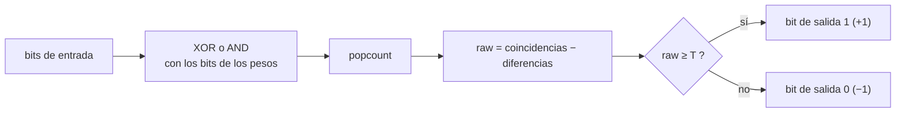
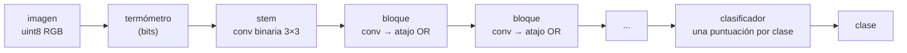
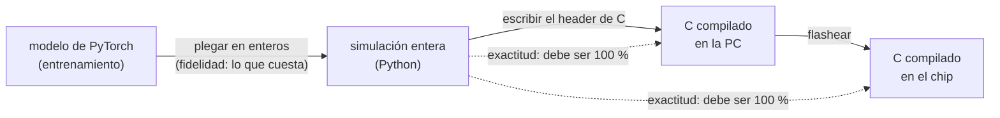

# Cómo funciona SYMBEX-1

*[Read in English](../en/how-it-works.md)*

Una red neuronal pasa casi todo su tiempo calculando productos punto: multiplicar cada entrada por un peso y sumar.
SYMBEX-1 hace que las entradas y los pesos sean de **un bit** cada uno. Entonces un producto punto no necesita ninguna
multiplicación: se convierte en **un conteo de bits**, que un microcontrolador hace con unas pocas instrucciones lógicas.
Esta página explica cómo, paso a paso, y cómo SYMBEX-1 garantiza que el chip calcula exactamente lo mismo que el modelo
entrenado.

## 1. Un producto punto hecho de bits

En una red binaria cada valor es **+1 o −1**, guardado como un bit (1 para +1, 0 para −1). El producto de dos de esos
valores es +1 cuando los bits son iguales y −1 cuando son distintos. Así que el producto punto de dos vectores de `n`
valores es

$$\text{raw} = (\text{bits iguales}) - (\text{bits distintos}) = n - 2 \cdot \text{popcount}(x \oplus w)$$

donde `x ⊕ w` (XOR) marca los bits que difieren y `popcount` los cuenta. Una palabra de 32 bits guarda 32 valores, así
que un XOR y un conteo reemplazan 32 multiplicaciones y 32 sumas.

**Ejemplo con 8 valores:**

| | bits | valores |
|---|---|---|
| entrada `x` | `1 0 1 1 0 0 1 0` | +1 −1 +1 +1 −1 −1 +1 −1 |
| pesos `w` | `1 0 0 1 1 0 1 0` | +1 −1 −1 +1 +1 −1 +1 −1 |
| `x XOR w` | `0 0 1 0 1 0 0 0` | difieren 2 bits |

`raw = 8 − 2 · 2 = 4`: seis productos de +1 y dos de −1, lo mismo que multiplicar y sumar.

Algunos chips cuentan más rápido con AND que con XOR. El mismo número sale de

$$\text{bits distintos} = \text{popcount}(x) + \text{popcount}(w) - 2 \cdot \text{popcount}(x \wedge w)$$

(en el ejemplo: `4 + 4 − 2 · 3 = 2`). La librería usa la forma que el chip ejecuta más rápido (sección 5).

## 2. Una capa: contar y comparar con un umbral

Después del conteo, una red normal aplica una escala, un BatchNorm y una activación, todo en punto flotante. En SYMBEX-1
esos pasos se **pliegan en un entero por salida**, un umbral `T`, así que una capa solo hace esto:

La salida vuelve a ser bits, lista para la siguiente capa. **No hay punto flotante en ninguna parte** de la inferencia.

### De dónde sale el umbral

Durante el entrenamiento, después del conteo la capa calcula un BatchNorm y luego toma el signo:

$$\text{bit} = \left[\;\gamma \cdot \frac{\text{raw} - \mu}{\sigma} + \beta \;\geq\; 0\;\right]$$

`γ, β` se aprenden y `μ, σ` son las estadísticas acumuladas. Cuando `γ > 0` esto es lo mismo que

$$\text{raw} \;\geq\; \mu - \frac{\beta\,\sigma}{\gamma}$$

y como `raw` es un entero, el lado derecho se puede redondear hacia arriba: `T = ⌈μ − βσ/γ⌉`. Cuando `γ < 0` la
desigualdad se invierte; el exportador niega la fila de pesos de esa salida (lo que niega `raw`) y el C sigue haciendo
solo `raw ≥ T`. El resultado es idéntico al de la capa en punto flotante para cualquier entrada posible: no es una
aproximación.

Las redes densas pliegan más cosas en el mismo umbral: la escala de los pesos, el sesgo, la normalización de la entrada
y el umbral de binarización de la capa siguiente.

## 3. La entrada y la salida

**La entrada.** Una cámara o un sensor da bytes, no bits. Hay dos formas de entrar:

- **Termómetro (redes convolucionales).** Cada color de cada píxel se convierte en `levels` bits: el bit `k` es 1
  cuando el valor es al menos `(k + 1) · 256 / (levels + 1)`. Con 8 niveles un píxel se convierte en 24 bits y la
  primera capa es binaria como las demás.
- **Una primera capa int8 (opcional, redes convolucionales).** La primera convolución conserva pesos de 8 bits y lee
  los píxeles directamente, centrados (`píxel − 128`): un producto punto entero por salida, y su BatchNorm y su signo se
  pliegan en un umbral sobre él, `D ≥ T`, como en todas las demás capas. Su salida son bits, así que el resto de la red
  no cambia. Es más precisa (ResNet-8 en CIFAR-10: 75.6 % contra 71.2 % en validación, 3 semillas) y es más rápida donde
  el chip multiplica bytes con SIMD (el stem solo: 1.79× en el ESP32-S3, 1.13× en el Cortex-M33 del Pico 2), pero más
  lenta donde no (0.86× en el ESP32, 0.62× en Hazard3). La ResNet-8 completa, 3 semillas, exacta en todas las placas:
  75.4 % en el conjunto de prueba contra 71.3 %, 1.10× más rápida en el S3 (35.5 contra 39.2 ms), 1.03× en el M33,
  0.93× en el ESP32 y 0.87× en Hazard3 ([el benchmark](../../benchmarks/conv2d/cnn_cifar_resnet8/README.md)). Desde
  entonces el stem tiene sus propios kernels (PIE en el S3, uno sin búfer de ventana en los demás chips), y la misma red
  mide (semilla 42, pesos en flash) 1.22× más rápido que el termómetro en el S3 (32.1 frente a 39.2 ms), 1.12× en el
  M33 (66.4 frente a 74.6), 1.04× en el ESP32 (61.1 frente a 63.3) y 0.98× en Hazard3 (57.4 frente a 56.1). El
  termómetro sigue siendo la opción por defecto.
- **Bytes directamente (redes densas).** La primera capa lee los valores `uint8`, suma los que tienen peso +1 y resta
  los que tienen peso −1. Sigue siendo una suma sin multiplicaciones, y la normalización de la entrada va a los
  umbrales.

**La salida.** La última capa es la única que no termina en un bit: calcula una puntuación por clase,
`scale · raw + bias`, con escala y sesgo enteros (punto fijo, productos de 64 bits). Gana la clase con la puntuación
más alta (la primera, si dos empatan).

## 4. Una red completa

Las redes convolucionales (`layers/conv/symbex_bool`) necesitan tres piezas más, todas sobre bits:

| Pieza | Sobre bits es | Por qué |
|---|---|---|
| pooling 2 × 2 | OR de los 4 píxeles | el máximo de cuatro valores ±1 es +1 cuando cualquiera de ellos es +1 |
| atajo residual | OR de dos mapas | la salida del bloque y su atajo se unen sin sumar números |
| cambio de forma | una convolución binaria 1 × 1 después del pooling | cuando un bloque reduce el tamaño a la mitad o cambia los canales |

Los mapas se guardan con los canales de cada píxel juntos, 32 canales por palabra, así que una ventana 3 × 3 es una
serie corta de palabras, copiada una vez por posición y comparada con cada fila de pesos.

## 5. Contar bits en cada chip

No todos los chips cuentan bits de la misma forma. La capa de hardware (HAL) de la librería elige el método;
`tools/dev/count_bench.py` los midió en cada chip.

| Chip | Cómo cuenta |
|---|---|
| x86, AArch64 | la instrucción nativa de popcount |
| RP2350 (Pico 2), núcleo Hazard3 RISC-V | la instrucción nativa `cpop` (extensión Zbb) |
| RP2350 (Pico 2), núcleo Cortex-M33 | una tabla de 16 bits (`lut16`) |
| ESP32 | una tabla de 16 bits (`lut16`) o SWAR |
| ESP32-S3 | la unidad SIMD (PIE): su multiplicador suma los bits (`pie_swar`) |
| AVR (Arduino Uno) | una tabla de 8 bits (`lut8`) |

Cada función de conteo tiene también una forma `*_rows` que calcula una capa entera en una llamada, así que el costo de
preparación se paga una vez por capa en vez de una vez por neurona.

## 6. Exacto, siempre

Un modelo solo sirve en un chip si el chip calcula **exactamente** lo que se validó en la PC. SYMBEX-1 lo comprueba en
cada paso:

- **La fidelidad** compara el modelo entrenado con su simulación entera: lo que cuesta plegar en enteros. Las capas
  binarias se pliegan de forma exacta (un entero comparado con un umbral redondeado hacia arriba da el mismo bit); las
  puntuaciones de la última capa se redondean a punto fijo y pueden cambiar algunas predicciones. El CDT la reporta.
- **La exactitud** compara la simulación entera con el C compilado, imagen por imagen. Debe ser **100 %**, en la PC y
  en el chip. Cualquier otra cosa es un error en la exportación o en el motor, y el CDT lo reporta como
  `[X] MISMATCH`.

## Dónde mirar en el código

| Tema | Archivo |
|---|---|
| Plegar redes convolucionales (umbrales, clasificador) | [`tools/compiler_core/export/boolean.py`](../../tools/compiler_core/export/boolean.py) |
| Plegar redes densas | [`tools/compiler_core/export/dense.py`](../../tools/compiler_core/export/dense.py) |
| La convolución binaria, el termómetro, el pool OR y el atajo en C | [`layers/conv/symbex_bool.h`](../../Symbex1_PIO/lib/lib_symbex/include/layers/conv/symbex_bool.h) |
| La capa de hardware (conteo de bits por chip) | [`include/hal/symbex_hal.h`](../../Symbex1_PIO/lib/lib_symbex/include/hal/symbex_hal.h) |
| Medir los métodos de conteo de un chip | [`tools/dev/count_bench.py`](../../tools/dev/count_bench.py) |
