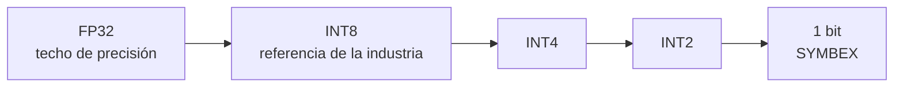
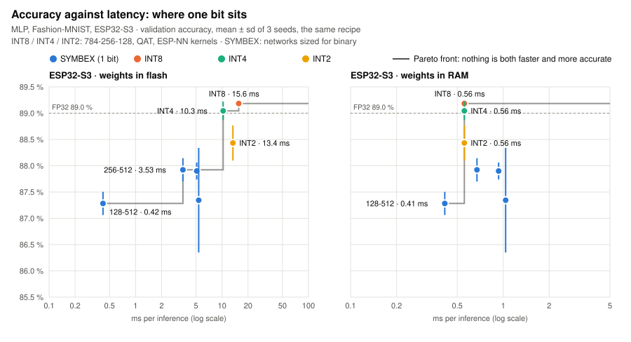

# Metodología: cómo mide SYMBEX-1

*[Read in English](../en/methodology.md)*

Todos los benchmarks de SYMBEX-1 siguen el mismo estándar, para que cualquier resultado se pueda revisar, repetir y
comparar con los demás. Esta página reúne ese estándar: qué se compara, contra qué, cómo, y cómo repetirlo. La única
excepción es el benchmark 1D contra Daghero et al. (`benchmarks/conv1d/har_ultracompact`), que sigue las redes y el
simulador de ese artículo.

## La pregunta

Una red totalmente binaria guarda cada peso y cada activación en **un bit** y cambia la multiplicación por contar bits.
La pregunta que responde SYMBEX-1 no es "¿es más rápido que X?", sino **dónde queda un bit** entre las formas de correr
la misma red en el mismo microcontrolador: cuánta precisión, tiempo, memoria (y, pronto, energía) cuesta cada número de
bits.

Por eso el resultado de un benchmark es una **frontera de Pareto** por chip: precisión contra latencia (y contra flash
y RAM). Un método vale la pena donde ningún otro del gráfico es a la vez más preciso y más barato.

<picture>
  <source media="(prefers-color-scheme: dark)" srcset="../assets/pareto_mlp_dark.svg">
  
</picture>

El primer gráfico hecho así, mlp_fashion en el ESP32-S3 (precisión de validación, media ± desviación de 3 semillas, la
misma receta para todos los métodos; INT8 / INT4 / INT2 = 784-256-128 con entrenamiento consciente de la cuantización
sobre kernels ESP-NN, latencia de la semilla 42; SYMBEX = las redes dimensionadas para binario; techo FP32 89.0 %):

| Método | Red | Validación | ms, pesos en flash | ms, pesos en RAM |
|---|---|---|---|---|
| INT8 | 784-256-128 | 89.18 ± 0.03 % | 15.6 | 0.56 |
| INT4 | 784-256-128 | 89.04 ± 0.18 % | 10.3 | 0.56 |
| INT2 | 784-256-128 | 88.43 ± 0.33 % | 13.4 | 0.56 |
| SYMBEX | 784-128-512 | 87.28 ± 0.22 % | **0.42** | **0.41** |
| SYMBEX | 784-256-512 | 87.92 ± 0.22 % | 3.53 | 0.67 |
| SYMBEX | 784-384-512 | 87.90 ± 0.16 % | 5.10 | 0.93 |
| SYMBEX | 784-512-256 | 87.34 ± 1.00 % | 5.37 | 1.04 |

Lo que dice, sin adornos: con los pesos en flash, un bit se queda con el extremo rápido de la curva (784-128-512 es
37× más rápido que INT8 con 1.9 puntos menos) e INT4 le gana a INT2 en los dos ejes (desempaquetar códigos de 2 bits
cuesta más de lo que ahorra); con los pesos en RAM la ventaja baja a 1.34× por los mismos 1.9 puntos, e INT8 le gana a
todas las redes SYMBEX más grandes. Los demás benchmarks tendrán el mismo gráfico a medida que se midan sus
referencias INT4 / INT2 (ver la última tabla).

## Tres tipos de referencia, tres preguntas

| Referencia | La pregunta que responde | Qué es |
|---|---|---|
| **INT8**: TensorFlow Lite Micro (kernels ESP-NN en los ESP32, CMSIS-NN en el Cortex-M33 del Pico 2); ESP-DL en el ESP32-S3 | ¿Qué gana quien hoy despliega con la herramienta estándar? | La referencia de la industria, la más usada. Hecha para precisión, no para el menor costo |
| **INT4 / INT2**: [`tools/lowbit`](../../tools/lowbit/README.md), multiplicar y acumular sobre los mismos kernels ESP-NN | Con el mismo presupuesto de bits, ¿contar bits le gana a multiplicar? | La competencia directa en eficiencia. Justa por construcción, pero es implementación nuestra: ningún toolchain oficial corre INT2 |
| **Otro motor binario**: ultracompactBNN (Daghero et al. 2021) | ¿Es SYMBEX una mejor implementación de la misma idea? | Solo en el benchmark 1D, la excepción de arriba |

INT8 le dice al lector qué cambia frente a lo que ya usa; INT4 e INT2 dicen si un bit es el lugar correcto de la curva;
el otro motor dice si la implementación es buena.

## El estándar

Cada benchmark marca esta lista. Una casilla vacía se escribe en el README del benchmark como trabajo futuro.

**Modelo**
- [ ] La **arquitectura oficial** (MLPerf Tiny, Edge Impulse, la del artículo) y, si SYMBEX se redimensiona, **la
      misma forma redimensionada** para todos los métodos.
- [ ] Un modelo FP32 de partida por semilla, compartido por todos los métodos; se guarda su sha256.
- [ ] La misma receta para todos los métodos: épocas, optimizador, semillas 42 / 43 / 44, división de datos. Cuando una
      receta favorece a un método (destilación frente a solo etiquetas), se muestran las dos.

**Datos**
- [ ] Un split de validación sacado de los datos de entrenamiento (`load_data` del CDT devuelve train, validación, test).
- [ ] Toda elección (checkpoint, umbral, variante, forma) se hace en validación. El **test se usa una sola vez**, en los
      modelos finales, y el README dice cuándo.

**Métodos**
- [ ] FP32 (el techo), INT8 (TFLite Micro), INT4, INT2 (`tools/lowbit`), SYMBEX.
- [ ] Los híbridos (una primera capa o un clasificador int8 dentro de una red binaria) se etiquetan como tales, con sus
      **bits promedio por peso** (bits de todos los pesos / número de pesos); "totalmente binario" es 1 bit en todo.

**En el chip**
- [ ] Placas: ESP32 (sin SIMD), ESP32-S3 (SIMD PIE), Raspberry Pi Pico 2 Cortex-M33 y Hazard3 RISC-V.
- [ ] Reloj de fábrica (240 MHz en los dos ESP32, 150 MHz en el Pico 2), un núcleo, la mediana de 1000 inferencias.
- [ ] **Pesos en flash primero** (como se despliega un modelo normalmente), después pesos en RAM. Todos los métodos
      comparados tienen sus pesos en el mismo lugar.
- [ ] **Exacto**: la placa da la misma salida que la simulación entera en el 100 % de las entradas, imagen por imagen,
      para SYMBEX y para las referencias enteras.

**Se reporta**
- [ ] Precisión (validación; test una vez), latencia (ms), flash y RAM (medidas en el chip), energía cuando se mida.
- [ ] Media ± desviación estándar sobre las 3 semillas. Una sola semilla se llama ranking, no resultado.
- [ ] Las diferencias menores que las desviaciones estándar se llaman empate.
- [ ] Las cifras que no se midieron se llaman **estimaciones** y dicen de dónde salen.

## Primero predecir, después medir

Antes de que una red nueva vaya a un chip, su costo se predice con las operaciones contadas y el costo por operación
medido en el chip (`tools/dev/count_bench.py`, perfiles en `tools/chip_profiles/`): para SYMBEX las palabras que pasan
por un conteo de bits, para INT8 / INT4 / INT2 las multiplicaciones-acumulaciones. La predicción dice dónde debería caer
cada método en la curva y dónde INT2 o INT4 deberían alcanzar a un bit; la medición lo confirma o muestra lo que el
modelo no ve. Se reportan las dos, la predicción marcada como estimación.

## Dos formas de leer el gráfico

| Lectura | La pregunta | Cómo |
|---|---|---|
| **Misma precisión** | ¿Qué método llega a esta precisión al menor costo? | Dimensionar cada método hasta que llegue al objetivo en validación; comparar ms, flash, RAM |
| **Mismo presupuesto** | Con este presupuesto (por ejemplo 30 ms y 64 KB), ¿qué método es más preciso? | Quedarse con los métodos que caben; comparar precisión |

La primera es la que pregunta un investigador; la segunda, la que pregunta quien despliega.

## El esfuerzo de optimización, dicho abiertamente

| Método | Quién lo ajustó |
|---|---|
| INT8 TensorFlow Lite Micro | Kernels de Google / Espressif / Arm, usados tal como vienen, sin ajuste nuestro |
| INT8 ESP-DL (ESP32-S3) | El camino INT8 más optimizado de Espressif: el INT8 más fuerte que conocemos en ese chip |
| INT4 / INT2 (`tools/lowbit`) | Nuestro C alrededor de los kernels ESP-NN; el desempaquetado a int8 es código nuestro |
| SYMBEX | Ajustado por nosotros, por chip |

Así, una ventaja de velocidad de SYMBEX sobre TensorFlow Lite Micro es una ventaja sobre el camino de despliegue usual,
no sobre el INT8 más rápido posible; donde ESP-DL está medido, se muestran los dos.

## Repetir un benchmark

Todos los benchmarks tienen los mismos pasos y las mismas carpetas:

| Paso | Comando (desde la carpeta del benchmark) | Salida |
|---|---|---|
| 1. FP32, entrenamiento SYMBEX, exportación, simulación | `python <bench>_symbex.py --seeds 3` | `runs/<run>_s<semilla>/` |
| 2. SYMBEX en una placa | `python <bench>_symbex.py --seeds 3 --board <placa> --port <puerto>` (después `--weights ram`) | `results/symbex/` |
| 3. INT8 TensorFlow Lite Micro | `python <bench>_tflite.py --board <placa> --port <puerto>` | `results/tflite/` |
| 4. INT4 / INT2 | `python <bench>_lowbit.py ...` | `results/lowbit/` |
| 5. Gráficos | `python tools/dev/docs_charts.py` (desde la raíz) | `docs/assets/` |

Placas: `esp32`, `s3` (su puerto USB nativo: `--usb`), `pico2_arm`, `pico2_riscv`. Cada README lista los comandos
exactos con que se midió. Los resultados superados pasan a `results/earlier/`; no se borra nada medido.

**Sin entrenar.** La carpeta `reference/` de cada benchmark ([mlp_fashion](../../benchmarks/mlp/mlp_fashion/reference/README.md), [mlp_digits](../../benchmarks/mlp/mlp_digits/reference/README.md), [ResNet-8](../../benchmarks/conv2d/cnn_cifar_resnet8/reference/README.md), [FOMO](../../benchmarks/conv2d/fomo_voc_person/reference/README.md), [HAR](../../benchmarks/conv1d/har_ultracompact/reference/README.md)) tiene un modelo
listo, semilla 42: el modelo FP32 de partida, la cabecera SYMBEX lista para compilar, el `.tflite` INT8, la
configuración con que se entrenó y una tarjeta con su precisión, latencia y memoria por placa. Basta para meter el
modelo en un proyecto o medirlo en una placa sin reentrenar.

## Qué guarda un archivo de resultados

Cada JSON que se escribe en `results/` guarda la placa, dónde están los pesos, el modo de conteo, el motor, el número
de imágenes, la precisión, la latencia (mediana y mínima), la flash, la RAM y si la placa es igual a la simulación.
Falta agregar a todos los archivos, para que no se vuelvan a mezclar resultados de fechas distintas: el commit de la
librería, las versiones del toolchain, el reloj y el sha256 del modelo FP32.

## Límites

- INT4 e INT2 corren sobre código nuestro alrededor de ESP-NN: una referencia justa, pero no un toolchain oficial. No
  existe un kernel INT2 oficial en estos chips.
- ESP-NN solo existe para los chips de Espressif; en el Pico 2 las referencias enteras por debajo de INT8 necesitan
  otra librería de kernels.
- ESP-DL se midió una vez, fuera de este repositorio, y solo en el ESP32-S3.
- La energía todavía no se ha medido: latencia no es energía.
- El benchmark 1D sigue el montaje de Daghero et al., no este estándar.

## Dónde está cada benchmark

| Benchmark | INT8 (TFLite Micro) | INT4 / INT2 | Pico 2 | ESP-DL |
|---|---|---|---|---|
| [mlp_fashion](../../benchmarks/mlp/mlp_fashion/README.md) | ESP32, S3, los dos núcleos del Pico 2 | precisión (PC), ESP32, S3 | SYMBEX e INT8 | S3 (fuera del repositorio) |
| [mlp_digits](../../benchmarks/mlp/mlp_digits/README.md) | ESP32, S3 | pendiente | pendiente | pendiente |
| [cnn_cifar_resnet8](../../benchmarks/conv2d/cnn_cifar_resnet8/README.md) | ESP32, S3, los dos núcleos del Pico 2 | pendiente (`tools/lowbit` todavía no pliega las conexiones residuales) | SYMBEX e INT8 | S3 (fuera del repositorio) |
| [fomo_voc_person](../../benchmarks/conv2d/fomo_voc_person/README.md) | S3 (INT8 no cabe en el ESP32) | pendiente | solo SYMBEX | pendiente |
| [har_ultracompact](../../benchmarks/conv1d/har_ultracompact/README.md) | ESP32, S3 | solo precisión (PC) | solo SYMBEX | la excepción: se compara con ultracompactBNN en GVSoC |
