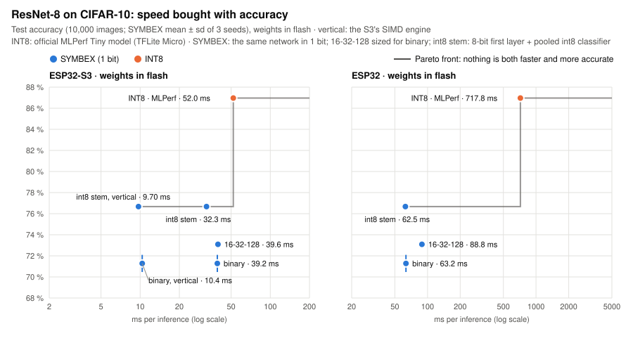

# Resultados: todos los benchmarks en un solo lugar

*[Read in English](../en/results.md)*

Cada benchmark compara una red SYMBEX completamente binaria con INT8 en el mismo chip y con la misma arquitectura. El
lado INT8 es el modelo oficial de TensorFlow Lite Micro o, donde no existe un modelo oficial, la misma red entrenada con
la misma receta. Todas las reglas vienen de la [metodología](methodology.md):

- los resultados son medias sobre 3 semillas (42, 43, 44);
- toda elección se hace sobre un split de validación, y el conjunto de test se usa una sola vez;
- los pesos están en flash salvo que la tabla diga otra cosa;
- en cada placa, el chip da **la misma salida que la simulación entera en el 100 % de las entradas**.

**Qué significa INT8 aquí.** El lado INT8 es la ruta de despliegue que usa casi todo el mundo: TensorFlow Lite Micro
con los kernels optimizados ESP-NN de Espressif. No es el INT8 más rápido posible: en el ESP32-S3, la librería ESP-DL de
Espressif ejecuta ResNet-8 2.6× más rápido que el motor estándar de SYMBEX. El motor vertical de SYMBEX
([El motor vertical](vertical.md)) lo ejecuta en 10.4 ms, 1.43× más rápido que ESP-DL con los pesos en flash; con los
pesos en RAM, ESP-DL sigue 1.06× más rápido, salvo con uno de los modos opcionales del motor: compacto (7.70 ms, 1.27×
más rápido que ESP-DL en RAM, con 151 KB de RAM frente a los 147 KB de ESP-DL) o preparado (6.44 ms, 1.52× más rápido,
238 KB de RAM). La receta más precisa de ResNet-8 (una primera capa int8 y un clasificador int8 con pooling, todo lo
demás binario) es más rápida aún: 9.70 ms en el modo por defecto, 7.07 ms en compacto con menos RAM que ESP-DL (138
frente a 147 KB), 6.02 ms en preparado. [¿Qué tan rápido podría ser INT8?](#qué-tan-rápido-podría-ser-int8)
muestra qué está medido y qué no.

Esta página da lo principal de cada benchmark. Los detalles, los comandos y los archivos crudos están en el README de
cada benchmark.

## Velocidad, flash y RAM

<picture>
  <source media="(prefers-color-scheme: dark)" srcset="../assets/speedup_dark.svg">
  
</picture>

<picture>
  <source media="(prefers-color-scheme: dark)" srcset="../assets/flash_dark.svg">
  
</picture>

Todas las corridas en un núcleo, a 240 MHz en los dos ESP32. SYMBEX e INT8 siempre tienen sus pesos en el mismo lugar:
flash en todas las filas menos una.

| Benchmark | Chip | Pesos en | Latencia, SYMBEX / INT8 | Aceleración | Flash, SYMBEX / INT8 | RAM, SYMBEX / INT8 |
|---|---|---|---|---|---|---|
| MLP (Fashion-MNIST, 784-128-512-10) | ESP32-S3 | flash | 0.42 / 11.67 ms | **27.8×** | 27.3 / 187.0 KB | 4.6 / 6.7 KB |
| MLP (Fashion-MNIST, 784-128-512-10) | ESP32-S3 | **RAM** | 0.414 / 0.888 ms | **2.14×** | 27.3 / 187.0 KB | 4.6 / 6.7 KB + los pesos (21 / 187 KB) |
| MLP (Fashion-MNIST, 784-128-512-10) | ESP32 | flash | 3.55 / 31.11 ms | **8.77×** | 27.3 / 187.0 KB | 4.4 / 6.7 KB |
| ResNet-8 (CIFAR-10), motor vertical ⁴ | ESP32-S3 | flash | 10.4 / 52.0 ms | **5.02×** | 24.3 / 96.2 KB | 62.6 / 80.5 KB |
| ResNet-8 (CIFAR-10), motor estándar | ESP32-S3 | flash | 39.2 / 52.0 ms | **1.33×** | 24.3 / 96.2 KB | 14.8 / 80.5 KB |
| ResNet-8 (CIFAR-10) | ESP32 | flash | 63.3 / 717.8 ms | **11.3×** | 24.3 / 96.2 KB | 78.6 / 53.1 KB ¹ |
| ResNet-8, receta más precisa ², motor vertical ⁴ | ESP32-S3 | flash | 9.70 / 52.0 ms | **5.36×** | 29.0 / 96.2 KB | 54.2 / 80.5 KB |
| ResNet-8, receta más precisa ², motor estándar | ESP32-S3 | flash | 32.3 / 52.0 ms | **1.61×** | 29.0 / 96.2 KB | 15.2 / 80.5 KB |
| ResNet-8, receta más precisa ², motor vertical, compacto ⁵ | ESP32 | flash | 48.6 / 717.8 ms | **14.8×** | 29.0 / 96.2 KB | 199.7 / 53.1 KB ¹ |
| ResNet-8, receta más precisa ², motor estándar | ESP32 | flash | 62.5 / 717.8 ms | **11.5×** | 29.0 / 96.2 KB | 79.0 / 53.1 KB ¹ |
| Detección de personas FOMO (32-32-128) | ESP32-S3 | flash | 126.3 / 256.9 ms | **2.03×** | 41.2 / 236.1 KB | 79.0 / 222.6 KB |
| Detección de personas FOMO (32-32-128) | ESP32 | flash | 226.3 ms / no cabe | **solo SYMBEX corre** | 41.2 / 236.1 KB | 142.8 KB ¹ / no cabe |
| Reconocimiento de actividad (1D), 4 redes | ESP32-S3 | flash | 0.49-3.83 / 0.72-7.11 ms | **1.47-1.90×** | 0.7-6.5 / 7.3-42.5 KB | 1.3-2.7 / 2.7-25.5 KB |
| Reconocimiento de actividad (1D), 4 redes | ESP32 | flash | 0.78-12.78 / 4.17-115.62 ms | **5.3-10.4×** | 0.7-6.5 / 7.3-42.5 KB | 1.3-2.7 / 2.7-10.3 KB |

- **Flash** es el modelo completo: pesos, umbrales y escalas en SYMBEX, el archivo `.tflite` en INT8.
- **RAM** es lo que usa el modelo mientras corre. En SYMBEX son los buffers, la entrada y la pila, medidos en el chip.
  En INT8 es la arena de TFLite Micro, que también guarda la entrada.
- ¹ En el ESP32 clásico, SYMBEX cuenta bits con una tabla de 64 KB en RAM, el método más rápido ahí. Sin ella, ResNet-8
  necesita 15 KB de RAM y corre en 71.0 ms (10.1×), y FOMO necesita 79 KB y corre en 274.5 ms.
- Las filas 1D son los rangos sobre las cuatro redes de Daghero, de la más pequeña a la más grande.
- ² La misma ResNet-8 con una primera capa int8 sobre los píxeles en lugar del termómetro, Bop para los pesos binarios y
  un clasificador int8 con pooling; todas las demás capas binarias (`--variant int8stem_pool2` del CDT). 76.7 ± 0.3 %
  en el conjunto de prueba contra 71.3 % (3 semillas), y más rápida que la red completamente binaria en todas las placas
  salvo Hazard3 (57.9 frente a 56.1 ms) ([el benchmark](../../benchmarks/conv2d/cnn_cifar_resnet8/README.md#the-most-accurate-recipe-int8-stem--bop--pooled-int8-classifier)).
- ⁴ En el ESP32-S3 las redes convolucionales corren en el motor vertical, el propio del S3: cuenta con la lógica de 128
  bits de su unidad SIMD, que no tiene instrucción para contar bits ([El motor vertical](vertical.md)).
  La misma red exportada y los mismos bits de salida que el motor estándar, con más RAM (su bloque de trabajo). FOMO y
  las redes 1D aún se miden con el motor estándar.
- ⁵ En el ESP32 clásico el motor vertical también gana (no tiene registros de 128 bits): 54.68 ± 0.09 ms
  por defecto (116 KB de RAM) y 48.57 ± 0.10 ms en modo compacto (200 KB), frente a 62.52 ms del motor estándar (79 KB);
  3 semillas, pesos en flash, exacto 100 %. El modo preparado no cabe en su DRAM
  ([el benchmark](../../benchmarks/conv2d/cnn_cifar_resnet8/README.md)).

Las gráficas se dibujan a partir de los archivos de resultados con `python tools/dev/docs_charts.py`, así que una nueva
medición las actualiza.

La diferencia la marca el chip. El ESP32 clásico no tiene SIMD, y ahí contar bits es un orden de magnitud más barato que
multiplicar y acumular en 8 bits. El ESP32-S3 tiene una unidad SIMD (PIE) que acelera INT8, así que la diferencia es
menor. Donde INT8 puede usar esa unidad por completo, la diferencia es la más estrecha: ResNet-8 a 1.33× con el motor
estándar (5.0× con el vertical) y el MLP con
sus pesos en RAM a 2.14×. Ahí, la librería ESP-DL de Espressif es más rápida que el motor estándar de SYMBEX; en
ResNet-8, [el motor vertical](vertical.md) le gana con los pesos en flash, y en RAM con sus modos opcionales compacto y preparado (ver
[¿Qué tan rápido podría ser INT8?](#qué-tan-rápido-podría-ser-int8)). [Cómo funciona](how-it-works.md) explica por
qué contar bits es más barato.

## Cómo se mide

- **Reloj.** El firmware fija el reloj en su configuración de compilación: 240 MHz en el ESP32 y el ESP32-S3
  (`CONFIG_ESP_DEFAULT_CPU_FREQ_MHZ_240`), 150 MHz en la Pico 2, 16 MHz en el Arduino Uno. Nadie mide los MHz; son el
  ajuste con el que se compilan los dos lados.
- **Tiempo.** El firmware lee el temporizador de microsegundos del chip (`esp_timer_get_time()`, `micros()` en el Uno)
  justo antes y justo después de una inferencia. Cada entrada se mide por separado, y se reporta la mediana sobre todas
  las entradas (1,000 entradas en la mayoría de las corridas). Un núcleo, nada más corriendo.
- **La misma compilación para los dos lados.** Los firmwares de SYMBEX y de TFLite usan la misma configuración de
  ESP-IDF: optimizado para velocidad (`CONFIG_COMPILER_OPTIMIZATION_PERF`), el mismo reloj y el mismo protocolo serie.
- **Corrección.** Cada salida de SYMBEX se compara con la simulación entera en la PC. Cada salida de TFLite se compara
  con el intérprete de TFLite en la PC.

## ¿Qué tan rápido podría ser INT8?

El lado INT8 es la ruta oficial de despliegue, ya optimizada: TensorFlow Lite Micro de Espressif (`esp-tflite-micro`)
con los kernels ESP-NN de Espressif activados (`CONFIG_NN_OPTIMIZED`). En el ESP32-S3, esos kernels usan la unidad SIMD
PIE. La arena se dimensiona a lo que necesita cada modelo.

Dónde podría INT8 ir todavía más rápido:

| Opción | Lo que sabemos |
|---|---|
| Llamar a ESP-NN directamente, sin el intérprete de TFLite | **Medido** en el MLP x1 (784-256-128-10) en el ESP32-S3, pesos en RAM: 0.556 ms en vez de 0.876 ms (1.58× más rápido). SYMBEX x1 corre en 0.525 ms, así que en RAM los dos están cerca (`tools/lowbit`, [mlp_fashion](../../benchmarks/mlp/mlp_fashion/README.md)). |
| Pesos en RAM | **Medido** donde el modelo cabe: el MLP y las redes 1D. En flash, INT8 es lento porque lee 8× más bytes a través de la caché de la flash. La RAM elimina eso, si el chip tiene espacio. |
| ESP-DL (la otra librería de Espressif, optimizada para el S3) | **Medido** en una comprobación rápida, tabla abajo. En el ESP32-S3 es el INT8 más rápido: más rápido que el motor estándar de SYMBEX en ResNet-8 (el motor vertical le gana con los pesos en flash, y en RAM con su modo compacto con casi la misma RAM), y en el MLP cuando los pesos están en RAM. |
| CMSIS-NN en el Cortex-M33 de la Pico 2 | **Medido** (TFLite Micro con los kernels CMSIS-NN de Arm, DSP activo). No alcanza a SYMBEX: ResNet-8 453.0 ms en flash y 211.4 ms con el modelo en RAM, frente a 74.5 ms de SYMBEX (6.1× / 2.8×); MLP 784-128-512-10 31.35 / 2.89 ms frente a 4.57 / 1.53 ms (6.9× / 1.9×). |

**ESP-DL, comprobación rápida.** ESP-DL v3 (`espressif/esp-dl`, ESP-IDF 6.1), modelos cuantizados a INT8 con `esp-ppq`
(post-entrenamiento, 512 imágenes de calibración; `target="esp32s3"` en el S3, `"c"` en el ESP32). ResNet-8 usa los
pesos en punto flotante de MLPerf Tiny; el MLP es el mismo FP32 784-128-512-10 del que parten las filas INT8. El mismo
reloj y la misma configuración de compilación que todas las demás corridas, mediana de 100 (ResNet-8) o 200 (MLP)
entradas de test, una compilación por fila. "Flash" deja los pesos en flash (`param_copy = false`); "RAM" los copia a
RAM cuando el modelo se carga.

| Modelo | Chip | Pesos en | ESP-DL | SYMBEX | TFLite Micro | SYMBEX frente a ESP-DL |
|---|---|---|---|---|---|---|
| ResNet-8 | ESP32-S3 | flash | **14.8 ms** | 39.2 ms | 52.0 ms | ESP-DL **2.6× más rápido** |
| ResNet-8, motor vertical de SYMBEX | ESP32-S3 | flash | 14.8 ms | **10.4 ms** (63 KB de RAM) | 52.0 ms | SYMBEX **1.43× más rápido** |
| ResNet-8, motor vertical de SYMBEX | ESP32-S3 | RAM | **9.8 ms** (147 KB de RAM) | 10.4 ms (87 KB de RAM) | — | ESP-DL **1.06× más rápido** |
| ResNet-8, motor vertical de SYMBEX, compacto (opcional) | ESP32-S3 | flash | 14.8 ms | **7.70 ms** (151 KB de RAM) | 52.0 ms | SYMBEX **1.92× más rápido** |
| ResNet-8, motor vertical de SYMBEX, compacto (opcional) | ESP32-S3 | RAM | 9.8 ms (147 KB de RAM) | **7.70 ms** (175 KB de RAM) | — | SYMBEX **1.27× más rápido** |
| ResNet-8, motor vertical de SYMBEX, preparado (opcional) | ESP32-S3 | flash | 14.8 ms | **6.44 ms** (238 KB de RAM) | 52.0 ms | SYMBEX **2.3× más rápido** |
| ResNet-8, motor vertical de SYMBEX, preparado (opcional) | ESP32-S3 | RAM | 9.8 ms (147 KB de RAM) | **6.44 ms** (262 KB de RAM) | — | SYMBEX **1.52× más rápido**, con más RAM |
| ResNet-8, receta más precisa ², motor vertical | ESP32-S3 | flash | 14.8 ms | **9.70 ms** (54 KB de RAM) | 52.0 ms | SYMBEX **1.53× más rápido** |
| ResNet-8, receta más precisa ², compacto | ESP32-S3 | RAM (SYMBEX: flash) | 9.8 ms (147 KB de RAM) | **7.07 ms** (138 KB de RAM) | — | SYMBEX **1.39× más rápido**, con menos RAM |
| ResNet-8, receta más precisa ², preparado | ESP32-S3 | RAM (SYMBEX: flash) | 9.8 ms (147 KB de RAM) | **6.02 ms** (217 KB de RAM) | — | SYMBEX **1.63× más rápido**, con más RAM |
| ResNet-8 | ESP32 | flash | 712.4 ms | **63.3 ms** | 717.8 ms | SYMBEX **11.3× más rápido** |
| ResNet-8 | ESP32 | RAM | 603.4 ms | **59.7 ms** | — | SYMBEX **10.1× más rápido** |
| ResNet-8, receta más precisa ², motor vertical, compacto | ESP32 | flash | 712.4 ms | **48.6 ms** (200 KB de RAM) | 717.8 ms | SYMBEX **14.7× más rápido** |
| ResNet-8, receta más precisa ² | ESP32 | flash | 712.4 ms | **62.5 ms** | 717.8 ms | SYMBEX **11.4× más rápido** |
| ResNet-8, receta más precisa ² | ESP32 | RAM | 603.4 ms | **58.2 ms** | — | SYMBEX **10.4× más rápido** |
| MLP 784-128-512-10 | ESP32-S3 | flash | 11.38 ms | **0.42 ms** | 11.67 ms | SYMBEX **27× más rápido** |
| MLP 784-128-512-10 | ESP32-S3 | RAM | **0.317 ms** (177 KB de RAM) | 0.414 ms | 0.888 ms | ESP-DL **1.31× más rápido** |
| MLP 784-128-512-10 | ESP32 | flash | 28.49 ms | **3.55 ms** | 31.11 ms | SYMBEX **8.0× más rápido** |
| MLP 784-128-512-10 | ESP32 | RAM | 4.84 ms (177 KB de RAM) | **3.55 ms** (en flash) | — | SYMBEX 1.36× más rápido, desde flash |

Precisión en esas entradas: ResNet-8 86 / 100, el MLP 179 / 200, la misma en los dos chips. Esta comprobación es una
corrida sobre una parte del conjunto de test, todavía no un benchmark completo con 3 semillas; basta para mostrar dónde
está ESP-DL.

Así que los números principales comparan SYMBEX con la ruta INT8 que despliega casi todo el mundo, no con el INT8 más
rápido posible. En el ESP32-S3, ESP-DL es más rápido que el motor estándar de SYMBEX en ResNet-8 (2.6×) y en el MLP
con sus pesos en RAM (1.31×). [El motor vertical](vertical.md) le da la vuelta en ResNet-8 con los pesos en flash
(10.4 ms, 1.43× más rápido que ESP-DL); con los pesos en RAM, ESP-DL sigue 1.06× más rápido, salvo con un modo
opcional: compacto (7.70 ms, 1.27× más rápido que ESP-DL con 151 KB de RAM frente a 147 KB) o preparado (6.44 ms,
1.52× más rápido, 238 KB). Las ventajas claras de SYMBEX son los chips sin SIMD (el ESP32 clásico: 7.8-11.3× más rápido que ESP-DL
también), los pesos que se quedan en flash en capas densas, el tamaño en flash (4-10× menor) y la RAM.

## Precisión: dónde cuesta lo binario

Los pesos y las activaciones binarias cuestan precisión. Cuánto depende de la tarea:

| Benchmark | SYMBEX | INT8 (la misma red) | Diferencia |
|---|---|---|---|
| Detección de personas FOMO, F1 | **31.2 ± 0.7 %** | 30.1 ± 0.2 % | binaria tan buena como INT8 |
| Dígitos en un Arduino Uno (entrada de 1 bit) | 94.5 ± 1.3 % | FP32 con la misma entrada: 94.4 % | binarizar la red no cuesta nada |
| MLP, Fashion-MNIST (784-128-512-10) | 87.5 % | 89.8 % (QAT) | −2.3 puntos |
| ResNet-8, CIFAR-10 | 71.3 ± 0.8 % (73.1 % dimensionada para binario; 76.7 ± 0.3 % con la primera capa y el clasificador int8 ²) | 87.0 % (MLPerf Tiny) | −10 a −16 puntos |
| Reconocimiento de actividad, redes grandes | 56.8-58.8 % | 66.2-67.9 % (TFLite) | unos −9 puntos |

La detección, y las tareas pequeñas con una entrada binaria, se binarizan bien. Las clases que solo se distinguen por
detalles finos, como las diez de CIFAR-10, son las que más pierden. Con una entrada de un byte, como un acelerómetro, una
primera capa int8 es más rápida y más precisa que una binaria (ver el benchmark 1D).

El mismo intercambio en ResNet-8 (más arriba es más preciso, más a la izquierda es más rápido; latencia en el chip,
precisión en la PC sobre las 10,000 imágenes de prueba; en el chip SYMBEX coincide con su simulación en el 100 % de las
imágenes, TFLite Micro con su intérprete de la PC en el 98.1 %):

<picture>
  <source media="(prefers-color-scheme: dark)" srcset="../assets/pareto_resnet8_dark.svg">
  
</picture>

## Los benchmarks

Cada benchmark tiene una carpeta `reference/` con un modelo listo (semilla 42), su modelo INT8 y los comandos para
medir los dos en una placa sin entrenar ([Metodología](methodology.md)).

### ResNet-8 en CIFAR-10: contra el modelo oficial de MLPerf Tiny

[`benchmarks/conv2d/cnn_cifar_resnet8`](../../benchmarks/conv2d/cnn_cifar_resnet8/README.md)

- La arquitectura es la misma que la ResNet-8 INT8 oficial de MLPerf Tiny, medida con TFLite Micro en las mismas
  placas.
- **ESP32-S3, motor vertical (el propio del S3):** 10.36 ± 0.05 ms (3 semillas), 5.0× más rápido que
  TFLite Micro y 1.43× más rápido que ESP-DL con los pesos en flash, 63 KB de RAM ([El motor vertical](vertical.md)).
  Sus modos opcionales construyen listas y umbrales una vez en RAM: compacto 7.70 ± 0.05 ms con 151 KB de RAM (1.27×
  más rápido que ESP-DL en RAM), preparado 6.44 ± 0.02 ms con 238 KB (8.1× más rápido que TFLite Micro, 1.52× más
  rápido que ESP-DL en RAM).
- **ESP32-S3, motor estándar:** 39.2 ms frente a 52.0 ms (1.33×), 15 KB de RAM. ESP-DL de Espressif ejecuta la misma red en
  14.8 ms, 2.6× más rápido que este motor (ver [¿Qué tan rápido podría ser INT8?](#qué-tan-rápido-podría-ser-int8)).
- **ESP32:** 63.3 ms con los pesos en flash frente a 717.8 ms (11.3×); 59.7 ms con los pesos en RAM.
- **Pico 2:** 56.1 ms en Hazard3 y 74.5 ms en el M33; en el M33 el modo preparado del motor vertical la ejecuta en
  57.4 ms (semilla 42, un ranking; [El motor vertical](vertical.md#otros-chips-pico-2)). TFLite Micro INT8 con
  CMSIS-NN en el M33: 453.0 ms (6.1×), 211.4 ms con el modelo en RAM; en Hazard3, con los kernels de referencia: 5702 ms.
- **La receta más precisa** (primera capa int8 + Bop + clasificador int8 con pooling, el resto binario; en el CDT):
  76.7 ± 0.3 % en el conjunto de prueba con 29.0 KB de flash. ESP32-S3 32.3 ms (1.61×), motor vertical 9.70 / 7.07 /
  6.02 ms (por defecto / compacto / preparado); ESP32 62.5 ms (11.5×), motor vertical 54.7 / 48.6 ms (por
  defecto / compacto, 116 / 200 KB de RAM; el preparado no cabe); M33 67.8 ms (6.7×); Hazard3 57.9 ms. Lista para
  usar en [`reference/`](../../benchmarks/conv2d/cnn_cifar_resnet8/reference/README.md).
- **Memoria:** 24.3 KB de flash frente a 96.2 KB, y 15 KB de RAM frente a una arena de 53-80 KB.
- **Precisión:** 71.3 ± 0.8 % frente a 87.0 %. Con la red dimensionada para binario (16-32-128 / 1-1-2) llega a 73.1 %
  a la misma velocidad.

### Detección de personas FOMO en Pascal VOC

[`benchmarks/conv2d/fomo_voc_person`](../../benchmarks/conv2d/fomo_voc_person/README.md)

- La comparación es el mismo detector, entrenado de la misma forma, contra su versión INT8.
- **Detección:** F1 31.2 % frente a 30.1 %, así que los dos detectan igual.
- **ESP32-S3:** la binaria es 2.03× más rápida.
- **Flash:** 41 KB frente a 236 KB.
- **ESP32 clásico:** el detector binario corre en 226.3 ms; el INT8 no cabe, porque su arena excede la RAM por 88 KB.
- **Pico 2:** 338.5 ms en Hazard3 y 416.4 ms en el M33.

### MLP en Fashion-MNIST: binario contra INT8, INT4 e INT2

[`benchmarks/mlp/mlp_fashion`](../../benchmarks/mlp/mlp_fashion/README.md)

- **Dimensionado para binario** (784-128-512-10): 0.42 ms en el ESP32-S3 con los pesos en flash frente a 11.7 ms de
  TFLite INT8 con la misma red (28×), 27 KB de flash y 4.6 KB de RAM.
- **Precisión por byte:** ganan los enteros de pocos bits. INT2 QAT es 1.0-1.6 puntos más preciso que un modelo binario
  de más o menos el mismo tamaño.
- **Velocidad y memoria:** gana SYMBEX. El ancho funciona mejor cuando la primera capa es estrecha y las capas binarias
  son anchas.

### Dígitos en un Arduino Uno: binario de principio a fin

[`benchmarks/mlp/mlp_digits`](../../benchmarks/mlp/mlp_digits/README.md)

- La entrada, los pesos y las activaciones son todos de 1 bit.
- **Arduino Uno:** 94.5 % en dígitos escritos a mano en 5.3 ms, con 0.21 KB de RAM y 3.4 KB de flash.
- **La misma red** corre en 0.11 ms en el ESP32-S3, 0.23 ms en el ESP32 y 0.38-0.40 ms en la Pico 2.

### Reconocimiento de actividad con convoluciones 1D: contra ultracompactBNN e INT8

[`benchmarks/conv1d/har_ultracompact`](../../benchmarks/conv1d/har_ultracompact/README.md)

- **Contra ultracompactBNN** (Daghero et al. 2021), en su propio entorno: su procesador (RI5CY en GVSoC), sus cuatro
  redes y su código sin cambios. SYMBEX necesita **1.07-1.37× menos instrucciones**, y los dos son exactos.
- **Contra TFLite INT8** en las placas: 5.3-10.4× más rápido en el ESP32 y 1.47-1.90× en el ESP32-S3, con 6.5-10× menos
  flash.
- **Dónde deja de convenir lo completamente binario (una teoría de trabajo):** con una entrada de 8 bits, una primera
  capa int8 es más rápida que la binaria y más precisa.

## Las tablas de cada benchmark

Las tablas completas de cada benchmark, medidas en los chips con un núcleo (estaban en el README principal hasta noviembre de 2026).

### Clasificación de imágenes: una ResNet-8 completamente binaria ([`benchmarks/conv2d/cnn_cifar_resnet8`](../../benchmarks/conv2d/cnn_cifar_resnet8/))

CIFAR-10, contra la ResNet-8 INT8 oficial de MLPerf Tiny. Todas las capas de la red de SYMBEX son binarias, la primera
incluida (la imagen entra como un termómetro de bits); 3 semillas de entrenamiento, solo etiquetas.

| | **SYMBEX, binaria** | MLPerf Tiny INT8 |
|---|---|---|
| Precisión | 71.28 ± 0.81 % | 87.0 % |
| ESP32-S3, motor vertical | **10.4 ms (5.02× más rápida)**; 39.2 ms con el motor estándar | 52.0 ms |
| ESP32 | **59.7 ms (12.0× más rápida)**, pesos en RAM; 63.3 ms en flash | 717.8 ms |
| Raspberry Pi Pico 2, Cortex-M33 | **74.5 ms (6.1× más rápido)** | 453.0 ms (CMSIS-NN) |
| Raspberry Pi Pico 2, Hazard3 RISC-V | **56.1 ms** | 5702 ms (kernels de referencia, los únicos que TFLite Micro tiene para él) |
| Flash | **24.3 KB** | 96.2 KB |
| RAM | **15 KB** (62.6 KB con el motor vertical) | 53-80 KB |
| Mismo resultado que su referencia en la PC | **100 %** | 98.1 % |

**La receta más precisa.** Con una primera capa int8 sobre los píxeles y un clasificador int8 con pooling (todas las
demás capas binarias, Bop para los pesos binarios; `--variant int8stem_pool2` en el CDT), la misma ResNet-8 llega a
**76.7 ± 0.3 %** y corre más rápido: ESP32-S3 32.3 ms (1.61×), 6.0-9.7 ms con el motor vertical; ESP32 62.5 ms
(11.5×), 48.6 ms con el modo compacto del motor vertical (14.8×); Pico 2 M33 67.8 ms (6.7×), Hazard3 57.9 ms; 29 KB de flash, exacta en todas las placas. La semilla 42 está
lista para usar en [`reference/`](../../benchmarks/conv2d/cnn_cifar_resnet8/reference/README.md).

**Dimensionada para binario.** La mejor forma de una red binaria no es la de INT8: un estudio de dimensionamiento
(bloques y canales por etapa, latencia predicha con perfiles medidos en el chip) encontró que las primeras etapas pueden
ser más delgadas y la última más ancha. Medido en el chip, 3 semillas (en el ESP32 la ganancia es precisión a la misma
velocidad; la mejor forma depende del chip):

| Red | Precisión | ESP32-S3 | ESP32 | RAM |
|---|---|---|---|---|
| Forma de la ResNet-8 (16-32-64, bloques 2-2-2) | 71.28 ± 0.81 % | 39.2 ms | 59.7 ms (pesos en RAM) | 15 KB |
| **16-32-128, bloques 1-1-2** | **73.10 ± 0.23 %** | **39.6 ms** | 60.9 ms (pesos en RAM) | 15 KB |
| **16-64-128, bloques 1-1-2** | **74.45 ± 0.23 %** | 46.6 ms | | 16 KB |

### Detección de personas: FOMO, binario contra el mismo detector en INT8 ([`benchmarks/conv2d/fomo_voc_person`](../../benchmarks/conv2d/fomo_voc_person/))

Personas de Pascal VOC, imágenes de 96 × 96, una cuadrícula de 12 × 12 de centros de personas. La referencia INT8 es
**la misma arquitectura** entrenada con la misma receta.

| | **SYMBEX, binario** | TFLite INT8 |
|---|---|---|
| F1 (3 semillas) | **31.2 ± 0.7 %** | 30.1 ± 0.2 % |
| ESP32-S3 | **126.3 ms (2.0× más rápido)** | 256.9 ms |
| ESP32 | **corre** | no cabe (su arena desborda la RAM) |
| Flash | **41 KB** | 236 KB |
| RAM | **51 KB** | 223 KB |
| Mismo resultado que su referencia en la PC | **100 %** | 88 % |

La detección se binariza bien: cada celda responde una pregunta de sí o no, y el detector binario es tan preciso como
el INT8.

### Redes densas ([`benchmarks/mlp/mlp_fashion`](../../benchmarks/mlp/mlp_fashion/), [`benchmarks/mlp/mlp_digits`](../../benchmarks/mlp/mlp_digits/))

Fashion-MNIST, dimensionada para binario (784-128-512-10: una primera capa angosta y capas binarias anchas), contra
INT8 de la misma red; 3 semillas, solo etiquetas, pesos en flash salvo que se indique:

| | **SYMBEX, binaria** | INT8 (misma red) |
|---|---|---|
| Precisión | 87.47 ± 0.09 % | 89.81 ± 0.11 % (QAT) |
| ESP32-S3 | **0.42 ms (28× más rápida)** | 11.7 ms (TFLite Micro) |
| ESP32-S3, pesos en RAM | **0.41 ms (2.1× más rápida)** | 0.89 ms |
| ESP32 | **3.5 ms (8.8× más rápida)** | 31.1 ms |
| Raspberry Pi Pico 2, Cortex-M33 | **4.6 ms (6.9× más rápido)**; 1.5 ms con los pesos en RAM (1.9×) | 31.4 ms (CMSIS-NN); 2.9 ms en RAM |
| Raspberry Pi Pico 2, Hazard3 | **4.4 ms (8.5× más rápido)**; 1.4 ms con los pesos en RAM (6.8×) | 37.5 ms; 9.6 ms en RAM (kernels de referencia) |
| Flash | **27 KB** | 187 KB |
| RAM | **4.6 KB** | 6.7 KB |

INT8 es 2.3 puntos más precisa; SYMBEX gana en velocidad y memoria. En el MLP más chico (Digits) los dos empatan en el
ESP32-S3 (0.109 contra 0.110 ms), SYMBEX es 2-3.3× más rápido en el ESP32, y es el único que corre en un Arduino Uno.

### Reconocimiento de actividad: convoluciones 1D binarias ([`benchmarks/conv1d/har_ultracompact`](../../benchmarks/conv1d/har_ultracompact/))

UniMiB-SHAR (acelerómetro, 17 actividades), las cuatro redes del trabajo previo más cercano (Daghero et al. 2021,
ultracompactBNN), 3 semillas:

- **Contra su librería binaria, en su propio entorno RISC-V simulado (GVSoC):** SYMBEX necesita **1.07-1.37× menos
  instrucciones** en las cuatro redes, también con sus propios pesos entrenados.
- **Contra INT8 de TFLite Micro, mismas arquitecturas, pesos en flash:** **5.3-10.4× más rápido** en el ESP32 y
  **1.47-1.90× más rápido** en el ESP32-S3, con 2-10× menos RAM y 6.5-10× menos flash. INT8 es más preciso en estas
  redes pequeñas (unos 9 puntos en las grandes).
- **Dónde deja de convenir lo completamente binario (una teoría de trabajo):** con una entrada de 8 bits como la del
  acelerómetro, una primera capa con pesos int8 es más rápida y más precisa que una binaria en todas las placas medidas.

### Por qué es más rápido: contar bits contra multiplicar

`tools/dev/count_bench.py` mide la aritmética pura de cada chip con el mismo patrón de convolución: binaria (conteo de
bits) contra int8 (multiplicación-suma).

| Chip | Binario contra int8, aritmética pura |
|---|---|
| ESP32 (sin SIMD) | **11-17× más rápido** |
| ESP32-S3 (SIMD de 8 bits, sin instrucción de popcount) | 1.05-2.1× más rápido (el multiplicador SIMD cuenta los bits: `pie_swar`) |
| x86 (AVX2 / VNNI) | 1.5-3.8× |

## Trabajo futuro

- Energía por inferencia, medida con un medidor de corriente.
- ESP-DL como referencia INT8 completa (3 semillas, todo el conjunto de test, todos los benchmarks), con sus scripts en
  el repositorio.
- Ganarle a ESP-DL en el ESP32-S3 con los pesos en RAM usando claramente menos RAM (motor vertical por defecto: 10.4 ms
  frente a 9.8 ms con 63 KB; el modo compacto gana con 7.70 ms y casi la misma RAM, 151 KB frente a 147 KB), y el
  motor vertical para el MLP y las redes 1D.
- Volver a calibrar el umbral de decisión de FOMO sobre el nuevo split de validación.
- Un kernel de primera capa int8 para Hazard3: ahí la primera capa int8 sigue un poco más lenta que el termómetro
  (ResNet-8 completa, semilla 42: 57.4 frente a 56.1 ms); en todas las demás placas ya es más rápida.
