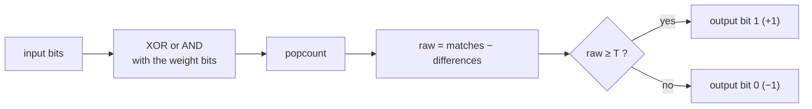
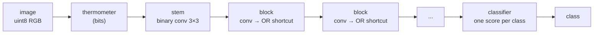
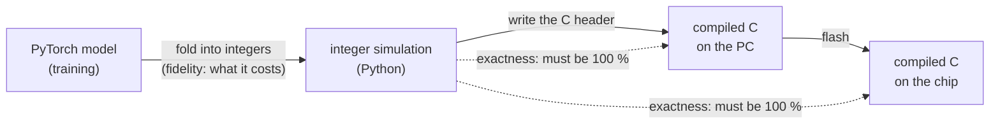

# How SYMBEX-1 works

*[Leer en español](how-it-works.es.md)*

A neural network spends almost all of its time computing dot products: multiply every input by a weight and add.
SYMBEX-1 makes the inputs and the weights **one bit** each. A dot product then needs no multiplication at all: it
becomes **a bit count**, which a microcontroller does with a few logic instructions. This page explains how, step by
step, and how SYMBEX-1 guarantees that the chip computes exactly what the trained model computes.

## 1. A dot product made of bits

In a binary network every value is **+1 or −1**, stored as one bit (1 for +1, 0 for −1). The product of two such values
is +1 when the bits are equal and −1 when they differ. So the dot product of two vectors of `n` values is

$$\text{raw} = (\text{bits equal}) - (\text{bits different}) = n - 2 \cdot \text{popcount}(x \oplus w)$$

where `x ⊕ w` (XOR) marks the bits that differ and `popcount` counts them. One 32-bit word holds 32 values, so one XOR
and one count replace 32 multiplications and 32 additions.

**Example with 8 values:**

| | bits | values |
|---|---|---|
| input `x` | `1 0 1 1 0 0 1 0` | +1 −1 +1 +1 −1 −1 +1 −1 |
| weights `w` | `1 0 0 1 1 0 1 0` | +1 −1 −1 +1 +1 −1 +1 −1 |
| `x XOR w` | `0 0 1 0 1 0 0 0` | 2 bits differ |

`raw = 8 − 2 · 2 = 4`: six products of +1 and two of −1, the same as multiplying and adding.

Some chips count faster with AND than with XOR. The same number comes out of

$$\text{bits different} = \text{popcount}(x) + \text{popcount}(w) - 2 \cdot \text{popcount}(x \wedge w)$$

(in the example: `4 + 4 − 2 · 3 = 2`). The library uses whichever form the chip runs faster (section 5).

## 2. One layer: count, then compare with a threshold

After the count, a normal network applies a scale, a BatchNorm and an activation, all in floating point. In SYMBEX-1
those steps are **folded into one integer per output**, a threshold `T`, so a layer only does this:

The output is bits again, ready for the next layer. There is **no floating point anywhere** in the inference.

### Where the threshold comes from

During training, after the count the layer computes a BatchNorm and then takes the sign:

$$\text{bit} = \left[\;\gamma \cdot \frac{\text{raw} - \mu}{\sigma} + \beta \;\geq\; 0\;\right]$$

`γ, β` are learned and `μ, σ` are the running statistics. When `γ > 0` this is the same as

$$\text{raw} \;\geq\; \mu - \frac{\beta\,\sigma}{\gamma}$$

and since `raw` is an integer, the right side can be rounded up: `T = ⌈μ − βσ/γ⌉`. When `γ < 0` the inequality flips;
the exporter negates that output's weight row (which negates `raw`) and the C still only does `raw ≥ T`. The result is
identical to the floating-point layer for every possible input: it is not an approximation.

The dense networks fold more into the same threshold: the weight scale, the bias, the normalization of the input and
the threshold of the next layer's binarization.

## 3. The input and the output

**The input.** A camera or a sensor gives bytes, not bits. There are two ways in:

- **Thermometer (convolutional networks).** Each color of each pixel becomes `levels` bits: bit `k` is 1 when the
  value is at least `(k + 1) · 256 / (levels + 1)`. With 8 levels a pixel becomes 24 bits and the first layer is binary
  like the rest.
- **Bytes directly (dense networks).** The first layer reads the `uint8` values and adds those whose weight is +1 and
  subtracts those whose weight is −1. That is still a sum without multiplications, and the input normalization goes
  into the thresholds.

**The output.** The last layer is the only one that does not end in a bit: it computes one score per class,
`scale · raw + bias`, with integer scale and bias (fixed point, 64-bit products). The class with the largest score wins
(the first one, if two are equal).

## 4. A whole network

Convolutional networks (`layers/conv/symbex_bool`) need three more pieces, all on bits:

| Piece | On bits it is | Why |
|---|---|---|
| 2 × 2 pooling | OR of the 4 pixels | the maximum of four ±1 values is +1 when any of them is +1 |
| residual shortcut | OR of two maps | the block's output and its shortcut are merged without adding numbers |
| change of shape | a 1 × 1 binary convolution after the pooling | when a block halves the size or changes the channels |

The maps are stored with the channels of each pixel together, 32 channels per word, so a 3 × 3 window is a short run
of words, copied once per position and compared against every weight row.

## 5. Counting bits on each chip

Not every chip counts bits the same way. The hardware layer (HAL) of the library picks the method; `tools/dev/count_bench.py`
measured them on each chip.

| Chip | How it counts |
|---|---|
| x86, AArch64 | the native popcount instruction |
| RP2350 (Pico 2), Hazard3 RISC-V core | the native `cpop` instruction (Zbb extension) |
| RP2350 (Pico 2), Cortex-M33 core | a 16-bit table (`lut16`) |
| ESP32 | a 16-bit table (`lut16`) or SWAR |
| ESP32-S3 | the SIMD unit (PIE): its multiplier adds the bits (`pie_swar`) |
| AVR (Arduino Uno) | an 8-bit table (`lut8`) |

Every counting function also has a `*_rows` form that computes a whole layer in one call, so the setup cost is paid
once per layer instead of once per neuron.

## 6. Exact, always

A model is only useful on a chip if the chip computes **exactly** what was validated on the PC. SYMBEX-1 checks it at
every step:

- **Fidelity** compares the trained model with its integer simulation: what folding into integers costs. The binary
  layers fold exactly (an integer compared with a rounded-up threshold gives the same bit); the scores of the last
  layer are rounded to fixed point and can change a few predictions. The CDT reports it.
- **Exactness** compares the integer simulation with the compiled C, image by image. It must be **100 %**, on the PC
  and on the chip. Anything else is a bug in the export or in the engine, and the CDT reports it as
  `[X] MISMATCH`.

## Where to look in the code

| Topic | File |
|---|---|
| Folding convolutional networks (thresholds, classifier) | [`tools/compiler_core/export/boolean.py`](../tools/compiler_core/export/boolean.py) |
| Folding dense networks | [`tools/compiler_core/export/dense.py`](../tools/compiler_core/export/dense.py) |
| The binary convolution, thermometer, OR pool and shortcut in C | [`layers/conv/symbex_bool.h`](../Symbex1_PIO/lib/lib_symbex/include/layers/conv/symbex_bool.h) |
| The hardware layer (bit counting per chip) | [`include/hal/symbex_hal.h`](../Symbex1_PIO/lib/lib_symbex/include/hal/symbex_hal.h) |
| Measuring the counting methods of a chip | [`tools/dev/count_bench.py`](../tools/dev/count_bench.py) |
