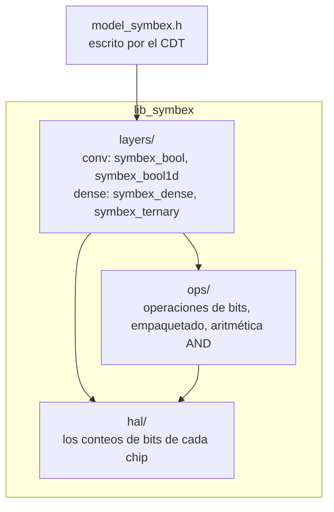

# lib_symbex: el motor en C

*[Read in English](library.md)*

lib_symbex ejecuta las redes que exporta el [CDT](cdt.es.md). Es C simple sin dependencias, la memoria del modelo es
estática, y cada modelo que ejecuta se comprobó bit a bit contra la simulación entera del CDT. Vive en
`Symbex1_PIO/lib/lib_symbex/`, y las mismas fuentes compilan para la PC, el ESP32, el ESP32-S3 y la Raspberry Pi Pico 2
(ambos núcleos), además de para PULP en el benchmark 1D.

## Usarla en un proyecto

El CDT escribe un header por modelo, `model_symbex.h`. Contiene los pesos, los umbrales y los buffers, y todos los
modelos ofrecen la misma llamada:

```c
#include "model_symbex.h"

int cls = symbex_mlp_infer(input);   // entrada uint8 -> índice de la clase
```

En los modelos convolucionales, `input` es una imagen RGB (uint8, orden HWC); en los densos, es el vector de entrada.
`SYMBEX_MLP_N_INPUTS` y `SYMBEX_MLP_N_CLASSES` dan los tamaños. Los pesos y los buffers son arreglos estáticos, y no hay
llamada de inicialización. La única reserva de memoria es la tabla de conteo de 64 KB de la HAL (tabla de 16 bits, en
el ESP32 y el M33), hecha una vez en el primer conteo; si no hay RAM para ella, la HAL usa SWAR.

`Symbex1_PIO/` es el proyecto mínimo de PlatformIO. `src/main.cpp` ejecuta una red de demostración pequeña y compara
cada imagen con la clase que dio la simulación en la PC ("8/8 equal"). Para ejecutar un modelo real, copia su
`model_symbex.h` sobre `src/model_symbex.h` y borra `src/demo_input.h`; `main.cpp` explica los tres pasos.

Fuera de PlatformIO, compila `src/` con `include/` en la ruta de includes. Solo hace falta una HAL: `src/hal/esp32s3/`
en el ESP32-S3, `src/hal/generic/` en todos los demás (más `src/hal/rp2350/` en la Pico 2).

## Cómo está organizada



| Carpeta | Qué contiene |
|---|---|
| `include/layers/conv/` | `symbex_bool.h`: redes 2D completamente binarias (entrada termómetro, convoluciones binarias con umbrales enteros, pool OR, atajo OR, clasificador o cabeza de detección por celda, y el ejecutor de la red completa `symbex_bool_net_run`). `symbex_bool1d.h`: convoluciones 1D binarias para series de tiempo, con cualquier número de canales y un pool OR fusionado |
| `include/layers/dense/` | `symbex_dense.h`: capas densas de 1 bit (primera capa uint8, luego bits con un umbral entero por neurona). `symbex_ternary.h`: pesos en {-1, 0, +1} |
| `include/ops/` | operaciones de bits, empaquetado de bits, la forma AND de los conteos |
| `include/hal/symbex_hal.h` | la interfaz que implementa cada chip: los conteos de bits y los kernels de la primera capa |
| `include/core/` | tipos y los ejecutores de redes densas / conv del motor anterior |

Los demás archivos de `layers/` (`symbex_conv2d`, `symbex_bpr`, `symbex_binary_pool`, `symbex_gated`) pertenecen a
versiones anteriores del motor: todavía compilan, y los tests todavía los cubren a todos menos `symbex_gated`, pero
ninguna exportación actual los usa.

## Una capa binaria en C

Todas las capas de las redes completamente binarias tienen la misma forma:

```c
struct SymbexBoolConv {
    uint16_t in_ch, out_ch, kernel, stride;
    uint16_t in_h, in_w, out_h, out_w;
    uint16_t row_words;               // words per weight row
    const uint32_t* weights;          // one packed row of bits per output channel
    const int32_t*  thresholds;       // out bit = raw >= thresholds[o]
    const int16_t*  weight_counts;    // popcount of the weights per kernel pixel (image borders)
};
```

Los mapas son bits en orden HWC: el canal c de un píxel es el bit c % 32 de la palabra c / 32. Para cada posición de
salida, la capa arma la ventana una vez, empaquetada (16 canales × 9 píxeles = 144 bits llenan 5 palabras, no 9), y
cuenta la capa entera en una llamada a la HAL. Luego compara cada conteo con el umbral de su canal. El CDT ya plegó el
BatchNorm y el signo en ese umbral, así que no hay ninguna otra aritmética.

`weights`, `thresholds` y `weight_counts` son `const`, así que se quedan en flash en el ESP32 (mapeada en memoria) a
menos que la exportación los ponga en RAM.

## La HAL: cómo cuenta bits cada chip

Toda la aritmética de una red binaria es contar bits. La HAL es donde cada chip lo hace a su manera, elegida al
compilar:

| Chip | Cómo cuenta | Dónde |
|---|---|---|
| x86, AArch64 | la instrucción popcount de la CPU | `hal/generic` |
| RP2350 Hazard3 (RISC-V) | `cpop` (Zbb) | `hal/generic` + `hal/rp2350` |
| RP2350 Cortex-M33 | tabla de 16 bits (64 KB en RAM); `usada8` (DSP) para la primera capa | `hal/generic` + `hal/rp2350` |
| ESP32 (Xtensa LX6) | tabla de 16 bits (64 KB en RAM), o SWAR cuando no hay RAM para ella | `hal/generic` |
| ESP32-S3 (Xtensa LX7) | la unidad SIMD PIE (`pie_swar`), 128 bits a la vez | `hal/esp32s3` |
| AVR (Arduino Uno) | tabla de 8 bits en flash | `hal/generic` |
| cualquier otro | SWAR (C portable) | `hal/generic` |

Estas elecciones salen de mediciones, no de suposiciones: `tools/dev/count_bench.py` mide cada método en cada chip y
guarda el más rápido por tamaño de capa en `tools/chip_profiles/`. Por ejemplo, en el M33 de la Pico 2 la tabla de 16
bits es 1.8× más rápida que SWAR, y en Hazard3 `cpop` es 1.25× más rápido que SWAR.

Cada conteo tiene una forma `*_rows` que calcula una capa entera en una llamada, así que el costo fijo de una llamada
(comprobaciones, preparar la tabla, registros SIMD) se paga una vez por capa en vez de una vez por neurona.

La HAL también responde qué forma del conteo es más rápida en el chip (`symbex_hal_prefers_xor`): la forma XOR cuenta
las diferencias directamente, y la forma AND usa `popcount(x) + popcount(w) − 2·popcount(x AND w)` con los conteos de
pesos guardados. Las dos dan los mismos bits.

**Flags de compilación** (para medir, o para un chip que la detección automática no conoce):

| Flag | Efecto |
|---|---|
| `-DSYMBEX_POPCOUNT_FORCE_SWAR`, `_LUT16`, `_LUT8` | fuerza un método |
| `-DSYMBEX_POPCOUNT_FORCE_NATIVE` | el `__builtin_popcount` del compilador, para un núcleo donde se convierte en una instrucción (el `p.cnt` de PULP) |
| `-DSYMBEX_POPCOUNT_NO_LUT16` | sin la tabla de 64 KB: devuelve esa RAM en el ESP32 o el M33 |
| `-DSYMBEX_U8_EXTERNAL` | la aplicación da sus propios kernels de primera capa (ejemplo: `benchmarks/conv1d/har_ultracompact/pulp/`) |

`symbex_hal_name()` devuelve como texto el método en uso, útil en los logs.

**Un chip nuevo** solo necesita `hal/generic` para funcionar (SWAR es portable). Para que sea rápido, mídelo con
`count_bench.py` y añade su método a `hal/generic` si es una instrucción que el compilador ya emite, o una carpeta
`hal/<chip>/` si necesita su propio código (como el PIE del S3).

## Tests

```
python Symbex1_PIO/lib/lib_symbex/tests/run_tests.py            # cada capa contra una referencia en Python
python Symbex1_PIO/lib/lib_symbex/tests/run_tests.py --stress   # + sanitizers y tamaños límite
```

Los tests compilan la librería con gcc en varias configuraciones de la HAL: genérica, el modo C del S3, el conteo
nativo forzado, los caminos AVR de 8 bits y los dos kernels de primera capa del RP2350. Cada capa debe dar los mismos
resultados que una referencia en numpy en cada una de ellas. Los chips en sí los comprueba la etapa chip del CDT: la red
completa, imagen por imagen, contra la simulación.
