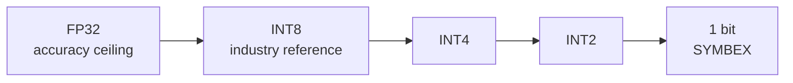
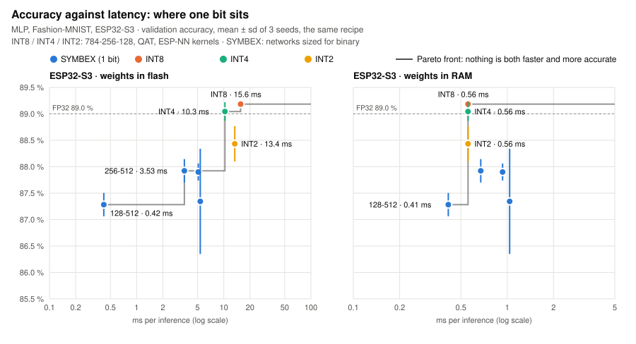

# Methodology: how SYMBEX-1 measures

*[Leer en español](methodology.es.md)*

Every benchmark in SYMBEX-1 follows the same standard, so that any result can be checked, repeated and compared with
the others. This page is that standard in one place: what is compared, against what, how, and how to repeat it.
The only exception is the 1D benchmark against Daghero et al. (`benchmarks/conv1d/har_ultracompact`), which follows
the networks and the simulator of that paper.

## The question

A fully binary network stores each weight and each activation in **one bit** and replaces multiplication by counting
bits. The question SYMBEX-1 answers is not "is it faster than X", but **where one bit sits** among the ways of running
the same network on the same microcontroller: how much accuracy, time, memory (and, soon, energy) each number of bits
costs.

The result of a benchmark is therefore a **Pareto front** per chip: accuracy against latency (and against flash and
RAM). A method is worth using where nothing else on the chart is both more accurate and cheaper.

<picture>
  <source media="(prefers-color-scheme: dark)" srcset="assets/pareto_mlp_dark.svg">
  
</picture>

The first chart drawn this way, mlp_fashion on the ESP32-S3 (validation accuracy, mean ± sd of 3 seeds, the same
recipe for every method; INT8 / INT4 / INT2 = 784-256-128 with quantization-aware training on ESP-NN kernels, latency
of seed 42; SYMBEX = the networks sized for binary; FP32 ceiling 89.0 %):

| Method | Network | Validation | ms, weights in flash | ms, weights in RAM |
|---|---|---|---|---|
| INT8 | 784-256-128 | 89.18 ± 0.03 % | 15.6 | 0.56 |
| INT4 | 784-256-128 | 89.04 ± 0.18 % | 10.3 | 0.56 |
| INT2 | 784-256-128 | 88.43 ± 0.33 % | 13.4 | 0.56 |
| SYMBEX | 784-128-512 | 87.28 ± 0.22 % | **0.42** | **0.41** |
| SYMBEX | 784-256-512 | 87.92 ± 0.22 % | 3.53 | 0.67 |
| SYMBEX | 784-384-512 | 87.90 ± 0.16 % | 5.10 | 0.93 |
| SYMBEX | 784-512-256 | 87.34 ± 1.00 % | 5.37 | 1.04 |

What it says, plainly: with the weights in flash, one bit owns the fast end of the curve (784-128-512 is 37× faster
than INT8 for 1.9 points less) and INT4 beats INT2 on both axes (unpacking 2-bit codes costs more than it saves);
with the weights in RAM the gap closes to 1.34× for the same 1.9 points, and INT8 beats every larger SYMBEX network.
The other benchmarks get the same chart as their INT4 / INT2 baselines are measured (see the last table).

## Three kinds of reference, three questions

| Reference | The question it answers | What it is |
|---|---|---|
| **INT8**: TensorFlow Lite Micro (ESP-NN kernels on the ESP32s, CMSIS-NN on the Pico 2's Cortex-M33); ESP-DL on the ESP32-S3 | What does someone who deploys with the standard tool today gain? | The industry reference, the most used. Built for accuracy, not for the smallest cost |
| **INT4 / INT2**: [`tools/lowbit`](../tools/lowbit/README.md), multiply-accumulate on the same ESP-NN kernels | At the same bit budget, does counting bits beat multiplying? | The direct competitor in efficiency. Fair by construction, but our own implementation: no official toolchain runs INT2 |
| **Another binary engine**: ultracompactBNN (Daghero et al. 2021) | Is SYMBEX a better implementation of the same idea? | Only in the 1D benchmark, the exception above |

INT8 tells the reader what changes against what they already use; INT4 and INT2 tell whether one bit is the right
place on the curve; the other engine tells whether the implementation is good.

## The standard

Every benchmark ticks this list. A box left empty is written in the benchmark's README as future work.

**Model**
- [ ] The **official architecture** (MLPerf Tiny, Edge Impulse, the paper's) and, if SYMBEX is resized, the **same
      resized shape** for every method.
- [ ] One FP32 starting model per seed, shared by every method; its sha256 recorded.
- [ ] The same recipe for every method: epochs, optimizer, seeds 42 / 43 / 44, data split. When a recipe favors one
      method (distillation against labels only), both recipes are shown.

**Data**
- [ ] A validation split carved out of the training data (the CDT's `load_data` returns train, validation, test).
- [ ] Every choice (checkpoint, threshold, variant, shape) made on validation. The **test set is used once**, on the
      final models, and the README says when.

**Methods**
- [ ] FP32 (the ceiling), INT8 (TFLite Micro), INT4, INT2 (`tools/lowbit`), SYMBEX.
- [ ] Hybrids (an int8 first layer or classifier inside a binary network) are labelled as such, with their
      **average bits per weight** (all weight bits / number of weights); "fully binary" means 1 bit everywhere.

**On the chip**
- [ ] Boards: ESP32 (no SIMD), ESP32-S3 (PIE SIMD), Raspberry Pi Pico 2 Cortex-M33 and Hazard3 RISC-V.
- [ ] Stock clock (240 MHz on both ESP32s, 150 MHz on the Pico 2), one core, the median over 1000 inferences.
- [ ] **Weights in flash first** (how a model is normally deployed), then weights in RAM. Every method compared has
      its weights in the same place.
- [ ] **Exact**: the board gives the same output as the integer simulation on 100 % of the inputs, image by image,
      for SYMBEX and for the integer baselines.

**Reported**
- [ ] Accuracy (validation; test once), latency (ms), flash and RAM (measured on the chip), energy when measured.
- [ ] Means ± standard deviation over the 3 seeds. A single seed is called a ranking, not a result.
- [ ] Differences smaller than the standard deviations are called a tie.
- [ ] Figures that are not measured are called **estimates** and say where they come from.

## Predict first, then measure

Before a new network goes on a chip, its cost is predicted from counted operations and the chip's measured cost per
operation (`tools/dev/count_bench.py`, profiles in `tools/chip_profiles/`): for SYMBEX the words that go through a
bit count, for INT8 / INT4 / INT2 the multiply-accumulates. The prediction says where on the curve each method should
fall and where INT2 or INT4 should catch up with one bit; the measurement confirms it or shows what the model misses.
Both are reported, the prediction labelled as an estimate.

## Two ways to read the chart

| Reading | The question | How |
|---|---|---|
| **Same accuracy** | Which method reaches this accuracy at the lowest cost? | Size each method until it reaches the target on validation; compare ms, flash, RAM |
| **Same budget** | With this budget (say 30 ms and 64 KB), which method is most accurate? | Keep the methods that fit; compare accuracy |

The first is what a researcher asks; the second is what someone deploying asks.

## Optimization effort, said openly

| Method | Who tuned it |
|---|---|
| INT8 TensorFlow Lite Micro | Google / Espressif / Arm kernels, used as shipped, no tuning by us |
| INT8 ESP-DL (ESP32-S3) | Espressif's most optimized INT8 path: the strongest INT8 we know on that chip |
| INT4 / INT2 (`tools/lowbit`) | Our C around ESP-NN's kernels; unpacking to int8 is our code |
| SYMBEX | Tuned by us, per chip |

So a SYMBEX speed-up over TensorFlow Lite Micro is a speed-up over the usual deployment path, not over the fastest
INT8 possible; where ESP-DL is measured, both are shown.

## Repeat a benchmark

Every benchmark has the same steps and the same folders:

| Step | Command (from the benchmark's folder) | Output |
|---|---|---|
| 1. FP32, SYMBEX training, export, simulation | `python <bench>_symbex.py --seeds 3` | `runs/<run>_s<seed>/` |
| 2. SYMBEX on a board | `python <bench>_symbex.py --seeds 3 --board <board> --port <port>` (`--weights ram` after) | `results/symbex/` |
| 3. INT8 TensorFlow Lite Micro | `python <bench>_tflite.py --board <board> --port <port>` | `results/tflite/` |
| 4. INT4 / INT2 | `python <bench>_lowbit.py ...` | `results/lowbit/` |
| 5. Charts | `python tools/dev/docs_charts.py` (from the root) | `docs/assets/` |

Boards: `esp32`, `s3` (its native USB port: `--usb`), `pico2_arm`, `pico2_riscv`. Each README lists the exact commands
it was measured with. Superseded results move to `results/earlier/`; nothing measured is deleted.

**Without training.** Each benchmark's `reference/` folder ([mlp_fashion](../benchmarks/mlp/mlp_fashion/reference/README.md), [mlp_digits](../benchmarks/mlp/mlp_digits/reference/README.md), [ResNet-8](../benchmarks/conv2d/cnn_cifar_resnet8/reference/README.md), [FOMO](../benchmarks/conv2d/fomo_voc_person/reference/README.md), [HAR](../benchmarks/conv1d/har_ultracompact/reference/README.md)) holds one ready model,
seed 42: the FP32 starting model, the SYMBEX header ready to compile, the INT8 `.tflite`, the configuration it was
trained with and a card with its accuracy, latency and memory per board. It is enough to build the model into a
project or to measure it on a board without retraining.

## What a result file records

Each JSON written to `results/` records the board, the placement of the weights, the counting mode, the engine, the
image count, accuracy, latency (median and minimum), flash, RAM and whether the board equals the simulation. Still
to be added to every file, so that results from different dates cannot be mixed again: the library commit, the
toolchain versions, the clock and the sha256 of the FP32 model.

## Limits

- INT4 and INT2 run on our own code around ESP-NN: a fair baseline, but not an official toolchain. No official INT2
  kernel exists on these chips.
- ESP-NN only exists for Espressif chips; on the Pico 2 the integer baselines below INT8 need another kernel library.
- ESP-DL was measured once, outside this repository, on the ESP32-S3 only.
- Energy has not been measured yet: latency is not energy.
- The 1D benchmark follows Daghero et al.'s setup, not this standard.

## Where each benchmark stands

| Benchmark | INT8 (TFLite Micro) | INT4 / INT2 | Pico 2 | ESP-DL |
|---|---|---|---|---|
| [mlp_fashion](../benchmarks/mlp/mlp_fashion/README.md) | ESP32, S3, both Pico 2 cores | accuracy (PC), ESP32, S3 | SYMBEX and INT8 | S3 (outside the repository) |
| [mlp_digits](../benchmarks/mlp/mlp_digits/README.md) | ESP32, S3 | to do | to do | to do |
| [cnn_cifar_resnet8](../benchmarks/conv2d/cnn_cifar_resnet8/README.md) | ESP32, S3, both Pico 2 cores | to do (`tools/lowbit` does not fold skip connections yet) | SYMBEX and INT8 | S3 (outside the repository) |
| [fomo_voc_person](../benchmarks/conv2d/fomo_voc_person/README.md) | S3 (INT8 does not fit the ESP32) | to do | SYMBEX only | to do |
| [har_ultracompact](../benchmarks/conv1d/har_ultracompact/README.md) | ESP32, S3 | accuracy only (PC) | SYMBEX only | the exception: compared with ultracompactBNN on GVSoC |
