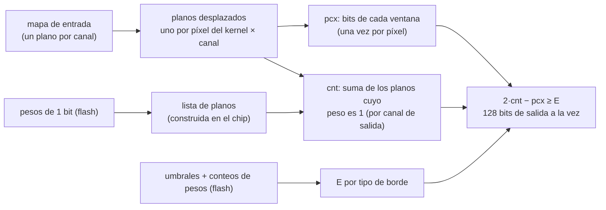

# El motor vertical: ResNet-8 en 6.4 ms en el ESP32-S3

*[Read in English](vertical.md)*

El motor vertical es una segunda forma de ejecutar las redes convolucionales totalmente binarias de SYMBEX-1
(`layers/conv/symbex_bool`). Ejecuta **la misma red exportada, con los mismos datos en flash y los mismos bits de
salida**, pero da la vuelta a los bucles: en lugar de contar los bits de una ventana a la vez, cuenta **128 ventanas a la
vez**, un bit de cada una en un registro de 128 bits. En el ESP32-S3 esto usa la unidad SIMD PIE para lo que mejor hace
(lógica de 128 bits), y la ResNet-8 totalmente binaria corre **3.8× más rápido que el motor estándar y 1.43× más rápido
que ESP-DL INT8 de Espressif** con los pesos en flash. Dos modos opcionales construyen una vez en RAM, al arrancar, las
listas de planos y los umbrales del motor: **preparado** (6.44 ms, 1.52× más rápido que ESP-DL con sus pesos en RAM,
238 KB de RAM) y **compacto** (7.70 ms, 1.27× más rápido que ESP-DL en RAM con casi la misma RAM: 151 KB frente a
147 KB). Lo elige quien despliega la red.

## Resultados

ResNet-8 en CIFAR-10, la forma de MLPerf Tiny (16-32-64 canales), en el ESP32-S3 a 240 MHz, mediana de 1000 imágenes de
validación, cada imagen **100 % igual a la simulación entera**. SYMBEX: media ± desviación estándar sobre las 3 semillas
(42, 43, 44), modo de conteo `swar` (el motor vertical no usa la tabla de 64 KB):

| Motor / librería | Pesos en flash | Pesos en RAM | RAM (pesos en flash) | Flash del modelo |
|---|---|---|---|---|
| **Motor vertical de SYMBEX, preparado (opcional)** | **6.44 ± 0.02 ms** | **6.44 ± 0.02 ms** | 238.0 KB | 24.3 KB |
| **Motor vertical de SYMBEX, compacto (opcional)** | **7.70 ± 0.05 ms** | **7.70 ± 0.05 ms** | 150.8 KB | 24.3 KB |
| **Motor vertical de SYMBEX** | **10.36 ± 0.05 ms** | **10.36 ± 0.05 ms** | 62.6 KB | 24.3 KB |
| Motor estándar de SYMBEX | 39.19 ms | — | 14.8 KB | 24.3 KB |
| ESP-DL INT8 (comprobación rápida, 2 nov) | 14.8 ms | 9.8 ms (147 KB de RAM) | sin registrar | — |
| TFLite Micro INT8 (ESP-NN) | 52.0 ms | — | 80.5 KB | 96.2 KB |

- Con los pesos en flash, el despliegue que usa todo el mundo, el motor vertical es **1.43× más rápido que ESP-DL** y
  5.0× más rápido que TFLite Micro, con menos RAM que TFLite Micro.
- Con los pesos en RAM, ESP-DL va un poco por delante del motor vertical por defecto (9.8 ms frente a 10.4 ms, 1.06×),
  usando 147 KB de RAM. El modo **compacto** es **1.27× más rápido que ESP-DL en RAM** (7.70 ms frente a 9.8 ms) con
  casi la misma RAM (151 KB, con los pesos de SYMBEX todavía en flash), y 1.92× más rápido que ESP-DL en flash. El modo
  **preparado** es **1.52× más rápido que ESP-DL en RAM** (6.44 ms) y 2.3× más rápido que ESP-DL en flash, con más RAM:
  238 KB.
- SYMBEX no se acelera con sus pesos en RAM: sus 24 KB de pesos ya se quedan en la caché de datos. La columna de RAM es
  con los pesos en flash; con ellos en RAM suma 24 KB (87.0, 175.1 y 262.4 KB).
- La precisión no cambia con el motor (mismos bits). La ResNet-8 binaria sigue siendo menos precisa que INT8
  (71.3 ± 0.8 % frente a 87.0 %, ver [Resultados](results.es.md)).
- Los números de ESP-DL vienen de una comprobación rápida (scripts fuera del repositorio, cuantización post-entrenamiento,
  100 entradas de test), no de un benchmark completo.

Tiempo por paso en el chip (semilla 42, pesos en flash, `swar`; medido antes del ajuste de abajo, que llevó los totales
de 11.09 a 10.36 ms y de 7.36 a 6.44 ms):

| Paso | Estándar | Vertical | Aceleración | Vertical, preparado |
|---|---|---|---|---|
| termómetro + stem 24→16, 32×32 | 7.84 ms | 2.09 ms | 3.8× | 1.72 ms |
| bloque 0: conv 16→16, 32×32 | 7.73 ms | 1.29 ms | 6.0× | 1.01 ms |
| bloque 1: conv 16→16, 32×32 | 7.73 ms | 1.29 ms | 6.0× | 1.01 ms |
| bloque 2: conv 16→32, stride 2, + OR pool + 1×1 | 5.40 ms | 1.15 ms | 4.7× | 0.83 ms |
| bloque 3: conv 32→32, 16×16 | 4.28 ms | 1.23 ms | 3.5× | 0.69 ms |
| bloque 4: conv 32→64, stride 2, + OR pool + 1×1 | 3.01 ms | 1.71 ms | 1.8× | 1.00 ms |
| bloque 5: conv 64→64, 8×8 | 3.13 ms | 2.17 ms | 1.4× | 0.95 ms |
| clasificador | 0.06 ms | 0.17 ms | 0.35× | 0.16 ms |
| **total** | **39.19 ms** | **11.09 ms** | **3.5×** | **7.36 ms** |

Los mapas grandes son los que más ganan: un registro guarda 128 píxeles de salida, y un mapa de 8×8 solo tiene 64. El
clasificador es más lento porque primero el mapa final se convierte de planos al formato estándar. El modo preparado
ahorra el tiempo de construir en el chip la lista de planos y los umbrales de cada salida, sobre todo en los bloques de
8×8 y 16×16, donde cada lista se usa para pocos tiles.

## La fórmula

Una capa totalmente binaria calcula, para cada píxel de salida y canal de salida `o`
([Cómo funciona](how-it-works.es.md), sección 2):

$$\text{raw} = (\text{bits iguales}) - (\text{bits distintos}) \quad\text{sobre la parte de la ventana dentro de la imagen}, \qquad
\text{out} = \text{raw} \ge T_o$$

Con `n` los bits válidos de la ventana, `pcx` los bits de la ventana que valen 1, `pw` los pesos que valen 1 en las
posiciones válidas, y `cnt` las posiciones donde ambos valen 1, los bits distintos son `d = pcx + pw − 2·cnt`, así que

$$\text{raw} = n - 2d = n - 2\,\text{pcx} - 2\,\text{pw} + 4\,\text{cnt} \ge T_o
\;\Longleftrightarrow\; 2\,\text{cnt} - \text{pcx} \ge \frac{T_o + 2\,\text{pw} - n}{2}$$

El lado izquierdo es un entero, así que la condición es exactamente

$$\boxed{\,2\,\text{cnt} - \text{pcx} \ge E, \qquad E = \left\lceil \frac{T_o + 2\,\text{pw} - n}{2} \right\rceil\,}$$

- `cnt` depende de la entrada y de los pesos: es **el único conteo por canal de salida**.
- `pcx` depende solo de la entrada: se cuenta **una vez por píxel**, compartido por todos los canales de salida.
- `E` depende de los pesos y de qué píxeles del kernel caen dentro de la imagen (`pw` y `n`), no de la entrada: se
  calcula una vez por canal de salida y **tipo de borde** (abajo), cuando empieza la capa.

`E` se recorta a `[−K, K + 1]` (`K = k·k·C_in`), lo que conserva todos los resultados: por debajo de `−K` la salida
siempre es 1, por encima de `K` siempre es 0.

## La nueva lógica de inferencia

El motor estándar trabaja **en horizontal**: para un píxel de salida copia la ventana a un buffer y luego cuenta sus bits
contra la fila de pesos de cada canal de salida. El motor vertical trabaja **en vertical** (bit-sliced): un **plano** de
128 bits guarda un bit de 128 píxeles de salida, y los conteos también se guardan como planos (plano `i` = bit `i` del
conteo de los 128 píxeles).



1. **Planos de canal.** Un mapa se guarda como un plano por canal: el bit `p` del plano `c` es el píxel `p` (por filas)
   del canal `c`. Cada plano tiene palabras a cero antes y después, que hacen de relleno con ceros de la convolución.
2. **Planos desplazados.** Para cada píxel del kernel `(kh, kw)` y canal de entrada `c`, el plano de `c` se desplaza
   `(kh − 1)·W + (kw − 1)` bits, y se enmascaran los píxeles cuya columna de origen cae fuera de la imagen. Eso da
   `K = k·k·C_in` planos por bloque de 128 píxeles de salida, en el orden de los bits de una fila de pesos
   (`q·C_in + c`). Stride 2: cada plano de entrada se divide primero en sus 4 fases (filas pares/impares × columnas
   pares/impares), y luego los desplazamientos se hacen sobre la malla de salida.
3. **Conteo vertical.** Sumar `N` planos bit a bit se hace con **sumadores carry-save** (Harley-Seal): cada 8 planos
   cuestan 7 sumadores de 5 instrucciones lógicas cada uno y dejan un plano de "ochos", que se vuelve a contar igual. En
   el S3 cada instrucción trabaja sobre 128 píxeles (`ee.andq`, `ee.xorq`, `ee.orq` sobre los registros `q`).
   - `pcx`: la suma de los `K` planos del bloque, una vez por capa y bloque.
   - `cnt` del canal de salida `o`: la suma de **solo los planos cuyo peso es 1**. En lugar de hacer AND de cada plano
     con su peso, el motor recorre una **lista** de esos planos (desplazamientos en bytes), así que un canal de salida
     con `m` pesos a 1 cuesta `m` cargas de plano, no `K`.
4. **Umbral, 128 salidas a la vez.** El bit de salida es el signo de `2·cnt − pcx − E`. El motor suma tres operandos de
   12 bits, bit-sliced: `V = 2·cnt + (2048 − pcx) + (2048 − E)`. Entonces `V = 4096 + (2·cnt − pcx − E)`, y como
   `|2·cnt − pcx − E| < 4096`, **el bit de salida es el bit 12 de V**. Una suma carry-save más una cadena de acarreo lo
   da para los 128 píxeles en unas 110 instrucciones, sin comparaciones ni saltos.
5. **Tipos de borde.** `E` cambia donde la ventana pierde píxeles del kernel en el borde de la imagen. Las filas de salida
   se agrupan según qué filas del kernel caen dentro de la imagen (arriba, en medio, abajo) y las columnas igual, así que
   una capa 3×3 tiene como mucho 3 × 3 = 9 tipos. El operando de umbral de un bloque es el plano del tipo más común,
   corregido con las máscaras de carril de los otros tipos donde su `E` es distinto; los bloques con las mismas máscaras
   lo comparten.

### Qué se calcula en el chip, para que la flash siga pequeña

Los datos exportados no cambian: las mismas filas de pesos de 1 bit, los mismos umbrales y conteos de pesos por píxel
(24 KB para ResNet-8). Los datos extra que necesita el motor se construyen en el chip, mientras corre la capa:

- **Las listas de planos**, a partir de los pesos de 1 bit, un byte (8 pesos) por paso con una tabla de 256 entradas y
  sin saltos (1.5 ms para todas las convs en el estudio por capas). Las listas y umbrales precalculados ocuparían 181 KB
  de flash en lugar de 27 KB, y con la caché fría corrían más lento (14.3 ms para todas las convs, frente a 9.5 ms
  construidos en el chip).
- **Los operandos de umbral** por canal de salida y tipo de borde, a partir de `T_o` y los conteos de pesos.

## Ajuste (3 nov)

Una revisión del código propuso seis cambios. Cada uno se construyó como una variante propia y se midió en el S3
(semilla 42, pesos en flash, 300 imágenes, todas las corridas 100 % exactas) antes de quedarse o descartarse, uno encima
del otro:

| Cambio | Vertical | Preparado | Se queda |
|---|---|---|---|
| antes | 11.02 ms | 7.36 ms | |
| D: `count_finish` limpia solo los planos de conteo que lee el umbral | 10.95 ms | 7.29 ms | sí |
| C2: `shift_plane` desenrollado, cuatro palabras de 32 bits por paso | 10.48 ms | 6.83 ms | sí |
| C1: el clasificador lee los planos finales con `transpose32` en lugar de bit a bit (0.178 → 0.110 ms) | 10.41 ms | 6.78 ms | sí |
| B: los planos de fase del stride 2 comparten el bloque de trabajo con otros buffers | 10.44 ms | 6.79 ms | sí (2.7 KB menos de RAM) |
| C3: tipos de tile calculados una vez (en el init, o en el bloque preparado), no en cada inferencia | **10.34 ms** | **6.40 ms** | sí |
| A: los tiles en el bucle de fuera (buffer de planos desplazados más pequeño) | 10.41 ms | 7.09 ms | no: más lento |

A solo ahorra RAM en capas más anchas que las de ResNet-8 (su mayor buffer de planos desplazados es de 19.5 KB) y obliga
a reconstruir listas y umbrales en cada tile, así que se descartó. El modo compacto vino después de estos cambios; la
librería final, con su rama compacta, mide 10.36 y 6.44 ms (3 semillas, 1000 imágenes).

## Exactitud

El motor vertical se comprueba igual que el estándar:

- `tests/run_tests.py` ejecuta redes aleatorias completas (atajos identidad, 1×1 con pool y 1×1, stride 2, todos los
  bordes, umbrales en los extremos) por los dos motores y comprueba **la clase y el mapa final, bit a bit**, en las 6
  configuraciones de HAL, también con AddressSanitizer y UBSan (`--stress`).
- La exportación del CDT compila el header con `-DSYMBEX_BOOL_VERTICAL` y lo compara con la simulación entera
  (2000 imágenes de validación, 100 %).
- En el chip, `chip_test.py --engine vertical` (y `vertical_prepared`, `vertical_compact`) compara cada imagen con la
  simulación (1000 imágenes, 100 % en cada semilla, en flash y en RAM).
- El CDT calcula en Python el tamaño de los bloques preparado y compacto y lo compara con
  `symbex_bool_vertical_prepared_bytes` / `..._compact_bytes` de la librería al validar el header.

## Cómo usarlo

El header de toda red conv totalmente binaria exportada por el CDT admite los dos motores. Compila con
`-DSYMBEX_BOOL_VERTICAL` para usar el vertical (la misma `symbex_mlp_infer`), o mídelo directamente:

```
cd tools
python chip_test.py ../benchmarks/conv2d/cnn_cifar_resnet8/runs/w1_s42 --board s3 --port /dev/ttyACM0 --usb \
    --engine vertical --popcount swar
```

`--popcount swar` deja fuera la tabla de conteo de 64 KB que el motor vertical no usa. En C, el motor es
`symbex_bool_vertical_init` (una vez, sobre un bloque de trabajo alineado a 16 bytes de
`symbex_bool_vertical_work_bytes`) y `symbex_bool_net_run_vertical` (`include/layers/conv/symbex_bool_vertical.h`).

**Modo preparado (opcional, más RAM, más rápido).** Compila con `-DSYMBEX_BOOL_VERTICAL -DSYMBEX_BOOL_VERTICAL_PREPARED`
(o `--engine vertical_prepared` en chip_test.py): el header reserva un segundo bloque y su init construye ahí, una vez,
la lista de planos y los planos de umbral de cada salida a partir de los mismos datos en flash (sin flash extra). En C:
`symbex_bool_vertical_prepared_bytes` da el tamaño y `symbex_bool_vertical_prepare` llena un buffer alineado a 16 bytes
que debe seguir vivo (devuelve -1 y deja el motor como estaba si el buffer es pequeño). La salida es la misma, bit a
bit; los tests de la librería lo comprueban en 400 redes aleatorias.

**Modo compacto (opcional, más o menos la mitad de RAM que el preparado).** Compila con `-DSYMBEX_BOOL_VERTICAL
-DSYMBEX_BOOL_VERTICAL_PREPARED_COMPACT` (o `--engine vertical_compact`). El bloque guarda las listas de planos, pero en
lugar de un plano de umbral por salida y tipo de tile guarda un `E` de 16 bits por salida y tipo de borde, más las
máscaras de carril de cada tipo; los planos de umbral de un canal de salida se reconstruyen con ellos cuando la capa
llega a él. ResNet-8: un bloque de 90 KB en lugar de 179 KB, 7.70 ms en lugar de 6.44 ms. En C:
`symbex_bool_vertical_prepared_compact_bytes` y `symbex_bool_vertical_prepare_compact`, con las mismas reglas que los
del modo preparado.

**Código en RAM (opcional).** `-DSYMBEX_CODE_IN_RAM` (o `--code ram` en chip_test.py) pone los bucles internos del motor
en RAM: `.time_critical` en el RP2350, IRAM en los chips ESP32 (4.9 KB de IRAM en el S3 con ResNet-8; chip_test.py lo suma al total de RAM como `ram.code_in_ram`). No cambia los tiempos del S3;
en el Pico 2 quita la dependencia de la caché de flash de 16 KB (ver [Otros chips](#otros-chips-pico-2)).

Formas que ejecuta (`symbex_bool_vertical_check` dice qué parte de una red no): kernels 1×1 y 3×3; stride 1, o stride 2
con kernel 3×3 y una entrada del doble de la salida; anchos de mapa que dividen 32 y `h·w` múltiplo de 32; mapas de
salida de hasta 32768 píxeles (256 bloques de 128); `k·k·C_in`
múltiplo de 8 y menor que 2048; un termómetro de como mucho 32 bits por píxel. ResNet-8 en CIFAR-10 las cumple todas.
Los demás chips ejecutan los mismos pasos en C portable (correcto y exacto; la gran aceleración viene de los registros de
128 bits del S3, el Pico 2 está abajo). Las instancias separadas no comparten nada (cada llamada guarda su estado de
conteo en su propia pila y su bloque de trabajo), así que dos redes pueden correr a la vez en dos núcleos, o en dos
tareas (en el S3, dos tareas en un mismo núcleo necesitan además que el RTOS guarde los registros PIE al cambiar de tarea).

## Otros chips: Pico 2

El mismo C portable en la Raspberry Pi Pico 2 (RP2350, 150 MHz, palabras de 32 bits en lugar de planos de 128 bits),
ResNet-8, semilla 42, 1000 imágenes, todas 100 % iguales a la simulación (una semilla: un ranking, no un resultado de 3
semillas):

| Núcleo | Motor estándar | Vertical | Compacto | Preparado |
|---|---|---|---|---|
| Cortex-M33 | 74.5 ms | 67.9 ms | 59.4 ms | **57.4 ms** |
| Hazard3 (RISC-V) | **56.1 ms** | 69.6 ms | 61.7 ms | 60.1 ms |

- En el M33 gana el motor vertical (1.30× con el modo preparado); en Hazard3 el motor estándar sigue siendo más rápido,
  porque Hazard3 cuenta los bits de una palabra en una instrucción (`cpop`).
- El Pico 2 ejecuta su código desde la flash a través de una caché de 16 KB, así que importa dónde coloca el enlazador
  los bucles calientes: durante el ajuste, el mismo motor preparado en Hazard3 midió 60.0, 69.9 o 76.8 ms según solo la
  disposición del código. Con `-DSYMBEX_CODE_IN_RAM` (`--code ram`) midió 60.0 ms en todas. En esta compilación la
  disposición en flash resulta buena, y el código en RAM da casi los mismos tiempos (M33 67.7 / 59.9 / 58.0 ms,
  Hazard3 69.0 / 61.8 / 60.2 ms); está para las compilaciones donde la disposición sale mal.
- La receta más precisa (stem int8 + clasificador int8 con pooling, `int8stem_pool2` del CDT; 3 semillas, pesos en
  flash, exacta) mantiene el mismo orden. Cortex-M33: estándar 67.77, vertical 66.91, compacto 60.95, preparado
  **59.12 ms**. Hazard3: estándar **57.93**, vertical 71.92, compacto 64.11, preparado 62.66 ms.

## Coste

- **RAM:** el bloque de trabajo de ResNet-8 es de 58 KB (planos desplazados, mapas como planos, contadores), frente a
  14.8 KB del motor estándar. RAM total medida en el chip: 62.6 KB (TFLite Micro: 80.5 KB; ESP-DL con los pesos en RAM:
  147 KB).
- **RAM del modo preparado:** un bloque de 179 KB para ResNet-8 (los umbrales de cada salida y tipo de tile, y las
  listas de planos), 238 KB en total. **Modo compacto:** un bloque de 90 KB, 151 KB en total. Los dos caben en la RAM
  interna del ESP32-S3; las placas con menos RAM se quedan con el modo por defecto.
- **Flash:** los mismos 24 KB de datos del modelo, más el código del motor.

## El stem int8 y el clasificador int8 con pooling (5 nov)

El motor vertical también ejecuta redes con stem int8 (`stem_i8`: el kernel del motor estándar, su salida convertida en
planos de canal con `transpose32`) y con el clasificador int8 con pooling (`pool_head`: corre sobre el mapa final en
HWC, sus planos de cuentas después). Los mismos resultados bit a bit (run_tests.py, y en el chip). ResNet-8 x1 con
Bop, S3, pesos en flash, 3 semillas (detalles: benchmarks/experiments/training_gap):

| Red | validación | por defecto | compacto | preparado |
|---|---|---|---|---|
| termómetro + clasificador con pooling | 73.72 % | 10.67 ms | 7.92 ms | 6.74 ms |
| stem int8 + clasificador con pooling | 77.48 % | 13.37 ms | 10.84 ms | 9.78 ms |

Aquí el stem int8 tardaba 4.5 ms, más que el camino del termómetro (1.9 ms).

**El stem int8 en PIE (6 nov).** La HAL del S3 tiene ahora `symbex_s8_stem3_planes`: los 16 carriles de un registro
PIE son 16 píxeles de un canal de salida (`ee.vsmulas.s8.qacc`, el peso repetido en todos los carriles), y sus 16
signos se escriben directo en el plano del canal: sin mapa HWC, sin transposición. Corre stems 3×3 de paso 1 con un
ancho múltiplo de 16 hasta 128, y rechaza el resto (devuelve −1: corre el camino portable, los mismos bits). La misma
red, 3 semillas × 1000 imágenes, exacta en cada imagen:

| stem int8 + clasificador con pooling | por defecto | compacto | preparado |
|---|---|---|---|
| antes (kernel estándar + transposición) | 13.37 ms (52 KB) | 10.84 ms (136 KB) | 9.78 ms (215 KB) |
| PIE a planos, código en flash | **9.73 ms** (54 KB) | **7.09 ms** (138 KB) | **6.03 ms** (217 KB) |
| PIE a planos, código en RAM (`--code ram`) | 9.43 ms (65 KB) | 6.96 ms (149 KB) | 5.91 ms (228 KB) |

El paso del stem es ahora 0.72 ms (código en RAM). La red x1 más precisa (77.48 % validación, 77.26 % test) es también la más rápida: 1.52×
más rápida que ESP-DL en flash, y el modo compacto 1.38× más rápido que ESP-DL en RAM con menos RAM (138 frente a
147 KB). También se midió `chip_test.py --flash-config fast` (flash en modo quad, cachés más grandes): a 0.1 % del
valor por defecto, así que las comparaciones mantienen la configuración por defecto de ESP-IDF.

## Trabajo futuro

- **Pesos en RAM con menos RAM que ESP-DL:** ahí el motor por defecto es 1.06× más lento que ESP-DL (10.4 ms frente a
  9.8 ms, 63 KB frente a 147 KB de RAM); el modo compacto gana con casi la misma RAM. Un bloque solo para los mapas
  pequeños quedaría entre los dos.
- **El stem del termómetro** (unos 2 ms): el termómetro y la transposición a planos (el stem int8 ya está, arriba).
- **El clasificador** (0.17 ms frente a 0.06 ms): leer los planos finales directamente en lugar de convertirlos.
- **Mapas pequeños** (bloques 4 y 5, 8×8 y 16×16): un registro de 128 píxeles se usa a la mitad o menos, y cada lista
  de planos se usa una vez; empaquetar varios canales de salida por registro lo llenaría.
- **El ESP32 clásico** (sin registros de 128 bits), medido el 13 de noviembre (ResNet-8 stem int8 + Bop + pool2, lut16,
  pesos en flash, 3 semillas, exacto): estándar 62.52 ms, vertical 54.68 ms (1.14×), compact 48.57 ms (1.29×, 200 KB de
  RAM); prepared no cabe en su RAM de datos. Pendiente: un modo entre compact y prepared que quepa.

El estudio capa por capa que llevó a este motor (listas y umbrales precalculados frente a construidos en el chip, caché
fría y caliente) es `benchmarks/conv2d/cnn_cifar_resnet8/s3_vertical_layers.py`, con sus resultados en
`results/symbex/s3_vertical_layers*.json`.
