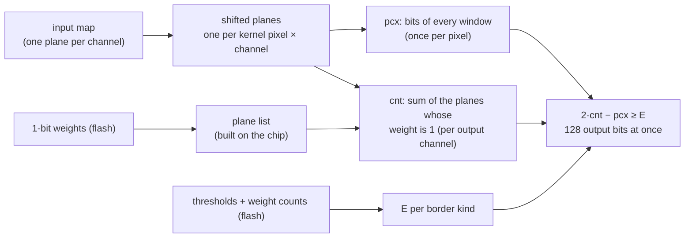

# The vertical engine: ResNet-8 in 6.4 ms on the ESP32-S3

*[Leer en español](vertical.es.md)*

The vertical engine is a second way to run SYMBEX-1's fully binary convolutional networks (`layers/conv/symbex_bool`).
It runs **the same exported network, with the same data in flash and the same output bits**, but turns the loops
around: instead of counting the bits of one window at a time, it counts **128 windows at once**, one bit of each in a
128-bit register. On the ESP32-S3 this uses the PIE SIMD unit for what it does best (128-bit logic), and the
fully binary ResNet-8 runs **3.8× faster than the standard engine and 1.43× faster than Espressif's ESP-DL INT8**
with the weights in flash. Two optional modes build the engine's plane lists and thresholds once into RAM at start:
**prepared** (6.44 ms, 1.52× faster than ESP-DL with its weights in RAM, 238 KB of RAM) and **compact** (7.70 ms,
1.27× faster than ESP-DL in RAM with about the same RAM: 151 KB against 147 KB). Whoever deploys the network chooses.

## Results

ResNet-8 on CIFAR-10, the MLPerf Tiny shape (16-32-64 channels), on the ESP32-S3 at 240 MHz, median of 1000
validation images, every image **100 % equal to the integer simulation**. SYMBEX: mean ± standard deviation over the
3 seeds (42, 43, 44), counting mode `swar` (the vertical engine does not use the 64 KB table):

| Engine / library | Weights in flash | Weights in RAM | RAM (weights in flash) | Flash of the model |
|---|---|---|---|---|
| **SYMBEX vertical engine, prepared (optional)** | **6.44 ± 0.02 ms** | **6.44 ± 0.02 ms** | 238.0 KB | 24.3 KB |
| **SYMBEX vertical engine, compact (optional)** | **7.70 ± 0.05 ms** | **7.70 ± 0.05 ms** | 150.8 KB | 24.3 KB |
| **SYMBEX vertical engine** | **10.36 ± 0.05 ms** | **10.36 ± 0.05 ms** | 62.6 KB | 24.3 KB |
| SYMBEX standard engine | 39.19 ms | — | 14.8 KB | 24.3 KB |
| ESP-DL INT8 (quick check, Nov 2) | 14.8 ms | 9.8 ms (147 KB of RAM) | not recorded | — |
| TFLite Micro INT8 (ESP-NN) | 52.0 ms | — | 80.5 KB | 96.2 KB |

- With the weights in flash, the deployment everyone uses, the vertical engine is **1.43× faster than ESP-DL** and
  5.0× faster than TFLite Micro, with less RAM than TFLite Micro.
- With the weights in RAM, ESP-DL is slightly ahead of the default vertical engine (9.8 ms vs 10.4 ms, 1.06×), using
  147 KB of RAM. The **compact** mode is **1.27× faster than ESP-DL in RAM** (7.70 ms vs 9.8 ms) with about the same
  RAM (151 KB with SYMBEX's weights still in flash), and 1.92× faster than ESP-DL in flash. The **prepared** mode is
  **1.52× faster than ESP-DL in RAM** (6.44 ms) and 2.3× faster than ESP-DL in flash, with more RAM: 238 KB.
- SYMBEX does not get faster with its weights in RAM: its 24 KB of weights already stay in the data cache. The RAM
  column is with the weights in flash; with them in RAM add 24 KB (87.0, 175.1 and 262.4 KB).
- Accuracy does not change with the engine (same bits). The binary ResNet-8 stays less accurate than INT8
  (71.3 ± 0.8 % vs 87.0 %, see [Results](results.md)).
- The ESP-DL numbers come from one quick check (scripts outside the repository, post-training quantization,
  100 test inputs), not from a full benchmark.

Time per step on the chip (seed 42, weights in flash, `swar`; measured before the tuning below, which took the totals
from 11.09 to 10.36 ms and from 7.36 to 6.44 ms):

| Step | Standard | Vertical | Speed-up | Vertical, prepared |
|---|---|---|---|---|
| thermometer + stem 24→16, 32×32 | 7.84 ms | 2.09 ms | 3.8× | 1.72 ms |
| block 0: conv 16→16, 32×32 | 7.73 ms | 1.29 ms | 6.0× | 1.01 ms |
| block 1: conv 16→16, 32×32 | 7.73 ms | 1.29 ms | 6.0× | 1.01 ms |
| block 2: conv 16→32, stride 2, + OR pool + 1×1 | 5.40 ms | 1.15 ms | 4.7× | 0.83 ms |
| block 3: conv 32→32, 16×16 | 4.28 ms | 1.23 ms | 3.5× | 0.69 ms |
| block 4: conv 32→64, stride 2, + OR pool + 1×1 | 3.01 ms | 1.71 ms | 1.8× | 1.00 ms |
| block 5: conv 64→64, 8×8 | 3.13 ms | 2.17 ms | 1.4× | 0.95 ms |
| classifier | 0.06 ms | 0.17 ms | 0.35× | 0.16 ms |
| **total** | **39.19 ms** | **11.09 ms** | **3.5×** | **7.36 ms** |

The large maps gain the most: one register holds 128 output pixels, and an 8×8 map has only 64. The classifier is
slower because the final map is converted from planes back to the standard layout first. The prepared mode saves the
time spent building each output's plane list and thresholds on the chip, most of it in the 8×8 and 16×16 blocks,
where each list is used for few tiles.

## The formula

A fully binary layer computes, for every output pixel and output channel `o`
([How it works](how-it-works.md), section 2):

$$\text{raw} = (\text{bits equal}) - (\text{bits different}) \quad\text{over the in-image part of the window}, \qquad
\text{out} = \text{raw} \ge T_o$$

With `n` the valid bits of the window, `pcx` the bits of the window that are 1, `pw` the weights that are 1 at the valid
positions, and `cnt` the positions where both are 1, the bits that differ are `d = pcx + pw − 2·cnt`, so

$$\text{raw} = n - 2d = n - 2\,\text{pcx} - 2\,\text{pw} + 4\,\text{cnt} \ge T_o
\;\Longleftrightarrow\; 2\,\text{cnt} - \text{pcx} \ge \frac{T_o + 2\,\text{pw} - n}{2}$$

The left side is an integer, so the condition is exactly

$$\boxed{\,2\,\text{cnt} - \text{pcx} \ge E, \qquad E = \left\lceil \frac{T_o + 2\,\text{pw} - n}{2} \right\rceil\,}$$

- `cnt` depends on the input and the weights: it is **the only count per output channel**.
- `pcx` depends on the input only: it is counted **once per pixel**, shared by every output channel.
- `E` depends on the weights and on which kernel pixels fall inside the image (`pw` and `n`), not on the input: it is
  computed once per output channel and **border kind** (below), when the layer starts.

`E` is clamped to `[−K, K + 1]` (`K = k·k·C_in`), which keeps every outcome: below `−K` the output is always 1, above
`K` always 0.

## The new inference logic

The standard engine works **horizontally**: for one output pixel it copies the window into a buffer, then counts its
bits against the weight row of every output channel. The vertical engine works **vertically** (bit-sliced): a 128-bit
**plane** holds one bit of 128 output pixels, and the counts are kept as planes too (plane `i` = bit `i` of the
count of all 128 pixels).



1. **Channel planes.** A map is stored as one plane per channel: bit `p` of plane `c` is pixel `p` (row-major) of
   channel `c`. Every plane has zero words before and after it, which act as the zero padding of the convolution.
2. **Shifted planes.** For every kernel pixel `(kh, kw)` and input channel `c`, the plane of `c` is shifted by
   `(kh − 1)·W + (kw − 1)` bits, and the pixels whose source column falls outside the image are masked out. That gives
   `K = k·k·C_in` planes per tile of 128 output pixels, in the order of the bits of a weight row (`q·C_in + c`).
   Stride 2: each input plane is first split into its 4 phases (even/odd rows × even/odd columns), and the shifts are
   then made on the output grid.
3. **Vertical counting.** Adding `N` planes bit by bit is done with **carry-save adders** (Harley-Seal): every 8 planes
   cost 7 adders of 5 logic instructions each and leave one "eights" plane, which is counted again the same way. On the
   S3 every instruction works on 128 pixels (`ee.andq`, `ee.xorq`, `ee.orq` on the `q` registers).
   - `pcx`: the sum of all `K` planes of the tile, once per layer and tile.
   - `cnt` for output channel `o`: the sum of **only the planes whose weight is 1**. Instead of AND-ing every plane with
     its weight, the engine walks a **list** of those planes (byte offsets), so an output channel with `m` weights at 1
     costs `m` plane loads, not `K`.
4. **Threshold, 128 outputs at once.** The output bit is the sign of `2·cnt − pcx − E`. The engine adds three 12-bit
   operands, bit-sliced: `V = 2·cnt + (2048 − pcx) + (2048 − E)`. Then `V = 4096 + (2·cnt − pcx − E)`, and since
   `|2·cnt − pcx − E| < 4096`, **the output bit is bit 12 of V**. A carry-save add plus a carry chain gives it for all 128
   pixels in about 110 instructions, with no comparison and no branch.
5. **Border kinds.** `E` changes where the window loses kernel pixels at the image border. The output rows are grouped
   by which kernel rows fall inside the image (top, middle, bottom) and the columns the same way, so a 3×3 layer has at
   most 3 × 3 = 9 kinds. The threshold operand of a tile is the plane of the commonest kind, corrected with the lane
   masks of the other kinds where their `E` differs; tiles with the same masks share it.

### What is computed on the chip, so the flash stays small

The exported data does not change: the same 1-bit weight rows, the same thresholds and per-pixel weight counts
(24 KB for ResNet-8). The extra data the engine needs is built on the chip, while the layer runs:

- **The plane lists**, from the 1-bit weights, one byte (8 weights) per step with a 256-entry table and no branches
  (1.5 ms for all the convs in the layer study). Precomputed lists and thresholds would take 181 KB of flash instead
  of 27 KB, and with a cold cache they ran slower (14.3 ms for all the convs, against 9.5 ms built on the chip).
- **The threshold operands** per output channel and border kind, from `T_o` and the weight counts.

## Tuning (Nov 3)

A code review proposed six changes. Each one was built as its own variant and measured on the S3 (seed 42, weights in
flash, 300 images, every run 100 % exact) before keeping or dropping it, one on top of the other:

| Change | Vertical | Prepared | Kept |
|---|---|---|---|
| before | 11.02 ms | 7.36 ms | |
| D: `count_finish` clears only the count planes the threshold reads | 10.95 ms | 7.29 ms | yes |
| C2: `shift_plane` unrolled, four 32-bit words per step | 10.48 ms | 6.83 ms | yes |
| C1: the classifier reads the final planes with `transpose32` instead of bit by bit (0.178 → 0.110 ms) | 10.41 ms | 6.78 ms | yes |
| B: the stride-2 phase planes share the work block with other buffers | 10.44 ms | 6.79 ms | yes (2.7 KB less RAM) |
| C3: tile types computed once (in init, or in the prepared block), not at every inference | **10.34 ms** | **6.40 ms** | yes |
| A: tiles in the outer loop (smaller shifted-plane buffer) | 10.41 ms | 7.09 ms | no: slower |

A saves RAM only in wider layers than ResNet-8's (its largest shifted-plane buffer is 19.5 KB) and forces the lists
and thresholds to be rebuilt for every tile, so it was dropped. The compact mode came after these changes; the final
library, with its compact branch, measures 10.36 and 6.44 ms (3 seeds, 1000 images).

## Exactness

The vertical engine is checked like the standard one:

- `tests/run_tests.py` runs whole random networks (identity, pooled 1×1 and 1×1 shortcuts, stride 2, every border,
  thresholds at the extremes) through both engines and checks **the class and the final map, bit by bit**, in the 6
  HAL configurations, also with AddressSanitizer and UBSan (`--stress`).
- The CDT export compiles the header with `-DSYMBEX_BOOL_VERTICAL` and checks it against the integer simulation
  (2000 validation images, 100 %).
- On the chip, `chip_test.py --engine vertical` (and `vertical_prepared`, `vertical_compact`) checks every image
  against the simulation (1000 images, 100 % on every seed, flash and RAM).
- The CDT computes the size of the prepared and compact blocks in Python and checks it against the library's
  `symbex_bool_vertical_prepared_bytes` / `..._compact_bytes` when it validates the header.

## How to use it

The header of every fully binary conv network exported by the CDT supports both engines. Build with
`-DSYMBEX_BOOL_VERTICAL` to use the vertical one (same `symbex_mlp_infer`), or measure it directly:

```
cd tools
python chip_test.py ../benchmarks/conv2d/cnn_cifar_resnet8/runs/w1_s42 --board s3 --port /dev/ttyACM0 --usb \
    --engine vertical --popcount swar
```

`--popcount swar` leaves out the 64 KB counting table the vertical engine does not use. In C, the engine is
`symbex_bool_vertical_init` (once, on a 16-byte aligned work block of `symbex_bool_vertical_work_bytes`) and
`symbex_bool_net_run_vertical` (`include/layers/conv/symbex_bool_vertical.h`).

**Prepared mode (optional, more RAM, faster).** Build with `-DSYMBEX_BOOL_VERTICAL -DSYMBEX_BOOL_VERTICAL_PREPARED`
(or `--engine vertical_prepared` in chip_test.py): the header reserves a second block and its init builds there, once,
every output's plane list and threshold planes from the same flash data (no extra flash). In C:
`symbex_bool_vertical_prepared_bytes` gives the size, `symbex_bool_vertical_prepare` fills a 16-byte aligned buffer
that must stay alive (it returns -1 and leaves the engine as it was if the buffer is too small). The output is the
same, bit for bit; the library tests check it on 400 random networks.

**Compact mode (optional, about half the RAM of prepared).** Build with `-DSYMBEX_BOOL_VERTICAL
-DSYMBEX_BOOL_VERTICAL_PREPARED_COMPACT` (or `--engine vertical_compact`). The block keeps the plane lists, but instead
of a threshold plane per output and tile type it keeps one 16-bit `E` per output and border kind plus the lane masks of
each kind; the threshold planes of an output channel are rebuilt from them when the layer reaches it. ResNet-8: a 90 KB
block instead of 179 KB, 7.70 ms instead of 6.44 ms. In C: `symbex_bool_vertical_prepared_compact_bytes` and
`symbex_bool_vertical_prepare_compact`, same rules as the prepared ones.

**Code in RAM (optional).** `-DSYMBEX_CODE_IN_RAM` (or `--code ram` in chip_test.py) puts the engine's inner loops in
RAM: `.time_critical` on the RP2350, IRAM on the ESP32 chips (4.9 KB of IRAM on the S3 with ResNet-8; chip_test.py adds it to the RAM total as `ram.code_in_ram`). It does not change the S3's
times; on the Pico 2 it removes the dependence on the 16 KB flash cache (see [Other chips](#other-chips-pico-2)).

Shapes it runs (`symbex_bool_vertical_check` says which part of a network is not): kernels 1×1 and 3×3; stride 1, or
stride 2 with a 3×3 kernel and an input twice the output; map widths that divide 32 and `h·w` a multiple of 32;
output maps up to 32768 pixels (256 tiles of 128);
`k·k·C_in` a multiple of 8 and below 2048; a thermometer of at most 32 bits per pixel. ResNet-8 on CIFAR-10 fits all of
them. Other chips run the same steps in portable C (correct and exact; the large speed-up comes from the S3's 128-bit
registers, the Pico 2 is below). Separate instances share nothing (each call keeps its counting state on its own stack
and work block), so two networks can run at the same time on two cores, or in two tasks (on the S3, two tasks on one
core also need the RTOS to save the PIE registers on a task switch).

## Other chips: Pico 2

The same portable C on the Raspberry Pi Pico 2 (RP2350, 150 MHz, 32-bit words instead of 128-bit planes), ResNet-8,
seed 42, 1000 images, every one 100 % equal to the simulation (one seed: a ranking, not a 3-seed result):

| Core | Standard engine | Vertical | Compact | Prepared |
|---|---|---|---|---|
| Cortex-M33 | 74.5 ms | 67.9 ms | 59.4 ms | **57.4 ms** |
| Hazard3 (RISC-V) | **56.1 ms** | 69.6 ms | 61.7 ms | 60.1 ms |

- On the M33 the vertical engine wins (1.30× with the prepared mode); on Hazard3 the standard engine stays faster,
  because Hazard3 counts the bits of a word in one instruction (`cpop`).
- The Pico 2 runs its code from flash through a 16 KB cache, so where the linker puts the hot loops matters: during the
  tuning, the same prepared engine on Hazard3 measured 60.0, 69.9 or 76.8 ms depending only on the code layout. With
  `-DSYMBEX_CODE_IN_RAM` (`--code ram`) it measured 60.0 ms in every layout. In this build the flash layout happens to
  be a good one, and code in RAM gives about the same times (M33 67.7 / 59.9 / 58.0 ms, Hazard3 69.0 / 61.8 /
  60.2 ms); it is there for builds where the layout is unlucky.

## Cost

- **RAM:** the work block of ResNet-8 is 58 KB (shifted planes, maps as planes, counters), against 14.8 KB for the
  standard engine. Total RAM measured on the chip: 62.6 KB (TFLite Micro: 80.5 KB; ESP-DL with the weights in RAM:
  147 KB).
- **RAM of the prepared mode:** a 179 KB block for ResNet-8 (the thresholds of every output and tile type, and the
  plane lists), 238 KB in total. **Compact mode:** a 90 KB block, 151 KB in total. Both fit the ESP32-S3's internal
  RAM; boards with less RAM keep the default mode.
- **Flash:** the same 24 KB of model data, plus the engine's code.

## Future work

- **Weights in RAM with less RAM than ESP-DL:** the default engine is 1.06× slower than ESP-DL there (10.4 ms vs
  9.8 ms, 63 KB vs 147 KB of RAM); the compact mode wins with about the same RAM. A block only for the small maps
  would sit between the two.
- **The stem** (about 2 ms): the thermometer and the transpose into planes.
- **The classifier** (0.17 ms vs 0.06 ms): reading the final planes directly instead of converting them back.
- **Small maps** (blocks 4 and 5, 8×8 and 16×16): a 128-pixel register is half used or less, and every plane list is
  used once; packing several output channels per register would fill it.
- **The classic ESP32** (no 128-bit registers): the portable C version runs there, not measured yet.

The layer-by-layer study that led to this engine (precomputed vs run-time lists and thresholds, cold and warm cache)
is `benchmarks/conv2d/cnn_cifar_resnet8/s3_vertical_layers.py`, with its results in `results/s3_vertical_layers*.json`.
